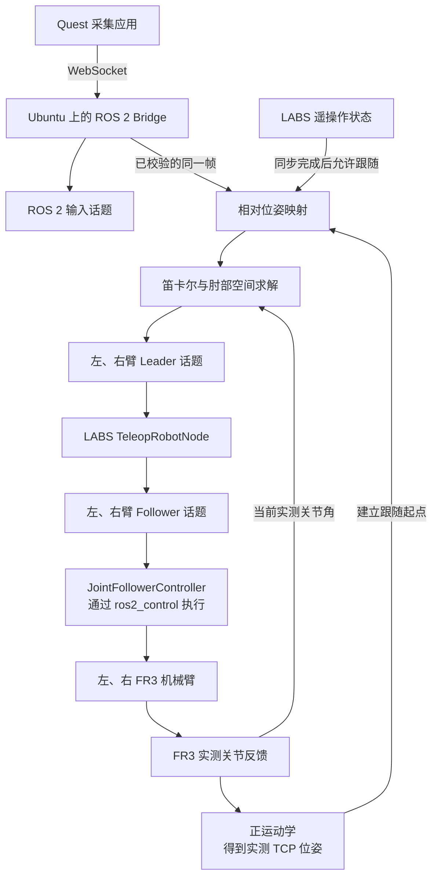
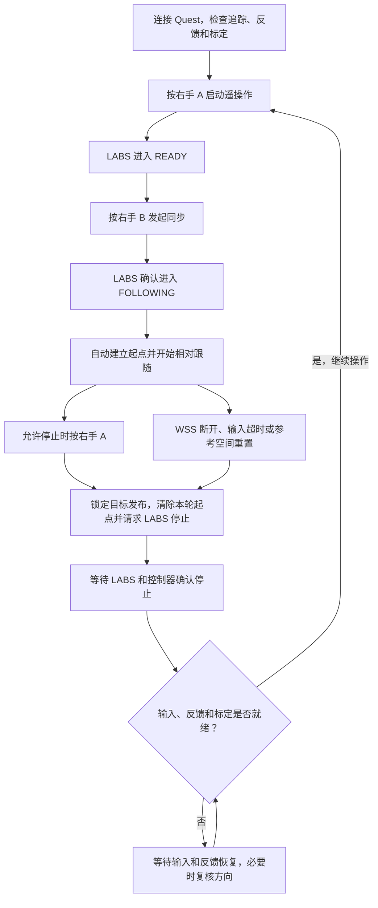

## 1.1 开发目标与适用场景

使用 Quest 3 左右手柄控制对应的 FR3 机械臂，实现相对位姿跟随，并接入 LABS 的示教录制流程。双臂以 `fr3_duo_mount_origin` 为公共基准。

### 1.1.1 开发目标

操作者用左手柄控制左臂的工具中心点（TCP），用右手柄控制右臂的 TCP。同步完成后，程序分别为已启用的机械臂建立跟随起点。

例如，左手柄停在操作者方便握持的位置，左臂停在工作台上方的准备位置。同步完成后，程序记录手柄位姿和左臂的实测 TCP 位姿。随后手柄沿工位正方向移动，左臂 TCP 从自身起点沿同一工位方向移动，距离按设定比例换算。

### 1.1.2 适用场景

系统面向左右 FR3 固定安装的台面工位，用于验证末端移动、姿态调整和短距离抓取放置的示教流程。每次示教前确定左右臂的工具、TCP 和可操作区域。Quest 需要在操作者实际使用的范围内持续追踪手柄，并能向 Ubuntu 发送有效数据。

左右 FR3 各有自己的基座坐标系，通过各自的固定安装变换与公共工位坐标系对应。安装参数以实际装配为准。

### 1.1.3 实现路径

1. **先建立工位方向。** 让机器人保持静止，按公共坐标系的 $+X$、$+Y$ 布置 $O/X/Y$ 三个标记点。Quest 在同一个 `local-floor` 参考系下记录手柄停在三个点时的位置。根据两条已知方向计算 Quest 到公共工位的旋转，再结合左右臂的安装旋转，得到各自的方向转换。用独立的手柄移动复核轴向后保存标定结果。[WebXR `local-floor` 定义](https://www.w3.org/TR/webxr/#dom-xrreferencespacetype-local-floor)
2. **把手柄数据接到 Ubuntu。** Quest 采集应用读取左右手柄的位置、姿态、按键和追踪状态，遥操作时通过 WebSocket 发给 `quest_teleop`。接收端检查左右手标识、时间与数据有效性，并通过 ROS 2 Bridge 发布手柄位姿、按键和追踪状态。
3. **建立起点并计算 TCP 目标。** LABS 进入 `READY` 后，按右手 B 发起同步，以站点配置中各启用侧的初始关节角作为同步目标。LABS 确认进入 `FOLLOWING` 且数据满足取点条件后，程序记录各启用侧的手柄位姿，并用实测关节角计算对应的 TCP 起点。跟随期间，将手柄相对起点的平移和旋转换算到对应机械臂的基座坐标系，再叠加到 TCP 起点。
4. **求解七关节目标并交给 LABS 执行。** `quest_teleop` 根据 TCP 目标和机器人实测反馈，在关节约束下求解每臂的七个关节目标。经过笛卡尔与肘部优化，在跟踪 TCP 的同时约束肘部姿态变化。通过关节顺序、限位和目标连续性检查后，以 `sensor_msgs/JointState` 发布到对应侧 Leader 话题，由 LABS 转发给 Follower。[ROS 2 JointState 定义](https://github.com/ros2/common_interfaces/blob/jazzy/sensor_msgs/msg/JointState.msg) 
5. **把操作过程接入示教录制。** 系统进入 FOLLOWING 后，左手 X 键调用 LABS 的 Episode 录制接口，再按一次结束。用同一段录制中的 Follower 关节目标和实测关节反馈检查示教结果。

## 1.2 系统组成与分层

Quest 头显上运行手柄采集应用。`quest_teleop` 和 LABS 都部署在 Ubuntu 上。

### 1.2.1 Quest 端采集与转发

Quest 开机并连上局域网后，操作者启动采集应用，应用自动连接 Ubuntu。

标定时，左手柄依次放到 $O$、$X$、$Y$ 点。每到一个点先停稳，再按一次右手 Trigger。Quest 把左手柄最近一小段的位置数据和按键事件发给 Ubuntu。

### 1.2.2 Ubuntu 端标定与数据处理

Ubuntu 运行标定程序。每次收到采点请求后，程序检查追踪状态和手柄是否停稳，算出平均坐标，并在终端打印当前点和下一个待采点。三个点采齐后，程序计算并打印 Quest 到双臂公共基座 `fr3_duo_mount_origin` 的旋转矩阵和拟合误差。验证方向正确后，将结果填入标定文件，供后续相对跟随加载。

### 1.2.3 LABS 转发和 FR3 执行

LABS 沿用现有的遥操作状态管理，负责启动、同步和停止。Follower 通过现有控制器执行关节目标。

## 1.3 端到端数据流

### 1.3.1 遥操作数据与机器人反馈

跟随程序按左右手分开处理输入，使用同一帧里的位姿、按键和追踪状态。

左臂的实测反馈话题为 `/left/franka_robot_state_broadcaster/measured_joint_states`，右臂为 `/right/franka_robot_state_broadcaster/measured_joint_states`。[FR3 站点配置](/home/xzz/Gitspace/labs/deployments/fr3_duo_example/config_station.yml:71)

### 1.3.2 标定数据与参数加载

`quest_teleop` 启动时读取标定文件，用标定结果换算手柄的运动方向。

## 1.4 标定与遥操作流程

### 1.4.1 工位方向标定

首次使用时完成三点标定，并确认手柄运动方向换算正确。

### 1.4.2 启动遥操作和跟随

启动 LABS 和 `quest_teleop`，在 Quest 浏览器打开采集页并启动追踪。确认启用侧的安装参数、TCP 配置、手柄追踪和机器人反馈都正常。首次接入、XR 会话重建或参考空间重置后，复核手柄运动与工位轴向是否一致。方向一致时可以复用标定结果，方向有变化时重做三点标定。

### 1.4.3 遥操作停止与恢复

## 1.5 quest_teleop 与 LABS 的职责

**`quest_teleop` 负责从手柄输入生成关节目标。** Quest 上的应用采集并转发手柄数据。Ubuntu 上的 ROS 2 Bridge 接收数据并发布消息。标定、相对位姿映射和笛卡尔与肘部空间优化也在这个仓库中实现，最终生成左右臂各自的七关节目标。

**LABS 负责操作入口、机器人执行和示教录制。** 现有 Web 页面用于遥操作控制和查看状态。LABS 管理启动、同步和停止，把 Leader 话题上的目标转发给 Follower 执行，并通过 Data Collection 录制示教过程。

**LABS 以 Git 子模块引入 `quest_teleop`，两个模块在运行时通过 ROS 2 话题通信。** LABS 仓库记录子模块使用的提交，站点配置指定左右臂的目标和反馈话题。`quest_teleop` 向对应侧 Leader 话题发布关节目标，并读取同侧实测关节状态。