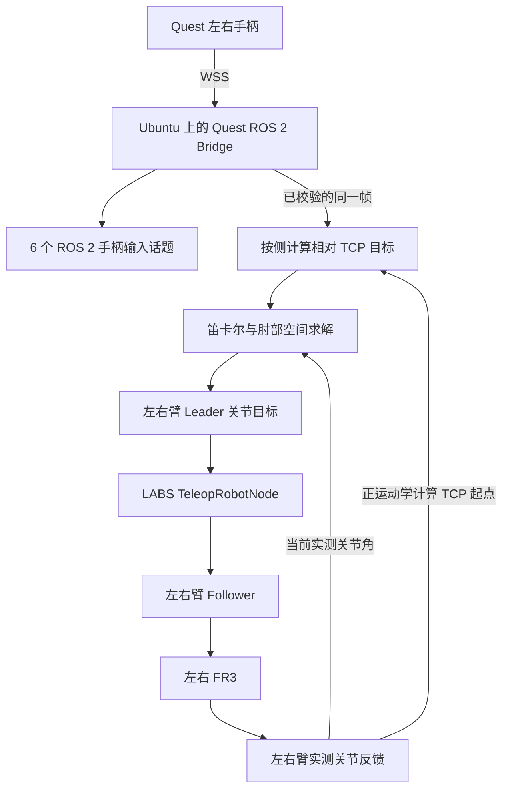
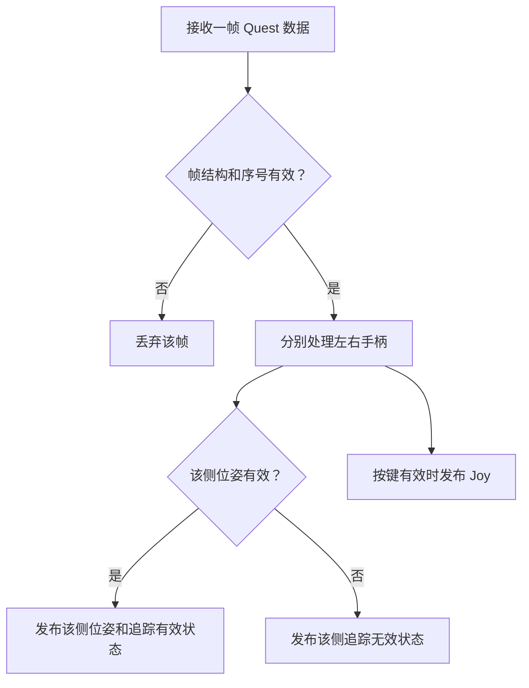
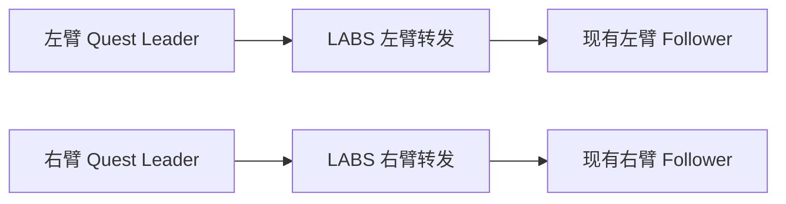

# 3. 系统通信与话题设计

## 3.1 数据流与话题总表

### 3.1.1 端到端数据流

Quest 通过 WSS 向 Ubuntu 发送左右手柄数据。Bridge 校验数据后，将位姿、按键和追踪状态发布为 ROS 2 输入话题。相对跟随模块使用同一帧手柄数据生成 TCP 目标，求解模块结合 FR3 实测关节角生成七关节目标。LABS 把对应侧 Leader 话题上的关节目标转发给 Follower。

### 3.1.2 ROS 2 话题总表

| 用途 | 左侧话题 | 右侧话题 | ROS 2 消息类型 | 发布方 → 接收方 | 开发范围 |
| --- | --- | --- | --- | --- | --- |
| 手柄位姿 | `/quest/left/pose` | `/quest/right/pose` | `geometry_msgs/msg/PoseStamped` | Bridge → ROS 2 输入订阅端 | 新增 |
| 手柄按键和摇杆 | `/quest/left/joy` | `/quest/right/joy` | `sensor_msgs/msg/Joy` | Bridge → ROS 2 输入订阅端 | 新增 |
| 手柄追踪有效性 | `/quest/left/tracking_valid` | `/quest/right/tracking_valid` | `std_msgs/msg/Bool` | Bridge → ROS 2 输入订阅端 | 新增 |
| Leader 关节目标 | `/left/leader/quest/joint_states` | `/right/leader/quest/joint_states` | `sensor_msgs/msg/JointState` | Quest 求解模块 → LABS | 新增 |
| Follower 关节目标 | `/left/follower/gello/joint_states` | `/right/follower/gello/joint_states` | `sensor_msgs/msg/JointState` | LABS → FR3 Follower Controller | 复用 |
| 机器人实测关节状态 | `/left/franka_robot_state_broadcaster/measured_joint_states` | `/right/franka_robot_state_broadcaster/measured_joint_states` | `sensor_msgs/msg/JointState` | FR3 状态广播器 → Quest 跟随与求解模块 | 复用 |

本节为双臂新增 8 个话题，其中 6 个对应手柄输入，2 个对应关节目标。Follower 和实测反馈的名称来自现有 FR3 双臂站点配置。[FR3 站点配置](/home/xzz/Gitspace/labs/deployments/fr3_duo_example/config_station.yml:5) · [实测反馈配置](/home/xzz/Gitspace/labs/deployments/fr3_duo_example/config_station.yml:71)

### 3.1.3 话题接口约定

- **手柄坐标系。** Bridge 发布手柄在 WebXR `local-floor` 下的位姿，`frame_id` 统一用 `quest_local_floor`。位置用米，姿态按四元数的 `x, y, z, w` 填写。标定和相对映射模块负责转换到机器人坐标系。
- **时间戳。** Bridge 在 Ubuntu 接收一帧时读取一次 ROS 时钟，同一帧的 `PoseStamped` 和 `Joy` 共用这个 ROS 时间戳。Quest 的采样时间戳用于计算帧间隔，Ubuntu 的单调时钟用于检查收包超时。
- **按键顺序。** 在 Bridge 配置中固定左右手柄的 `Joy.buttons` 和 `Joy.axes` 索引。跟随模块和按键处理模块共用这一份映射。
- **数据配对。** 三类手柄消息分别发布，`Bool` 没有消息头。首版跟随程序直接使用 Bridge 校验后的完整帧，保留同一帧的位姿、按键和有效性。6 个 ROS 2 输入话题供其他节点观察和调试。
- **关节目标。** 每侧的 `JointState.name` 和 `position` 一一对应，按该臂控制器的 J1 到 J7 顺序填写，位置单位为弧度。`header.stamp` 使用生成目标时的 ROS 时间，运行时与 LABS 和 Follower 使用同一时钟基准。[FR3 关节顺序](</home/xzz/Gitspace/labs/deployments/fr3_duo_example/config_contract_gr00t.yml:9>) · [Follower 目标时效检查](/home/xzz/Gitspace/labs/services/actuators/franka-robot/src/third_party/franka_follower_controllers/src/joint_follower_controller.cpp:266)

## 3.2 Quest WebSocket 通信与 ROS 2 Bridge

### 3.2.1 WebSocket 连接与数据帧

运行时沿用数据采集方案二的 WSS `/ws` 接口。Quest 网页启动 WebXR 后连接 Ubuntu，每帧发送左右手柄的位置、姿态、按键、摇杆和追踪状态。公共字段包含采样时间戳、帧序号、XR 会话编号和参考空间版本。参考空间发生重置时更新版本。手柄位姿不可用时，该侧位姿标为无效。[Quest 数据采集方案二](/home/xzz/AgileFIles/Quest-tel/Quest-Proposal/Quest数据采集.md:28)

### 3.2.2 数据校验与 ROS 2 发布

Bridge 收到数据后检查左右手标识、会话编号、帧序号和数据结构。对位姿检查数值是否有效、四元数能否归一化，对按键和摇杆检查数据类型及取值范围。通过检查后，按表中的左右侧话题发布对应消息。该侧位姿无效时停止发布该侧位姿，并将该侧 `tracking_valid` 置为 `false`。按键输入仍可读时，可以继续发布有效的按键数据。

### 3.2.3 断线、超时与追踪失效

- **连接断开或收包超时。** Bridge 使用 Ubuntu 单调时钟记录最近一次有效接收，定期检查是否超时。断线或超时后，清空旧帧缓存，发布双侧追踪无效状态，并通知跟随模块暂停。
- **单侧追踪失效。** 清除该侧用于跟随的旧手柄数据和起点，等待新数据，按 LABS 的运行状态执行对应侧的暂停或停止流程。
- **连接恢复。** 接收并校验新帧后恢复 ROS 2 输入发布。XR 会话号或参考空间版本变化时，废弃旧跟随起点，重新检查映射方向。继续遥操作前，按跟随流程重新建立起点。

## 3.3 LABS Leader/Follower 映射与接口复用

### 3.3.1 左右臂七关节目标发布

求解模块按侧生成七关节目标，检查数值、关节限位和与上一目标的连续性，再将关节角写入 `JointState.position`，发布到总表中对应的 Leader 话题。同步目标和跟随目标使用同一个话题，根据 LABS 当前状态选择发布的目标。Follower 按 `position` 数组顺序读取目标，因此发布前先保证七项顺序正确。[Follower 目标订阅](/home/xzz/Gitspace/labs/services/actuators/franka-robot/src/third_party/franka_follower_controllers/src/joint_follower_controller.cpp:109)

### 3.3.2 LABS 话题转发与 Follower 执行

Quest 遥操作站点配置中，将 `left_arm`、`right_arm` 的 `leader_topic` 都设为相对名称 `leader/quest/joint_states`，分别由 `left`、`right` 命名空间解析成完整名称。每侧保留 `follower_topic: follower/gello/joint_states` 与现有 `target_topic_name`，继续使用当前的控制器订阅和录制接口。Quest 运行时每侧只配置一条 Leader → Follower 转发。[话题解析](/home/xzz/Gitspace/labs/services/pipeline/packages/pipeline-configs/src/pipeline_configs/station.py:51) · [FR3 控制器配置](/home/xzz/Gitspace/labs/deployments/fr3_duo_example/config_franka_robot.yml:12) · [录制目标配置](/home/xzz/Gitspace/labs/deployments/fr3_duo_example/config_contract_gr00t.yml:95)

启动遥操作时，LABS 按站点配置创建 `TeleopRobotNode`，订阅 Leader 并转发到 Follower。联调时分别确认左右臂的订阅关系，检查 Follower 收到的关节角顺序和时间戳，再验证同步、跟随与录制。[LABS 启动遥操作](/home/xzz/Gitspace/labs/services/pipeline/data-collection/src/services/teleop.py:75) · [LABS 转发节点](/home/xzz/Gitspace/labs/services/pipeline/data-collection/src/services/teleop_robot_node.py:24)

### 3.3.3 FR3 实测反馈接入

跟随程序分别订阅两侧的实测关节状态，按 `JointState.name` 将 `position` 重排成 J1 至 J7。建立跟随起点时，用对应侧最新有效的实测关节角做正运动学，得到 TCP 起点。跟随期间，把实测关节角作为求解当前目标的参考。实测反馈缺失或超时后，暂停更新该侧的跟随目标，并进入对应侧的暂停或停止流程。
