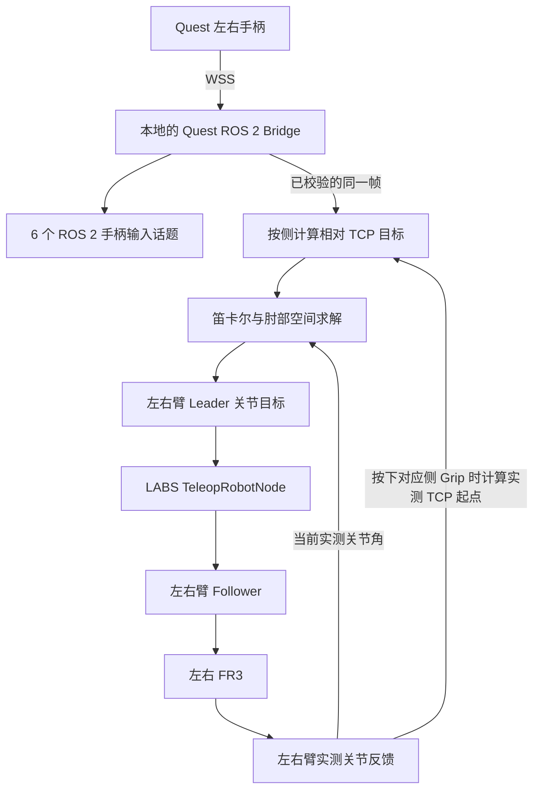
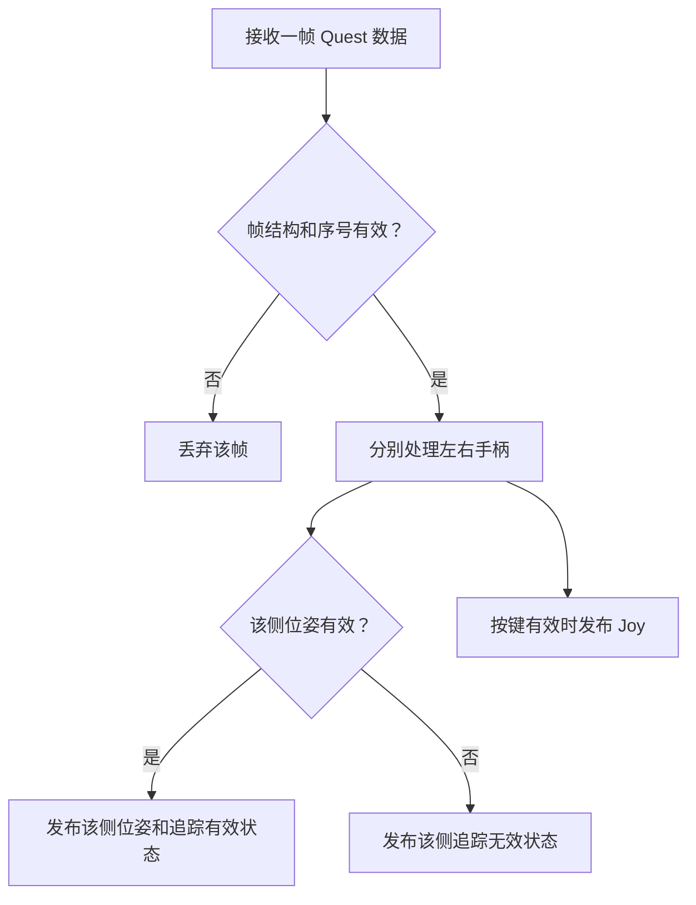
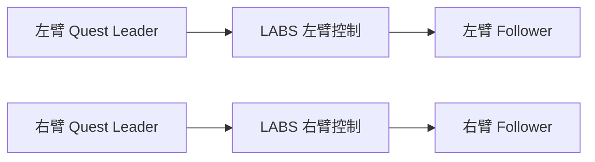
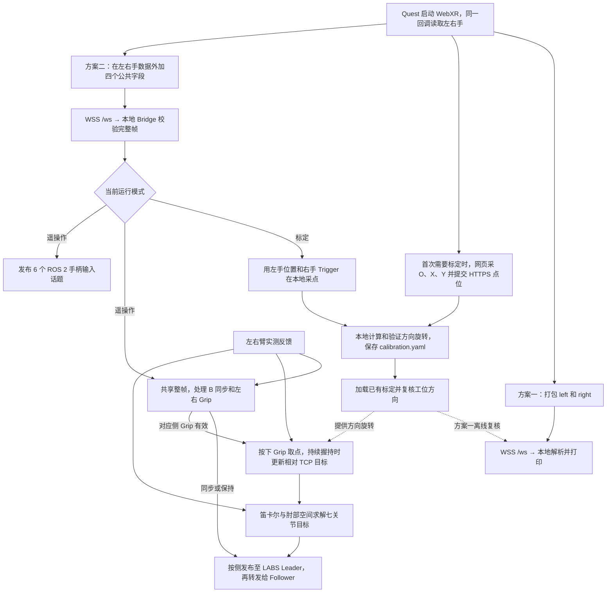

# 3. 系统通信与话题设计

## 3.1 数据流与话题总表

### 3.1.1 端到端数据流

Quest 通过 WSS 向本地发送左右手柄数据。Bridge 校验数据后，将位姿、按键和追踪状态发布为 ROS 2 输入话题。相对跟随模块使用同一帧手柄数据生成 TCP 目标，求解模块结合 FR3 实测关节角生成七关节目标。LABS 把对应侧 Leader 话题上的关节目标转发给 Follower。



### 3.1.2 ROS 2 话题总表

| 用途 | 左手话题 | 右手话题 | ROS 2 消息类型 | 发布方 → 接收方 | 开发范围 |
| --- | --- | --- | --- | --- | --- |
| 手柄位姿 | `/quest/left/pose` | `/quest/right/pose` | `geometry_msgs/msg/PoseStamped` | Bridge → ROS 2 输入订阅端 | 新增 |
| 手柄按键和摇杆 | `/quest/left/joy` | `/quest/right/joy` | `sensor_msgs/msg/Joy` | Bridge → ROS 2 输入订阅端 | 新增 |
| 手柄追踪有效性 | `/quest/left/tracking_valid` | `/quest/right/tracking_valid` | `std_msgs/msg/Bool` | Bridge → ROS 2 输入订阅端 | 新增 |
| Leader 关节目标 | `/left/leader/quest/joint_states` | `/right/leader/quest/joint_states` | `sensor_msgs/msg/JointState` | Quest 求解模块 → LABS | 新增 |
| Follower 关节目标 | `/left/follower/quest/joint_states` | `/right/follower/quest/joint_states` | `sensor_msgs/msg/JointState` | LABS → FR3 Follower Controller、MCAP 录制 | 复用控制器与录制 |
| 机器人实测关节状态 | `/left/franka_robot_state_broadcaster/measured_joint_states` | `/right/franka_robot_state_broadcaster/measured_joint_states` | `sensor_msgs/msg/JointState` | FR3 状态广播器 → Quest 跟随与求解 | 复用 |

Quest 双臂部署新增 10 个话题：6 个手柄输入、2 个 Leader 关节目标、2 个 Follower 关节目标。

### 3.1.3 话题接口约定

- **手柄坐标系。** Bridge 发布手柄在 WebXR `local-floor` 下的位姿，`frame_id` 统一用 `quest_local_floor`。位置用米，姿态按四元数的 `x, y, z, w` 填写。标定和相对映射模块负责转换到机器人坐标系。
- **时间戳。** Bridge 在本地接收一帧时读取一次 ROS 时钟，同一帧的 `PoseStamped` 和 `Joy` 共用这个 ROS 时间戳。Quest 的采样时间戳用于计算帧间隔，本地用于检查收包超时。
- **按键顺序。** 在 Bridge 配置中固定左右手柄的 `Joy.buttons` 和 `Joy.axes` 索引。跟随模块和按键处理模块共用此映射。
- **关节目标。** 每侧的 `JointState.name` 和 `position` 一一对应，按该臂控制器的 J1 到 J7 顺序填写，位置单位为弧度。`header.stamp` 使用生成目标时的 ROS 时间，运行时与 LABS 和 Follower 使用同一时钟基准。

## 3.2 Quest WebSocket 通信与 ROS 2 Bridge

### 3.2.1 WebSocket 连接与数据帧

Quest 网页启动 WebXR 后，通过 WSS `/ws` 连接本地，每帧发送左右手柄的位置、姿态、按键、摇杆和追踪状态。公共字段包含采样时间戳、帧序号、XR 会话编号和参考空间版本。参考空间发生重置时更新版本。读不到手柄位姿时，该侧位姿标为无效。

### 3.2.2 数据校验与 ROS 2 发布

Bridge 收到数据后检查左右手标识、会话编号、帧序号和数据结构。对位姿检查数值是否有效、四元数能否归一化，对按键和摇杆检查数据类型及取值范围。通过后，向对应侧的位姿、按键和追踪状态话题发布消息。该侧位姿无效时停止发布，并将该侧 `tracking_valid` 置为 `false`。按键输入仍可读时，可以继续发布有效的按键数据。



### 3.2.3 断线、超时与追踪失效

- **无效数据。** 整帧校验失败时丢弃该帧；只有一侧位姿无效时，仅丢弃该侧本帧位姿并发布追踪无效状态，另一侧的有效数据照常发布。后续帧校验通过后继续发布。偶发无效帧不触发暂停，也不使用无效位姿或旧位姿生成新的跟随目标。
- **断线与超时。** Bridge 使用本地单调时钟，分别记录各启用侧最近一次收到有效位姿的时间。无效帧不刷新计时。连接明确断开，或任一启用侧超过配置时限仍没有新的有效位姿时，Bridge 清除相关缓存并报告故障，跟随程序锁定所有启用侧的关节目标发布，请求 LABS 停止。
- **数据恢复。** 收到通过校验的新帧后恢复对应侧的输入发布。短时位姿丢帧未超时且 Grip 仍有效时，可保留本轮起点。已触发 LABS 停止时，先确认停止，再按 A 启动、长按 B 同步。确认到位后重新按对应侧 Grip 取点。XR 会话号或参考空间版本变化时，先废弃旧起点并复核映射方向，再执行上述恢复流程。

## 3.3 LABS Leader/Follower 映射与接口复用

### 3.3.1 左右臂七关节目标发布

求解模块按侧生成七关节目标，检查数值、关节限位和与上一目标的连续性。各侧同步、保持和跟随目标共用同一个 Quest Leader 话题，由 LABS 状态与该侧 Grip 发布许可决定发送哪类目标。发布时按 J1 至 J7 顺序把七项关节角写入 `JointState.position`。

### 3.3.2 LABS 话题转发与 Follower 执行

Quest 遥操作站点配置中，将 `left_arm`、`right_arm` 的 `leader_topic` 都设为相对名称 `leader/quest/joint_states`，分别由 `left`、`right` 命名空间解析成完整名称。每侧将 `follower_topic` 和控制器的 `target_topic_name` 都设为 `follower/quest/joint_states`，在各自命名空间内解析为 `/left/follower/quest/joint_states` 或 `/right/follower/quest/joint_states`。MCAP 录制的左右 `action` 目标分别选择对应的完整 Follower 话题，录制 LABS 转发给控制器的关节目标。Quest 站点每侧只启用一条 Quest Leader → Follower 转发；独立的 GELLO 站点保留原路由。



启动遥操作时，LABS 按配置创建 `TeleopRobotNode`，订阅 Leader 并转发到 Follower。分别确认左右臂的订阅关系，检查 Follower 收到的关节角顺序和时间戳，再同步、跟随与录制。

## 3.4 开发

先用方案一跑通 Quest 到本地的数据收发，并复用已经保存的方向标定。需要在本地从连续帧采集标定点，或继续联调第 3.1 至 3.3 节的 ROS 2 和 LABS 链路时，再扩展到方案二。两套方案共用 WebXR 采集页、WSS 接口和左右手数据结构。本地按当前方案解析，完整帧校验通过后才进入后续遥操作链路。

### 3.4.1 方案一：简化收发，复用已保存的标定

Quest 浏览器打开采集页并启动 WebXR。在同一次回调中读取左右手柄，把 `left` 和 `right` 组为一条 JSON 消息，通过 WSS `/ws` 发到本地。Python 接收后解析并打印左右手的位姿、按键和追踪状态，核对移动或按键时数据是否变化。

```json
{
  "left": {
    "tracking_valid": true,
    "pose": {
      "position_m": [0.23, 0.91, -0.42],
      "orientation_xyzw": [0.0, 0.0, 0.0, 1.0]
    },
    "buttons": {"grip": true, "trigger": false}
  },
  "right": {
    "tracking_valid": false,
    "pose": null,
    "buttons": {"grip": false, "trigger": true, "a": false, "b": false}
  }
}
```

- 简化帧省略 `frame_seq`、`sample_time_ms`、`xr_session_id` 和 `reference_space_version`。两侧的位姿和按键分别读取。位姿不可用时填 `pose: null`、`tracking_valid: false`。按键读不到时填 `null`，读到松开时填 `false`。摇杆按实际使用需求加到对应侧。
- 有经过验证的 `calibration.yaml` 时直接加载。首次标定时，可用第 2 章方案一在网页采集 O、X、Y，再通过 HTTPS `POST /points` 提交点位，由本地计算方向旋转并保存。网页采点用到的时间信息留在网页里，WSS 简化帧仍只传左右手数据。
- 同一台 Quest 在同一工位使用，机器人安装方向保持一致时，按第 4.6 节复核轴向后继续使用保存的标定。同型号机器人替换后，按同一标准确认安装方向。新建 XR 会话或参考空间重置后，复核方向一致即可复用，方向有变化时重新标定。
- 本方案验收以本地收到正确的左右手数据为准，机械臂运动输出保持锁定。

### 3.4.2 方案二：完整帧、本地采点及遥操作接入

在方案一的 `left` 和 `right` 外加四个公共字段。WebXR 每次采样仍发送一条 WSS 消息，位置用米，姿态按四元数 `x, y, z, w` 填写。

| 字段 | 用途 |
| --- | --- |
| `frame_seq` | 同一 XR 会话内递增，识别重复、乱序和帧号缺口，也用于核对 Grip 取点帧 |
| `sample_time_ms` | Quest 端采样时间，本地据此计算标定用的采样窗口 |
| `xr_session_id` | 标识 WebXR 会话。新的 XR 会话使用新编号，原会话下的 WSS 重连沿用原编号 |
| `reference_space_version` | WebXR 参考空间重置时更新，用来作废旧坐标下的采样和跟随起点 |

```json
{
  "frame_seq": 120,
  "sample_time_ms": 13240.5,
  "xr_session_id": "session-01",
  "reference_space_version": 1,
  "left": {
    "tracking_valid": true,
    "pose": {
      "position_m": [0.23, 0.91, -0.42],
      "orientation_xyzw": [0.0, 0.0, 0.0, 1.0]
    },
    "buttons": {"grip": false, "trigger": false, "x": false, "y": false},
    "stick_xy": [0.0, 0.0]
  },
  "right": {
    "tracking_valid": false,
    "pose": null,
    "buttons": {"grip": false, "trigger": true, "a": false, "b": false},
    "stick_xy": [0.0, 0.0]
  }
}
```

1. **标定模式。** 按第 2 章方案二，由本地程序用左手有效位置和右手 Trigger 采集 O、X、Y。用 `sample_time_ms` 计算采样窗口，用会话编号和参考空间版本判断能否继续使用已有样本。方向求解、误差验证和保存按第 4 章执行。
2. **遥操作模式。** 先加载并复核已有标定，再由 Bridge 校验完整帧、共享给本地控制模块，并发布左右手的 6 个 ROS 2 输入话题。长按 B 同步到预设关节位置，实测确认到位后等待 Grip。按下哪侧 Grip，就从触发帧读取该侧手柄位姿，并用时间接近的机器人反馈计算 TCP 起点。持续握持时跟随，松开时暂停该侧并清除起点。
3. **断线与恢复。** 用本地单调时钟检测收包超时。标定时按第 2 章判断暂停、续采或重采。跟随时按第 7 章停止和恢复。参考空间发生变化后，先复核已保存的方向标定再进入跟随。

### 3.4.3 开发模块与输出

| 开发模块 | 方案一先完成 | 方案二扩展 | 输出 |
| --- | --- | --- | --- |
| WebXR 采集与 WSS 接收 | 同一回调读取左右手，打包并发送。Python 按侧解析，检查位姿和按键，输出终端日志 | 加入公共字段，校验帧序号、会话和参考空间，检测断线和超时 | 左右手柄数据、输入有效状态 |
| 标定文件 | 加载已有文件，按第 2 章方案一提交点位时计算并保存结果 | 支持本地从完整帧采 O、X、Y，并复用同一套标定求解与保存 | `calibration.yaml` 和方向误差 |
| ROS 2 Bridge | 先在终端核对收发 | 使用 `rclpy` 按侧发布 `PoseStamped`、`Joy` 和 `Bool`。同一帧的位姿和按键共用本地 ROS 时间戳 | 左右手 `pose`、`joy`、`tracking_valid` |
| 跟随输入和 LABS 接入 | 记录按键状态供检查 | 识别 Grip 按下和松开，保留触发帧。接入实测反馈、相对映射和笛卡尔与肘部空间求解。按各侧许可发布同步、保持或跟随关节目标 | 各臂跟随起点、Leader 关节目标和 LABS Follower 转发 |

### 3.4.4 数据流向


