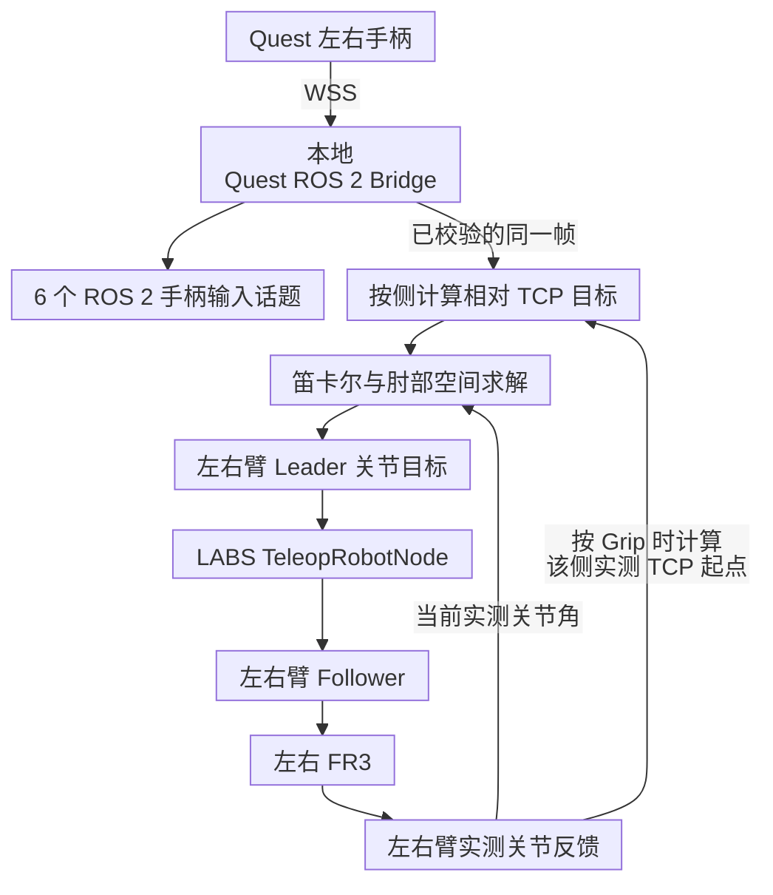
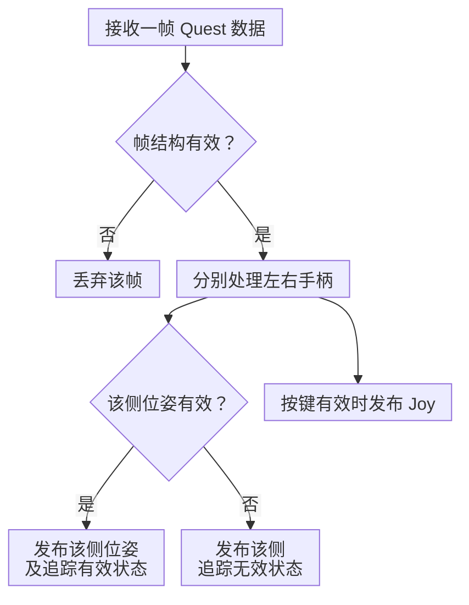
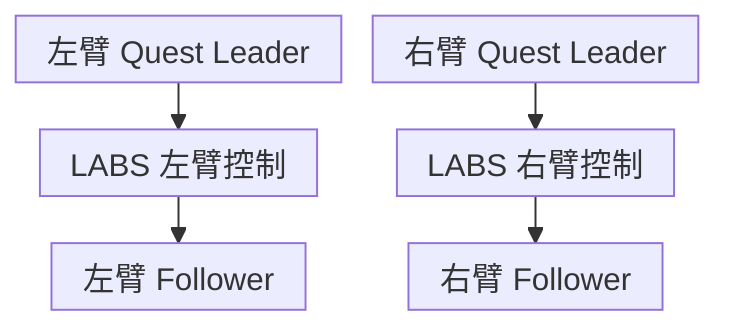
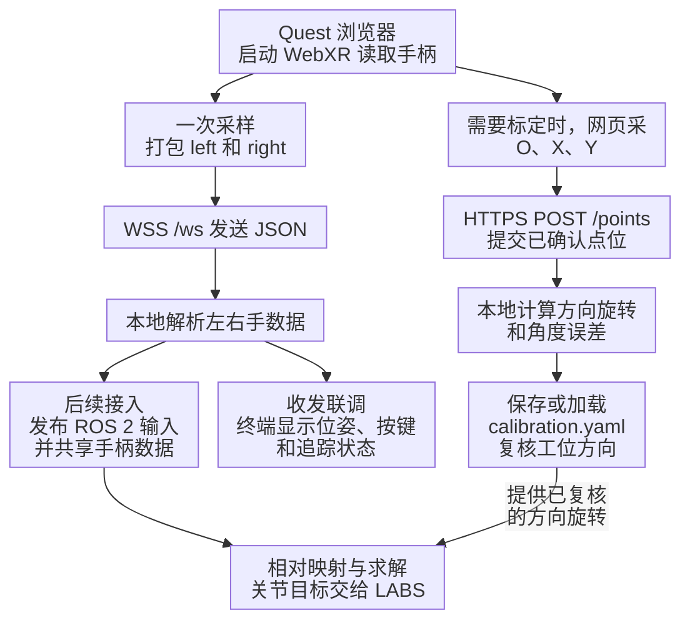

# 3. 系统通信与话题设计

## 3.1 数据流与话题总表

### 3.1.1 端到端数据流

Quest 通过 WSS 向本地发送左右手柄数据。Bridge 校验数据后，将位姿、按键和追踪状态发布为 ROS 2 输入话题。相对跟随模块使用同一帧手柄数据生成 TCP 目标，求解模块结合 FR3 实测关节角生成七关节目标。LABS 把对应侧 Leader 话题上的关节目标转发给 Follower。



### 3.1.2 ROS 2 话题总表

| 用途 | 左手话题 | 右手话题 | ROS 2 消息类型 | 发布方 → 接收方 | 开发范围 |
| --- | --- | --- | --- | --- | --- |
| 手柄位姿 | `/quest/left/pose` | `/quest/right/pose` | `geometry_msgs/msg/PoseStamped` | Bridge → ROS 2 输入订阅端 | 新增 |
| 手柄按键和摇杆 | `/quest/left/joy` | `/quest/right/joy` | `sensor_msgs/msg/Joy` | Bridge → ROS 2 输入订阅端 | 新增 |
| 手柄追踪有效性 | `/quest/left/tracking_valid` | `/quest/right/tracking_valid` | `std_msgs/msg/Bool` | Bridge → ROS 2 输入订阅端 | 新增 |
| Leader 关节目标 | `/left/leader/quest/joint_states` | `/right/leader/quest/joint_states` | `sensor_msgs/msg/JointState` | Quest 求解模块 → LABS | 新增 |
| Follower 关节目标 | `/left/follower/quest/joint_states` | `/right/follower/quest/joint_states` | `sensor_msgs/msg/JointState` | LABS → FR3 Follower Controller、MCAP 录制 | 复用控制器与录制 |
| 机器人实测关节状态 | `/left/franka_robot_state_broadcaster/measured_joint_states` | `/right/franka_robot_state_broadcaster/measured_joint_states` | `sensor_msgs/msg/JointState` | FR3 状态广播器 → Quest 跟随与求解 | 复用 |

Quest 双臂部署新增 10 个话题：6 个手柄输入、2 个 Leader 关节目标、2 个 Follower 关节目标。

### 3.1.3 话题接口约定

- **手柄坐标系。** Bridge 发布手柄在 WebXR `local-floor` 下的位姿，`frame_id` 统一用 `quest_local_floor`。位置用米，姿态按四元数的 `x, y, z, w` 填写。标定和相对映射模块负责转换到机器人坐标系。
- **时间戳。** Bridge 在本地接收一帧时读取一次 ROS 时钟，同一帧的 `PoseStamped` 和 `Joy` 共用这个 ROS 时间戳。收包超时用本地单调时钟检查。
- **按键顺序。** 在 Bridge 配置中固定左右手柄的 `Joy.buttons` 和 `Joy.axes` 索引。跟随模块和按键处理模块共用此映射。
- **关节目标。** 每侧的 `JointState.name` 和 `position` 一一对应，按该臂控制器的 J1 到 J7 顺序填写，位置单位为弧度。`header.stamp` 使用生成目标时的 ROS 时间，运行时与 LABS 和 Follower 使用同一时钟基准。

## 3.2 Quest WebSocket 通信与 ROS 2 Bridge

### 3.2.1 WebSocket 连接与数据帧

Quest 网页启动 WebXR 后，通过 WSS `/ws` 连接本地，每条消息只打包 `left` 和 `right`。每侧包含位置、姿态、按键和追踪状态，按需发送摇杆值。读不到手柄位姿时，该侧位姿标为无效。XR 会话结束或参考空间重置时，采集页关闭当前 WSS，恢复追踪后重新连接。

### 3.2.2 数据校验与 ROS 2 发布

Bridge 收到数据后检查 `left`、`right` 和各侧数据结构。对位姿检查数值是否有效、四元数能否归一化，对按键和摇杆检查数据类型及取值范围。通过后，向对应侧的位姿、按键和追踪状态话题发布消息。该侧位姿无效时停止发布该侧的位姿，并将 `tracking_valid` 置为 `false`。按键输入仍可读时，可以继续发布有效的按键数据。



### 3.2.3 断线、超时与追踪失效

- **无效数据。** 整帧校验失败时丢弃该帧。只有一侧位姿无效时，发布该侧追踪无效状态，另一侧的有效数据照常发布。Grip 状态有效且仍握持时，偶发位姿失效只跳过该侧本次跟随更新。
- **断线与超时。** Bridge 使用本地单调时钟，分别记录各启用侧最近一次收到有效位姿的时间。无效帧不刷新计时。连接明确断开，或任一启用侧超过配置时限仍没有新的有效位姿时，Bridge 清除相关缓存并报告故障，跟随程序锁定所有启用侧的关节目标发布，请求 LABS 停止。
- **数据恢复。** 收到通过校验的新帧后恢复对应侧的输入发布。短时位姿丢帧未超时且 Grip 仍有效时，可保留本轮起点。WSS 断开后清除旧输入、按键历史和跟随起点，重新连接后按第 4.6 节复核方向。已触发 LABS 停止时，确认停止且输入恢复后，再按 A 启动、长按 B 同步。到位后重新按对应侧 Grip 取点。

## 3.3 LABS Leader/Follower 映射与接口复用

### 3.3.1 左右臂七关节目标发布

求解模块按侧生成七关节目标，检查数值、关节限位和与上一目标的连续性。各侧同步、保持和跟随目标共用同一个 Quest Leader 话题，由 LABS 状态与该侧 Grip 发布许可决定发送哪类目标。发布时按 J1 至 J7 顺序把七项关节角写入 `JointState.position`。

### 3.3.2 LABS 话题转发与 Follower 执行

Quest 遥操作站点配置中，将 `left_arm`、`right_arm` 的 `leader_topic` 都设为相对名称 `leader/quest/joint_states`，分别由 `left`、`right` 命名空间解析成完整名称。每侧将 `follower_topic` 和控制器的 `target_topic_name` 都设为 `follower/quest/joint_states`，在各自命名空间内解析为 `/left/follower/quest/joint_states` 或 `/right/follower/quest/joint_states`。MCAP 录制的左右 `action` 目标分别选择对应的完整 Follower 话题，录制 LABS 转发给控制器的关节目标。Quest 站点每侧只启用一条 Quest Leader → Follower 转发；独立的 GELLO 站点保留原路由。



启动遥操作时，LABS 按配置创建 `TeleopRobotNode`，订阅 Leader 并转发到 Follower。分别确认左右臂的订阅关系，检查 Follower 收到的关节角顺序和时间戳，再同步、跟随与录制。

## 3.4 开发

先验证 Quest 到本地的数据收发。需要标定时，按第 2.2 节在网页上采集 O、X、Y，提交给本地计算并保存。后续启动时读取 `calibration.yaml`，按第 4.6 节复核方向后使用。接入 ROS 2 和 LABS 时沿用同一种左右手帧格式。

### 3.4.1 简化收发与标定复用

Quest 浏览器打开本地 HTTPS 采集页并启动 WebXR。同一次回调中读取左右手柄，把 `left` 和 `right` 组为一条 JSON 消息，通过 WSS `/ws` 发送。Python 接收后按侧解析并打印位姿、按键和追踪状态。

```json
{
  "left": {
    "tracking_valid": true,
    "pose": {
      "position_m": [0.23, 0.91, -0.42],
      "orientation_xyzw": [0.0, 0.0, 0.0, 1.0]
    },
    "buttons": {"grip": true, "trigger": false, "x": false}
  },
  "right": {
    "tracking_valid": false,
    "pose": null,
    "buttons": {"grip": false, "trigger": true, "a": false, "b": false}
  }
}
```

位姿和按键分别读取。位姿不可用时填 `pose: null` 和 `tracking_valid: false`。按键读不到时填 `null`，读到松开时填 `false`。摇杆按实际使用需求加到对应侧。位置用米，四元数按 `x, y, z, w` 填写。

### 3.4.2 开发模块与输出

| 开发模块 | 处理方式 | 输出 |
| --- | --- | --- |
| WebXR 与 WSS 收发 | 同一次回调读取左右手柄并组帧。Python 按侧解析，记录本地接收时间，在终端显示左右手的数据和追踪状态 | 左右手柄数据 |
| 三点标定 | 网页判断停稳，使用 HTTPS `POST /points` 提交组号、点名和已确认坐标。本地计算方向旋转并保存 | `calibration.yaml` 和方向误差 |
| ROS 2 与 LABS 接入 | 收发通过后，用 Bridge 将同一帧按侧发布为 ROS 2 输入。跟随程序使用进程内的同帧位姿和按键接入相对映射、求解和控制 | 左右手输入话题和各臂关节目标 |

### 3.4.3 数据流向


