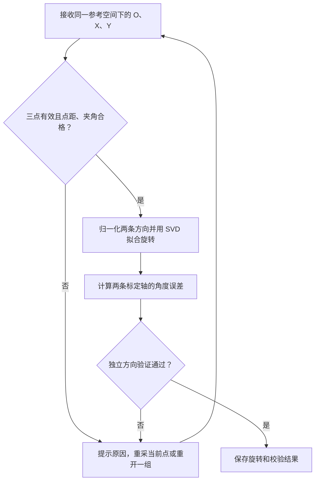

# 4. 双臂公共坐标系与方向标定

## 4.1 公共坐标系与双臂安装关系

### 4.1.1 坐标系定义

| 符号 | 坐标系 | 用途 |
| --- | --- | --- |
| $Q$ | Quest WebXR 的 `local-floor`，第 3 章用 `quest_local_floor` 标识 | 表示手柄采样位置和姿态 |
| $W$ | 双臂公共坐标系 `fr3_duo_mount_origin` | 规定两臂共用的工位方向 |
| $B_L$、$B_R$ | 左右 FR3 的基座 | 表示各臂的运动学和 TCP 目标 |
| $T_L$、$T_R$ | 左右臂各自的 TCP | 表示实际工具的操作点和姿态 |

记 ${}^A T_B$ 为把 $B$ 系中的点转换到 $A$ 系的齐次变换，${}^A R_B$ 为其中的旋转部分。左右臂分别用 $i=L,R$ 表示。

### 4.1.2 获取基座和 TCP 的变换

1. **读取固定安装关系。** 从双臂支架 Xacro 和对应的安装 YAML 读取 $W$ 到左右支架的固定连接，再沿双臂 URDF 链找到各臂基座。确认使用的支架版本、左右臂命名和现场安装一致。LABS 若按左右单臂模型启动，由站点配置显式提供 ${}^W T_{B_i}$，求解模块加载同一套数值。[支架 Xacro](/home/xzz/Gitspace/franka_ros2_ws/src/franka_description/accessories/fr3_duo_mount_v0_3/fr3_duo_mount.xacro:42) · [支架安装参数](/home/xzz/Gitspace/franka_ros2_ws/src/franka_description/accessories/fr3_duo_mount_v0_3/kinematics.yaml:20) · [支架到机械臂基座的固定关节](/home/xzz/Gitspace/franka_ros2_ws/src/franka_description/robots/fr3_duo/fr3_duo.xacro:49)
2. **确定 TCP。** 每侧配置实际工具以及法兰到 TCP 的固定变换 ${}^{F_i}T_{T_i}$。按关节名把实测反馈排成 J1 至 J7，做正运动学得到 ${}^{B_i}T_{F_i}(q_i)$。两者相乘得到当前实测 TCP。绘图、相对映射和求解器使用同一个 TCP 定义。

$$
{}^{B_i}T_{T_i}(q_i)={}^{B_i}T_{F_i}(q_i)\,{}^{F_i}T_{T_i}
$$

## 4.2 三点布置与标定输入

在工位布置 O、X、Y 三点，使 O→X 和 O→Y 分别对准 $W$ 的 $+X$、$+Y$。O 是布置方向的基准点，可以放在方便追踪的位置。用同一只左手柄、同一接触位置和相同朝向采样，避免手柄外壳接触点与追踪原点之间的偏移随姿态变化。右手 Trigger 只负责确认。采点接口和稳定性判断按第 2 章实现。

标定程序接收同一组的三个三维坐标。检查组号、点位顺序、坐标有效性以及 XR 会话和参考空间的一致性。遇到参考空间重置时，从 O 重采一组。成功采样后保存原始三点，方便检查重算结果。[第 2 章采集与标定](2、Quest数据采集.md)

## 4.3 求 Quest 到公共坐标系的旋转

1. 计算 $d_x=p_X^Q-p_O^Q$、$d_y=p_Y^Q-p_O^Q$。检查两段长度足够、夹角接近直角。点距和角度阈值放在标定配置中，由第 9 章联调记录确定。
2. 将两条向量归一化为 $u_x,u_y$。设 $e_x,e_y$ 为 $W$ 中的单位轴。对 $C=[e_x,e_y][u_x,u_y]^\top$ 做 SVD，得到 $C=U\Sigma V^\top$，计算 ${}^W R_Q=U\operatorname{diag}(1,1,\det(UV^\top))V^\top$。检查矩阵正交且行列式为 $+1$。
3. 分别计算 ${}^W R_Q u_x$ 与 $e_x$、${}^W R_Q u_y$ 与 $e_y$ 的夹角。终端按第 2 章的英文格式输出旋转矩阵和两条轴的误差。相对跟随只用该旋转转换运动方向，三点坐标留作校验记录。

## 4.4 生成左右臂方向转换

分别用两侧安装旋转的转置把公共工位方向转进各臂基座，再与 Quest 标定结果相乘。

$$
{}^{B_i} R_Q
= ({}^W R_{B_i})^\top\,{}^W R_Q
$$

两只手柄使用同一个 ${}^W R_Q$。左右臂仍各自使用 ${}^{B_i} R_Q$ 和该臂 TCP。用一支手柄标定即可，两支手柄都要做方向验证。

## 4.5 参数保存与加载

| 配置项 | 保存内容 | 加载检查 |
| --- | --- | --- |
| `calibration.yaml` | 源坐标系、目标坐标系、Quest 到工位的 $3\times3$ 旋转、原始三点、角度误差、标定时间 | 检查坐标系名称、矩阵和误差记录 |
| 双臂站点配置 | 支架版本、左右 ${}^W T_{B_i}$、工具和 TCP | 匹配现场安装、URDF 版本及左右臂 |
| 运行时 | 用上述两组参数计算两侧 ${}^{B_i}R_Q$ | 配置完整才允许进入第 7 章的同步流程 |

## 4.6 方向验证与复用

在手柄常用范围，用左右手柄分别做沿工位 $+X$、$+Y$、$+Z$ 的独立位移。在仿真或目标预览中，把两侧求得的基座位移转换回 $W$ 检查符号和串轴。复核通过后再加载到跟随程序。

Quest 会话重建、追踪重定位或参考空间重置后，先复核方向。方向保持一致时可以复用已保存的旋转。发现轴向改变、换了有效参考空间或调整了站点安装时，重新检查对应安装参数并按需要重做三点标定。第 5 章的跟随起点按新会话重新建立。
