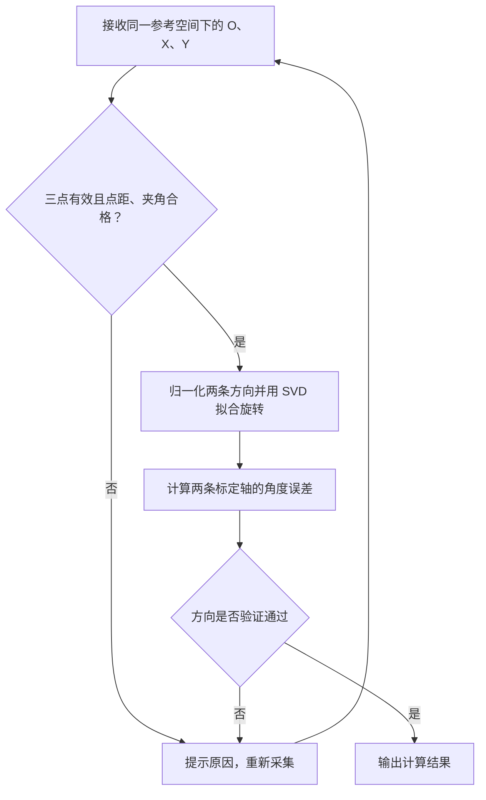

# 4. 双臂公共坐标系与方向标定

## 4.1 公共坐标系与双臂安装关系

### 4.1.1 坐标系定义

| 符号 | 坐标系 | 用途 |
| --- | --- | --- |
| $Q$ | Quest WebXR 的 `local-floor`，用 `quest_local_floor` 标识 | 表示手柄采样位置和姿态 |
| $W$ | 双臂公共坐标系 `fr3_duo_mount_origin` | 雙臂公用坐標系 |
| $B_L$、$B_R$ | 左右 FR3 的基座 | 表示各臂的运动学和 TCP 目标 |
| $T_L$、$T_R$ | 左右臂各自的 TCP | 表示实际工具的操作点和姿态 |

记 ${}^A T_B$ 为把 $B$ 系中的点转换到 $A$ 系的齐次变换，${}^A R_B$ 为其中的旋转部分。左右臂分别用 $i=L,R$ 表示。

### 4.1.2 获取基座和 TCP 的变换

1. **读取固定安装关系。** 从双臂支架 Xacro 和对应的安装 YAML 读取 $W$ 到左右支架的固定连接，再沿双臂 URDF 链找到各臂基座。LABS 若按左右单臂模型启动，由站点配置显式提供 ${}^W T_{B_i}$，求解模块加载同一套数值。
2. **确定 TCP。** 每侧配置实际工具以及法兰到 TCP 的固定变换 ${}^{F_i}T_{T_i}$。按关节名把实测反馈排成 J1 至 J7，做正运动学得到 ${}^{B_i}T_{F_i}(q_i)$。两者相乘得到当前实测 TCP。绘图、相对映射和求解器使用同一个 TCP 定义。

$$
{}^{B_i}T_{T_i}(q_i)={}^{B_i}T_{F_i}(q_i)\,{}^{F_i}T_{T_i}
$$

## 4.2 三点布置与标定输入

在工位同一平面上固定 O、X、Y 三个标记点。O 为基准点，选在手柄容易追踪的位置；X 沿工位坐标系 $W$ 的 $+X$ 方向布置，Y 沿 $+Y$ 方向布置。O→X 和 O→Y 互相垂直，各段实际距离为 200–300 mm。

按终端提示，将同一只左手柄以相同姿态依次放到 O、X、Y 点，每次用右手 Trigger 确认。读不到位置时留在当前点重采；采集中参考空间重置时，从 O 重新采集。三点采齐后保存实测坐标，用于计算方向和回查结果。

## 4.3 求 Quest 到公共坐标系的旋转

1. 计算 $d_x=p_X^Q-p_O^Q$、$d_y=p_Y^Q-p_O^Q$。检查两段长度足够、夹角接近直角。点距和角度阈值放在标定配置中。
2. 将两条向量归一化为 $u_x,u_y$。设 $e_x,e_y$ 为 $W$ 中的单位轴。对 $C=[e_x,e_y][u_x,u_y]^\top$ 做 SVD，得到 $C=U\Sigma V^\top$，计算 ${}^W R_Q=U\operatorname{diag}(1,1,\det(UV^\top))V^\top$。检查矩阵正交且行列式为 $+1$。
3. 分别计算 ${}^W R_Q u_x$ 与 $e_x$、${}^W R_Q u_y$ 与 $e_y$ 的夹角。在终端输出 Quest 到工位的旋转矩阵及 X、Y 两轴的角度误差（单位为度）。相对跟随只用该旋转转换运动方向，三点坐标留作校验记录。

## 4.4 生成左右臂方向转换

分别用两侧安装旋转的转置把公共工位方向转进各臂基座，再与 Quest 标定结果相乘。

$$
{}^{B_i} R_Q
= ({}^W R_{B_i})^\top\,{}^W R_Q
$$

两只手柄使用同一个 ${}^W R_Q$。左右臂仍各自使用 ${}^{B_i} R_Q$ 和该臂 TCP。用一支手柄标定即可。

## 4.5 参数保存与加载

将标定结果写到 `calibration.yaml`。跟随程序启动时加载该文件和双臂配置，结合各臂的安装相对于侧装基座旋转得到对应的方向转换。

## 4.6 方向验证与复用

在手柄捕捉范围，用左右手柄分别做沿工位 $+X$、$+Y$、$+Z$ 的独立位移。在仿真中，把两侧求得的基座位移转换回 $W$ 检查方向。

第 2 章的两种采点方式共用同一个 `calibration.yaml` 输出。已有标定时，保持机械臂静止，先用手柄移动复核工位轴向。Quest 当前参考空间和工位的方向关系一致时，继续使用保存的结果。同型号机器人替换后，核对安装方向和各臂基座配置。XR 会话重建或参考空间重置后重新复核轴向，发现方向变化时再做三点标定。
