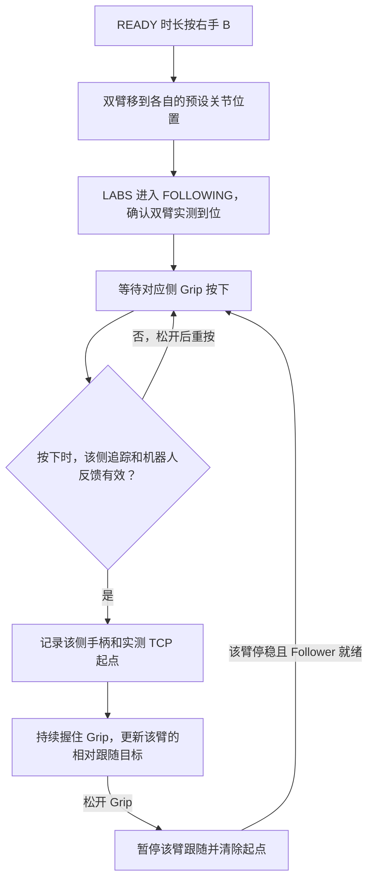

# 5. 相对位姿映射与 TCP 目标

## 5.1 映射输入与参数

进入遥操作联调后，跟随模块读取第 3.4.2 节方案二校验后的完整帧，并加载通过第 4.6 节方向复核的标定文件。

| 输入 | 来源 | 左右臂使用方式 |
| --- | --- | --- |
| 手柄位姿、采样时间、追踪状态、会话与参考空间版本 | Bridge 校验后的手柄整帧 | 左手柄对应左臂，右手柄对应右臂 |
| ${}^{B_i}R_Q$ | 由标定结果和各臂安装旋转得到 | 每侧加载自己的旋转 |
| 实测关节状态和 TCP 定义 | FR3 反馈与站点配置 | 按对应侧计算实测 TCP |
| 位移比例、可用工作空间和目标变化上限 | Quest 站点配置 | 每侧独立配置，单位分别用米和弧度 |

输出为对应侧、基座坐标系、生成时间和跟随的 TCP 目标。单位为m，姿态用四元数 `x, y, z, w`。求解器计算七关节目标。

## 5.2 双臂初始化与跟随起点

1. **长按右手 B 回初始位。** 左右臂各配置一组 `J1` 至 `J7` 的初始关节角。LABS 处于 `READY` 时，长按右手 B，双臂移到各自的预设位置。LABS 进入 `FOLLOWING` 且程序用实测关节角确认双臂到位后，等待 Grip 输入。
2. **按下哪侧 Grip，就为哪侧取点。** 在 Grip 按下的瞬间，确认该侧手柄追踪和机器人反馈有效，再记录手柄位姿和该臂的实测 TCP 位姿，作为本次跟随起点。若同步期间已握住 Grip，等双臂到位后松开再按。
3. **持续握住 Grip，手臂相对跟随。** 程序计算该侧手柄相对于起点的位移和旋转，并映射到对应手臂的起始 TCP 位姿上。左右臂各自取点、各自跟随。
4. **松开 Grip，暂停该臂跟随。** 该臂停止更新跟随目标，并清除本次起点。等该臂停稳且 Follower 就绪后，再次按下 Grip 会重新取点。

## 5.3 相对平移映射

对每侧计算手柄当前位置与本轮起点的差，转换到该臂基座后乘位移比例 $s_i$。在 TCP 起始位置上叠加这个位移。

$$
\Delta p_Q=p_H^Q(t)-p_{H0}^Q,\qquad
p_{\mathrm{target}}^{B_i}=p_0^{B_i}+s_i\,{}^{B_i}R_Q\,\Delta p_Q
$$

每帧都用本轮固定起点重新计算。只旋转手柄且追踪位置保持不变时，TCP 目标位置保持不变。单轴测试时分别记录原始位移、换算后的位移和 TCP 目标，便于定位方向错误或重复缩放。

## 5.4 相对旋转映射

在 Quest 参考系中计算空间旋转增量，再把它换到对应臂的基座系，并左乘 TCP 起始姿态。令 $G_i={}^{B_i}R_Q$。

$$
\Delta R_Q=R_H^Q(t)(R_{H0}^Q)^\top,\qquad
\Delta R_{B_i}=G_i\Delta R_Q G_i^\top,\qquad
R_{\mathrm{target}}^{B_i}=\Delta R_{B_i}R_0^{B_i}
$$

实现时先归一化输入四元数。输出四元数与上一目标做符号连续处理。平移和旋转分别计算，再合成同一帧 TCP 目标。起始位姿按对应臂的工具 TCP 计算。

## 5.5 目标检查与输出

1. 检查坐标和四元数是否有效、时间与轮次是否匹配、目标是否在该臂工作空间内。
2. 检查相邻目标的位置和角度变化。对正常变化使用站点配置的速率限制，对追踪跳变或超出边界的目标报告异常。把限制后的目标交给求解器。
3. Grip 仍有效且握住时，偶发无效位姿只跳过该侧的跟随更新，保留起点。松开 Grip 或按键状态不可读时，立即废弃该侧起点并按第 7.3 节暂停停稳。目标检查失败、手柄输入超时、WSS 断开或参考空间变化时，清除起点、锁定目标并请求 LABS 停止。LABS 离开允许跟随的状态时，起点同样失效。重新同步到位后，等对应侧 Grip 再次按下才建立新起点。

## 5.6 联调与验收

| 测试 | 验收内容 |
| --- | --- |
| 同步到位和首帧 | 同步到位后等待 Grip。按下时记录该侧实测起点，首帧 TCP 目标与起点一致 |
| 工位单轴平移 | 分别验证双侧的方向、正负号和比例 |
| 手柄原地旋转 | 目标位置保持，姿态绕预期轴变化 |
| 左右手独立跟随及暂停 | 只有持续握住 Grip 的一侧更新跟随目标。松开后清除该侧起点，停稳后重按取点 |
| 参考空间重置与重新同步 | 旧起点失效。重新同步到位后，按下对应侧 Grip 时从实测位姿建立新起点 |
