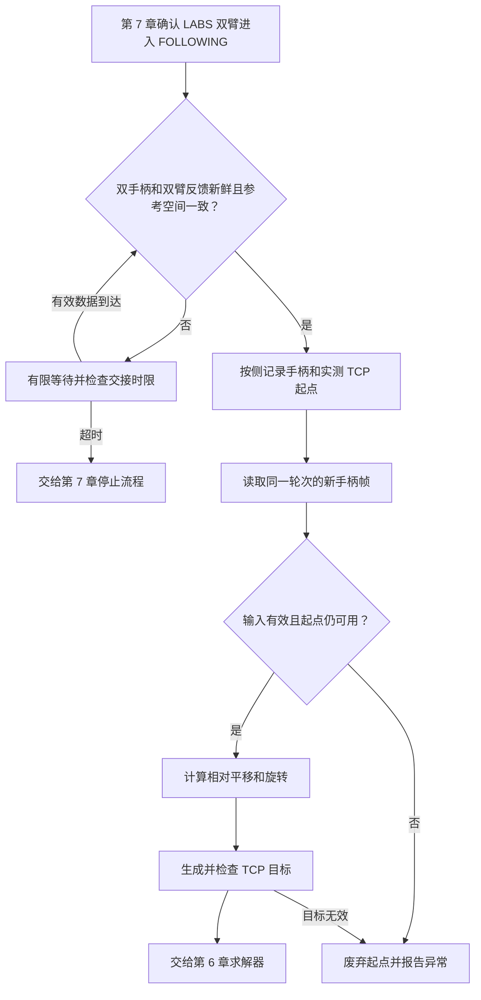

# 5. 相对位姿映射与 TCP 目标

## 5.1 映射输入与参数

| 输入 | 来源 | 左右臂使用方式 |
| --- | --- | --- |
| 手柄位姿、采样时间、追踪状态、会话与参考空间版本 | 第 3 章 Bridge 校验后的整帧 | 左手柄对应左臂，右手柄对应右臂 |
| ${}^{B_i}R_Q$ | 第 4 章的方向转换 | 每侧加载自己的旋转 |
| 实测关节状态和 TCP 定义 | FR3 反馈与站点配置 | 按对应侧计算实测 TCP |
| 位移比例、可用工作空间和目标变化上限 | Quest 站点配置 | 每侧独立配置，单位分别用米和弧度 |

输出为带侧别、基座坐标系、生成时间和跟随轮次的 TCP 目标。位置用米，姿态用四元数 `x, y, z, w`。第 6 章用这个目标求七关节角。

## 5.2 建立左右臂的跟随起点

右手 B 在 `READY` 发起同步。第 7 章确认双臂进入 `FOLLOWING` 并通过取点检查后，用同一帧有效的双手柄位姿和时间接近的双臂实测反馈建立两侧起点。本轮跟随由 B 的同步流程开启。每侧保存下列数据。

- 手柄起始位置 $p_{H0}^Q$、起始姿态 $R_{H0}^Q$ 和参考空间版本。
- 由当前实测关节角做正运动学得到的 TCP 起始位置 $p_0^B$、姿态 $R_0^B$。同时保存起点关节角供第 6 章建立肘部参考。
- 当前跟随轮次。状态退出、中断或参考空间改变后废弃这一轮的数据。

取点帧的 TCP 目标就是实测 TCP 起点。等待反馈时继续使用有效的同步目标，超过交接等待时限交由第 7 章处理。

## 5.3 相对平移映射

对每侧计算手柄当前位置与本轮起点的差，转换到该臂基座后乘位移比例 $s_i$。在 TCP 起始位置上叠加这个位移。

$$
\Delta p_Q=p_H^Q(t)-p_{H0}^Q,\qquad
p_{\mathrm{target}}^{B_i}=p_0^{B_i}+s_i\,{}^{B_i}R_Q\,\Delta p_Q
$$

每帧都用本轮固定起点重新计算。只旋转手柄且追踪位置保持不变时，TCP 目标位置保持不变。单轴测试时分别记录原始位移、换算后的位移和 TCP 目标，便于定位方向错误或重复缩放。

## 5.4 相对旋转映射

在 Quest 参考系中计算空间旋转增量，再把它换到对应臂的基座系，并左乘 TCP 起始姿态。令 $G_i={}^{B_i}R_Q$。

$$
\Delta R_Q=R_H^Q(t)(R_{H0}^Q)^\top,\qquad
\Delta R_{B_i}=G_i\Delta R_Q G_i^\top,\qquad
R_{\mathrm{target}}^{B_i}=\Delta R_{B_i}R_0^{B_i}
$$

实现时先归一化输入四元数。输出四元数与上一目标做符号连续处理。平移和旋转分别计算，再合成同一帧 TCP 目标。第 4 章的 TCP 配置已用于计算起始位姿。

## 5.5 目标检查与输出

1. 检查坐标和四元数是否有效、时间与轮次是否匹配、目标是否在该臂工作空间内。
2. 检查相邻目标的位置和角度变化。对正常变化使用站点配置的速率限制，对追踪跳变或超出边界的目标报告异常。把限制后的目标交给求解器。
3. 目标检查失败、追踪中断或 LABS 离开允许状态时，停止生成新的相对 TCP 目标，清除本轮起点，并按第 7 章处理。重新同步后，用新的实测 TCP 取点。

## 5.6 联调与验收

| 测试 | 验收内容 |
| --- | --- |
| 初始帧与静止输入 | 初次输出等于实测起点，静止时目标保持 |
| 工位单轴平移 | 分别验证双侧的方向、正负号和比例 |
| 手柄原地旋转 | 目标位置保持，姿态绕预期轴变化 |
| 左右手独立移动 | 一侧手柄运动只改变对应的 TCP 目标 |
| 参考空间重置与重新同步 | 旧起点失效，新起点从当前实测位姿建立 |
