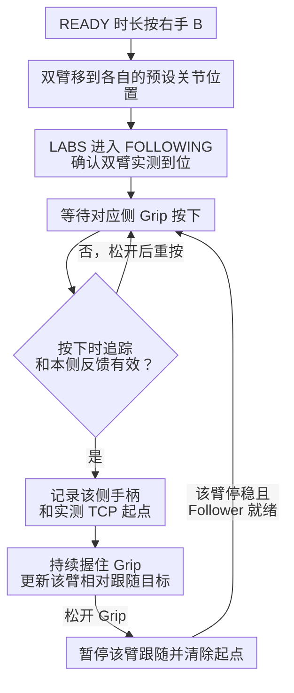
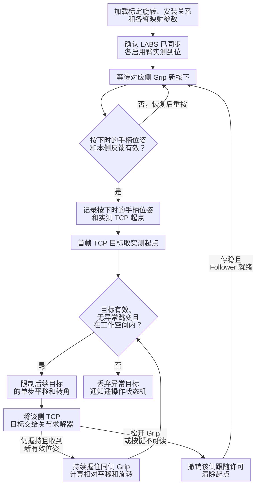

# 5. 相对位姿映射与 TCP 目标

## 5.1 映射输入与参数

进入遥操作联调后，跟随模块读取第 3.4.1 节的左右手数据，并加载通过第 4.6 节方向复核的标定文件。

| 输入 | 来源 | 左右臂使用方式 |
| --- | --- | --- |
| 手柄位姿、按键和追踪状态 | Bridge 校验后的同一帧，附本地接收时间 | 左手柄对应左臂，右手柄对应右臂 |
| ${}^{B_i}R_Q$ | 由标定结果和各臂安装旋转得到 | 每侧加载自己的旋转 |
| 实测关节状态和 TCP 定义 | FR3 反馈与站点配置 | 按对应侧计算实测 TCP |
| 位移比例、可用工作空间和目标变化上限 | Quest 站点配置 | 每侧独立配置，单位分别用米和弧度 |

输出为对应侧、基座坐标系、生成时间和跟随的 TCP 目标。单位为m，姿态用四元数 `x, y, z, w`。求解器计算七关节目标。

## 5.2 双臂初始化与跟随起点

1. **长按右手 B 回初始位。** 左右臂各配置一组 `J1` 至 `J7` 的初始关节角。LABS 处于 `READY` 时，长按右手 B，双臂移到各自的预设位置。LABS 进入 `FOLLOWING` 且程序用实测关节角确认双臂到位后，等待 Grip 输入。
2. **按下哪侧 Grip，就为哪侧取点。** 在 Grip 按下的瞬间，确认该侧手柄追踪和机器人反馈有效，再记录手柄位姿和该臂的实测 TCP 位姿，作为本次跟随起点。若同步期间已握住 Grip，等双臂到位后松开再按。
3. **持续握住 Grip，手臂相对跟随。** 程序计算该侧手柄相对于起点的位移和旋转，并映射到对应手臂的起始 TCP 位姿上。左右臂各自取点、各自跟随。
4. **松开 Grip，暂停该臂跟随。** 该臂停止更新跟随目标，并清除本次起点。等该臂停稳且 Follower 就绪后，再次按下 Grip 会重新取点。

## 5.3 相对平移映射

对每侧计算手柄当前位置与本轮起点的差，转换到该臂基座后乘位移比例 $s_i$。在 TCP 起始位置上叠加这个位移。

$$
\Delta p_Q=p_H^Q(t)-p_{H0}^Q,\qquad
p_{\mathrm{target}}^{B_i}=p_0^{B_i}+s_i\,{}^{B_i}R_Q\,\Delta p_Q
$$

每帧都用本轮固定起点重新计算。只旋转手柄且追踪位置保持不变时，TCP 目标位置保持不变。单轴测试时分别记录原始位移、换算后的位移和 TCP 目标，便于定位方向错误或重复缩放。

## 5.4 相对旋转映射

在 Quest 参考系中计算空间旋转增量，再把它换到对应臂的基座系，并左乘 TCP 起始姿态。令 $G_i={}^{B_i}R_Q$。

$$
\Delta R_Q=R_H^Q(t)(R_{H0}^Q)^\top,\qquad
\Delta R_{B_i}=G_i\Delta R_Q G_i^\top,\qquad
R_{\mathrm{target}}^{B_i}=\Delta R_{B_i}R_0^{B_i}
$$

实现时先归一化输入四元数。输出四元数与上一目标做符号连续处理。平移和旋转分别计算，再合成同一帧 TCP 目标。起始位姿按对应臂的工具 TCP 计算。

## 5.5 开发

在本地 `quest_teleop` 中实现按侧取点和 TCP 目标计算。左右臂共用计算方法，各自保存手柄起点和实测 TCP 起点，并使用各自的基座方向转换、工具 TCP 和位移比例。

### 5.5.1 开发模块与输出

| 开发模块 | 处理方式 | 输出 |
| --- | --- | --- |
| 参数加载 | 读取 `calibration.yaml` 中的方向标定，与各臂的安装旋转合成 Quest 到该臂基座的方向转换。加载各臂的 TCP、位移比例、工作空间和目标变化限制 | 左右臂各自的映射参数 |
| 按侧取点 | 长按右手 B 同步到预设位置，等 LABS 进入 `FOLLOWING` 且实测关节角确认各启用臂到位。收到对应侧 Grip 的新按下事件时，保留按键所在帧的手柄位姿，取时间接近且有效的实测关节角，通过正运动学计算该臂 TCP 位姿 | 该侧本轮的手柄起点和实测 TCP 起点 |
| 相对位姿映射 | Grip 持续按下，根据手柄相对起点的位移和旋转更新该臂的 TCP 目标 | 该臂基座坐标系下的 TCP 目标 |
| 目标检查与输出 | 检查位姿数值、追踪与反馈时效、工作空间和相邻目标变化。通过检查后，将侧别、基座坐标系、生成时间、位置和姿态交给关节求解器 | 有效的 TCP 目标或异常原因 |

### 5.5.2 TCP 目标计算方式

1. **首帧从实测位姿开始。** 有效按下 Grip 时，先用取点帧生成首个目标。此时手柄相对位移为零、相对旋转为单位旋转，所以首个 TCP 目标等于该臂实测起点。关节求解后，由控制程序检查首个关节目标与保持目标的连续性。
2. **后续位置用相对位移计算。** 用当前手柄位置减去按下 Grip 时的位置，将差值转到对应臂的基座坐标系，再乘位移比例，最后加到实测 TCP 起始位置。
3. **后续姿态用相对旋转计算。** 先归一化手柄四元数，用当前姿态乘起始姿态的逆得到旋转增量。将增量转换到该臂基座坐标系，再左乘 TCP 起始姿态。输出四元数与上一目标的符号保持连续。
4. **检查通过后才交给求解器。** 每帧都以本轮固定起点计算，从第二帧起，正常目标的单步平移和转角以上一有效目标为基准限幅。Grip 仍有效且握持、输入未超时时，偶发无效位姿只跳过当次更新。发现异常跳变、越界、超时或断线时，丢弃本周期目标，由遥操作状态机锁定输出并进入停止流程。松开 Grip 或按键不可读时，立即撤销该侧跟随许可并清除起点。该臂停稳且 Follower 就绪后，重新按下建立新起点。

### 5.5.3 数据流向

