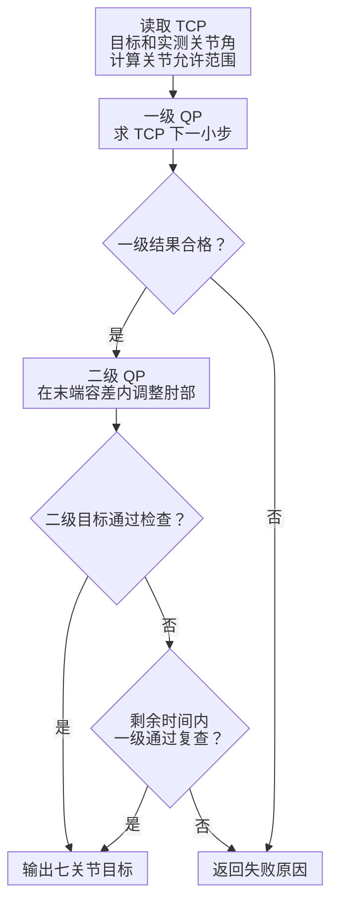

# 6. 笛卡尔空间与肘部空间优化

## 6.1 求解器输入与输出

| 输入 | 用途 |
| --- | --- |
| 对应臂的 TCP 目标 | 指定工具末端的位置和朝向 |
| 当前实测关节角 $q_m$ | 用正运动学计算当前 TCP 和肘部位置，作为本周期求解的起点 |
| 上一次实际发出的关节目标 $q_{\mathrm{prev}}$ | 用来限制新目标和上一条命令的差值 |
| 下一步肘部参考位置 | 让肘部在跟随过程中尽量靠近按下 Grip 时的位置 |

求解器返回该臂按 J1 至 J7 排列的目标关节角 `q_target`，单位为弧度，同时给出求解状态和耗时。控制程序确认本轮仍允许跟随后，再把通过检查的目标发到对应侧的 Leader 话题。

## 6.2 FR3 模型与计算参考点

1. **加载与部署一致的模型。** 各臂使用实际部署的 FR3 URDF、关节限位和工具 TCP。用关节名称把 ROS 2 关节反馈排成 J1 至 J7，先对照仿真或 TF 核对工具末端的位置和姿态。
2. **取 TCP 和 J4 原点作为计算点。** TCP 的正运动学和雅可比都用实际工具中心点，并将线速度和角速度表达在本臂基座方向上。肘部取 J4 的关节原点，只计算它在基座方向上的三维位置和线速度雅可比。
3. **按下 Grip 时记录肘部参考。** 使用取点时保存的实测关节角计算 J4 原点位置。grip按下期间使用同一个参考，停稳后重新按 Grip 时再取一次。

## 6.3 一级 QP 跟踪 TCP

先用当前实测关节角 $q_m$ 计算 TCP 的位置 $p$ 和姿态 $R$。设目标位置、姿态为 $p_d$、$R_d$，位置误差取 $p_d-p$，姿态误差用旋转向量 $\operatorname{Log}(R_dR^\top)$ 表示。分别乘增益并限速，再乘本周期的时间 $h$，得到这一步希望完成的平移和旋转 $d_T$。

TCP 雅可比 $J_T$ 用来预测关节转动 $\delta q$ 会让 TCP 移动多少。一级 QP 在每轴关节限位、速度和单步变化范围内，让预测的运动尽量接近这一步的目标。

$$
q_c=q_m+\delta q,\qquad
\min_{\delta q}\left\lVert W_T(J_T\delta q-d_T)\right\rVert^2
$$

$q_c$ 是候选关节目标。$W_T$ 用来平衡位置和姿态误差的权重。一级算完后，检查求解状态、关节约束以及预测的这一步与 $d_T$ 还差多少。

## 6.4 二级 QP 调整肘部和关节目标

一级得到关节增量 $\delta q_1$ 后，允许二级在设定的小范围内调整 TCP 的这一步。二级通过关节约束，要求 $J_T\delta q$ 与一级算出的 $J_T\delta q_1$ 的差变化范围内。平移分量用米、旋转分量用弧度，分别设置变化范围。

用肘部参考位置减去当前肘部位置，经过增益、限速和周期换算后得到肘部希望走的一小步 $d_E$。肘部雅可比 $J_E$ 预测关节增量会带来的肘部位移。二级一边让肘部往参考位置靠，一边让新关节目标尽量接近上一条命令。

$$
\min_{\delta q}\left(
\lVert W_E(J_E\delta q-d_E)\rVert^2
+\lambda\lVert q_c-q_{\mathrm{prev}}\rVert^2
\right)
$$

$W_E$ 是肘部任务的权重，$\lambda$ 用来平衡肘部误差和关节命令变化。肘部可以随末端运动适当移动。两级 QP 可以分别用 OSQP 求解。

## 6.5 关节限幅与运行约束

**实测关节角用来算姿态，上一条已发目标用来限制关节突变。** 按下 Grip 开始跟随时，$q_{\mathrm{prev}}$ 取该侧最后一次发出的保持目标。跟随期间，发布成功后用这条关节目标更新 $q_{\mathrm{prev}}$。

| 检查项 | 处理方式 |
| --- | --- |
| 关节位置 | 每个关节的候选角度须在模型限位及工作空间内 |
| 单步变化 | 逐个关节比较 $q_c$ 与 $q_{\mathrm{prev}}$。用该轴速度上限乘两次发布的时间间隔，再与配置的单步上限取较小值 |
| 命令加速度 | 根据上一段已发命令的速度，限制这一段的速度变化。刚开始跟随时从保持阶段的命令速度接续 |
| 奇异位形 | 检查雅可比是否退化。难以实现部分 TCP 方向时，限制这一步的运动量，并检查是否仍能在误差范围内完成 |
| 数据和时间 | 只使用当前跟随轮次且仍有效的手柄目标和关节反馈。求解或检查超过周期截止时间时，丢弃本次结果 |

## 6.6 结果检查与发布

- 七个关节角都在各自的限位内。用候选关节角算出 TCP 位姿，确认它在工作范围内，位置和朝向达到这一步的要求。
- 逐个关节与上一条已发目标比较，确认变化量没有超过单步上限。

优先使用通过检查的二级结果。二级用不了时，如果本周期还有时间，就按同样的条件检查一级结果。

选出结果后交给跟随程序，按 J1 至 J7 填写 `JointState.position`，带上目标生成时的 ROS 时间戳，发到对应侧的 Leader 话题。

## 6.7 开发

在 `quest_teleop` 的 `motion_solver` 中实现关节目标求解。左右臂共用计算方法，各自使用对应的 TCP、实测关节角、上一条已发目标和按下 Grip 时记录的肘部位置。跟随程序把选出的七关节角填入 `JointState.position`，按侧发到 Leader 话题。通过 FR3 Follower 根据关节目标和实测反馈计算力矩，通过 `ros2_control` 的 `effort` 接口执行。

### 6.7.1 开发模块与输出

| 开发模块 | 处理方式 | 输出 |
| --- | --- | --- |
| 运动学计算 | 加载 FR3 模型和工具 TCP，按 J1 至 J7 排列实测关节角，计算 TCP、J4 原点及各自的雅可比 | 当前 TCP 位姿、肘部位置和雅可比 |
| 关节约束 | 合并模型关节限位、相对上一条已发目标的单步变化上限和命令加速度限制 | 两级 QP 共用的七轴角度上下界 |
| 两级 QP 求解 | 用 OSQP 分别求解。一级算 TCP 下一小步，接近奇异位形时缩小这一步。二级在一级末端运动的允许偏差内，让肘部尽量靠近参考位置并减小相邻关节目标的变化 | 一级和二级候选关节目标、求解状态和耗时 |
| 候选检查 | 检查关节上下界，用正运动学复查 TCP 的预测运动和工作空间。双臂运行时，把两侧跟随或保持目标一起做干涉检查。二级结果未通过时，在剩余时间内用同样的检查复查一级结果 | 通过检查的七关节目标或失败 |

### 6.7.2 数据流向

