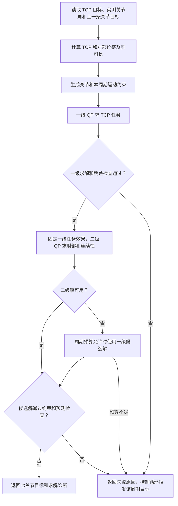

# 6. 笛卡尔空间与肘部空间优化

## 6.1 求解器接口与数据流

每侧求解器接收相对映射生成的 TCP 目标、带时间戳的 FR3 实测关节角、上一条已发布的目标和本轮肘部参考。输出为一组 J1 至 J7 的关节位置以及本周期的求解状态。输出角度用弧度，控制循环在确认跟随轮次和 LABS 状态后放行并发布目标。保留相同的运动目标接口，便于在仿真用只跟踪 TCP 的基线与新求解器对比。

## 6.2 FR3 运动学模型

1. **加载与部署相同的模型。** 每侧用实际部署的 FR3 URDF、关节限位和 TCP 配置。按名称建立 ROS 2 的 J1 至 J7 与模型索引之间的对应。加载后核对正运动学与仿真或 TF 树。
2. **定义肘部跟踪点。** 取模型中 J4 的关节原点作为肘部点。在仿真显示该点确认位置，计算它在本臂基座下的位置和线速度雅可比。每次按下对应侧 Grip 并成功取点时，用同一时刻保存的实测关节角计算该臂的肘部参考位置。
3. **统一速度表达。** TCP 位置误差、姿态误差、TCP 雅可比和肘部雅可比都使用本臂基座方向。用小关节增量做有限差分，对照雅可比的线速度和角速度顺序，再进入求解器联调。

## 6.3 TCP 跟踪主任务

令 $q_m$ 为本周期实测关节角，$p$、$R$ 为在 $q_m$ 处计算的当前 TCP 位姿，$p_d$、$R_d$ 为相对映射生成的 TCP 目标。位移误差取 $p_d-p$，姿态误差取旋转向量 $\operatorname{Log}(R_dR^\top)$。位置和姿态分别设增益与速度上限，再乘控制周期 $h$，得到该周期希望完成的六维 TCP 增量 $d_T$。

求解变量为关节增量 $\delta q$，候选命令为 $q_c=q_m+\delta q$。一级 QP 在运动约束内最小化 $\lVert W_T(J_T\delta q-d_T)\rVert^2$，其中 $W_T$ 用于平衡米和弧度两类误差。检查本步可实现的 TCP 增量及残差。相对映射先限制 TCP 目标的单步变化，求解器按周期跟踪并监测持续偏差。

## 6.4 肘部次任务与关节连续性

在一级结果 $\delta q_1$ 的基础上，二级 QP 尽量让肘部靠近本轮参考位置，同时减小和上一条已发布命令 $q_{\mathrm{prev}}$ 的差。用 $d_E$ 表示经过增益和限速的肘部期望增量。二级目标为

$$
\lVert W_E(J_E\delta q-d_E)\rVert^2
+\lambda\lVert q_c-q_{\mathrm{prev}}\rVert^2.
$$

二级继续使用相同的运动约束，并要求 $J_T\delta q$ 与一级得到的 $J_T\delta q_1$ 的差在配置的容差内。肘部参考是软目标。若机械臂没有足够余量调整肘部，用通过校验的一级解继续完成 TCP 任务。软件可用 OSQP 分别求解两级 QP，并检查两级的求解状态和重新计算的约束残差。[分层 QP 方法](https://gepettoweb.laas.fr/uploads/Publications/2014_escande_ijrr.pdf) · [OSQP 求解状态](https://osqp.org/docs/interfaces/status_values.html)

## 6.5 约束与运行周期

| 约束或检查 | 实现方式 |
| --- | --- |
| 关节位置 | 按部署模型的上下限和站点余量约束 $q_c$ |
| 关节速度和单周期变化 | 从实际发布间隔和上一条已发布命令计算可用变化量，限制 $q_c-q_{\mathrm{prev}}$ |
| 加速度或命令变化率 | 根据上一段命令速度限制本周期变化，首次交接使用保守初始化 |
| 奇异位形与求解预算 | 检查雅可比退化和求解耗时，限制输入步长。无可用解或持续超差时报告失败 |
| 数据新鲜度 | 求解前检查目标、反馈及跟随轮次。周期过长或反馈过期时报告异常 |
| 双臂干涉 | 两侧候选目标放入同一工位模型检查自碰、臂间和工位间距，通过后成对放行。检查模型和距离阈值在仿真验收 |

开发时固定发布周期的目标值，并记录运行中的实际间隔。复用上一次求解结果作为数值初值。关节变化限制以真正发布的关节命令为准，每次新同步后重置。

## 6.6 求解结果校验与输出

1. 一级成功后才尝试肘部任务。二级超时或失败时，若本周期仍有时间且一级结果通过完整校验，可使用一级结果并记录降级原因。
2. 对最终候选解检查七项数值、关节边界和目标连续性。再用正运动学检查预测的 TCP 位姿和单步效果。双臂同时更新时先完成成对校验。
3. 通过校验后返回 `q_target` 和诊断数据。控制循环发布前确认跟随轮次和 LABS 状态，按 J1 至 J7 的顺序写入 `JointState.position`，以目标生成时的 ROS 时间为时间戳，发布到对应侧的 Leader 话题。无法满足约束、反馈过期或持续偏差时，返回失败侧和原因。

## 6.7 仿真与验收

| 测试 | 验收内容 |
| --- | --- |
| 运动学和雅可比 | 用已知姿态和有限差分验证 TCP、肘部及各关节轴方向 |
| TCP 单轴平移、旋转和组合轨迹 | 记录位置与姿态误差，检查命令连续性 |
| 肘部效果对比 | 同一初始位姿、同一输入轨迹，分别测试 TCP 基线与肘部优化。比较 TCP 误差、肘部偏移及相邻命令变化 |
| 约束和超时 | 测试关节限位附近、不可达目标、奇异位形和求解超时，确认控制循环收到失败原因，拒发目标并请求 LABS 停止 |
| 双臂结果 | 在共同工位模型中验证两臂候选姿态及运动范围，记录需限制的区域 |
