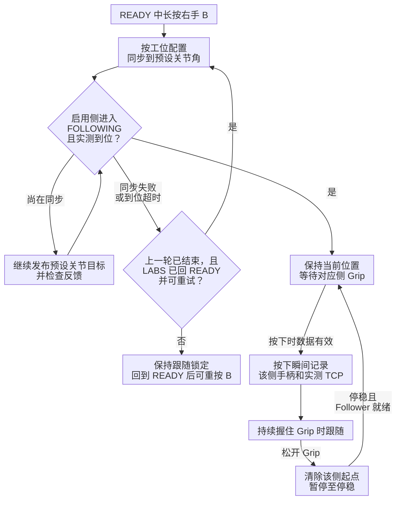
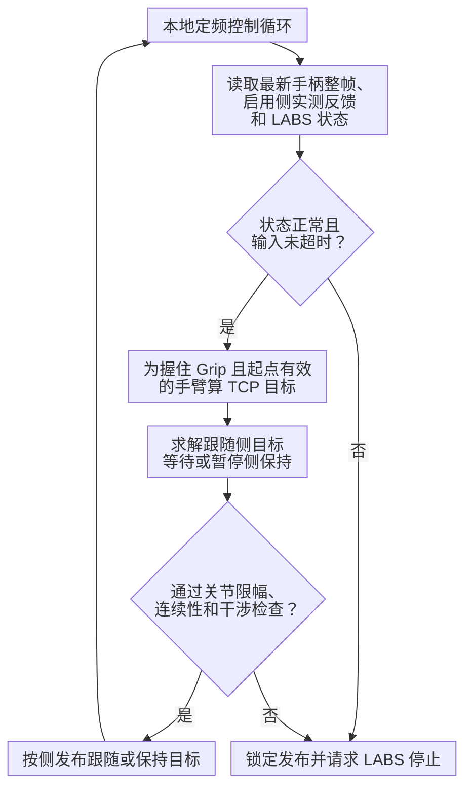
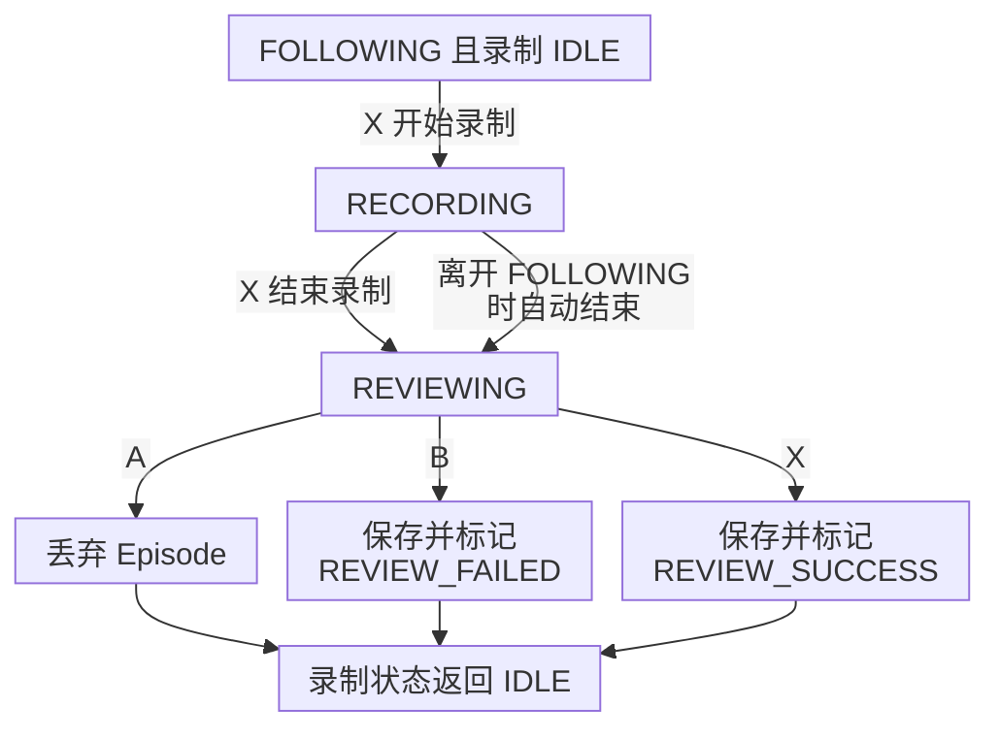
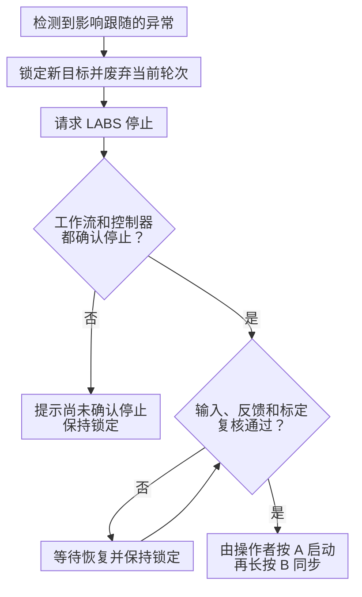

# 7. 遥操作同步、跟随及异常处理

## 7.1 GELLO 按键映射与状态判定

Quest 右手 A、右手 B、左手 X 分别对应 LABS 在 GELLO 模式下的左、中、右操作。A/B/X 的动作由 LABS 的 `workflow_state` 和 `recording_state` 一起决定，录制和审核的按键规则优先。长按 B 让启用侧移动到各自的预设关节位置。确认到位后，按下某侧 Grip 时记录该侧起点，持续握住时跟随，松开后暂停。录制期间仍可用 Grip 控制跟随。

| LABS 当前状态 | 右手 A | 右手 B | 左手 X |
| --- | --- | --- | --- |
| 遥操作 `IDLE`，录制 `IDLE` | `Start teleoperation`（启动遥操作） | 禁用 | 禁用 |
| 遥操作 `READY`，录制 `IDLE` | `Stop teleoperation`（停止遥操作） | 长按触发 `Sync robots`（同步到预设位，到位后等待 Grip） | 禁用 |
| `SYNCING` 或 `AUTORECOVERY`，录制 `IDLE` | `Stop teleoperation`（停止遥操作） | 禁用 | 禁用 |
| `FOLLOWING`，录制 `IDLE` | `Stop teleoperation`（停止遥操作） | 禁用 | `Start recording`（开始录制） |
| 录制 `RECORDING` | 禁用 | 禁用 | `Stop recording`（结束录制，进入审核） |
| 录制 `REVIEWING` | `Discard`（丢弃本轮录制） | `Save as failed`（保留本轮录制并标记失败） | `Save as successful`（保存本轮录制并标记成功） |

A、X 及审核时的 B 按下触发一次操作。同步时在 `READY` 中长按 B，每次长按只发起一次同步。启动或重连后，按键先松开再按下。同步、取点和关节目标发布只处理站点配置中启用的机械臂。

同步到位后，握住对应侧 Grip，才允许用同侧 Trigger 更新夹爪。Trigger 扣得越深，夹爪越闭合。松开 Grip 或 Trigger 读不到时，夹爪保留上一条开合目标。标定模式下，右 Trigger 用来确认当前点位。

## 7.2 A 键启动与停止遥操作

1. `IDLE` 时按 A，通过 LABS 启动接口建立遥操作。等待 LABS 进入 `READY`，并检查 Bridge、启用侧的实测反馈、映射参数和转发链路。完成后提示 `Ready. Hold B to sync the robots.`（已就绪，长按 B 同步）。
2. 在允许停止的状态按 A，先撤销当前目标的发布许可并使本轮起点和待发布结果失效，再发出 LABS 停止请求。确认工作流回到 `IDLE` 且控制器已停止后，才允许下一轮启动。停止结果未知时保持锁定并提示 `Stop not confirmed.`（停止尚未确认）。
3. 录制 `REVIEWING` 时按 A 执行丢弃当前 Episode。成功后录制状态回到 `IDLE`，之后按 A 再根据当前遥操作状态执行启停。

## 7.3 B 键同步与 Grip 跟随启动

1. **回到预设关节位置。** 在 `READY` 中长按右手 B，启用的机械臂通过 LABS 同步到各自的预设位置。同步期间移动手柄只更新输入，等各臂实测到位后再按 Grip。
2. **同步失败时等待重试。** 普通同步失败或到位超时记录重试信息，确认上一轮结束且 LABS 回到 `READY` 后重试。自动重试次数用完后，待 LABS 回到 `READY` 再长按 B。接口结果未知时先核对状态，断线、反馈过期或控制器故障时进入停止流程。
3. **到位后等待 Grip。** LABS 确认启用侧进入 `FOLLOWING`，且各侧实测关节角与预设关节角的差值均在到位容差内后，继续定频发送预设关节角作为保持目标。此时可等待操作者按下 Grip。到位时已按住的 Grip 需要松开再按。
4. **按侧取点和跟随。** 按下 Grip 的当帧，用该侧有效的手柄位姿和时间接近的实测关节反馈建立起点。按下当帧的数据无效时，等数据恢复后重新按下。首个跟随关节目标通过连续性检查后，持续握住 Grip 即可跟随。
5. **松开 Grip 暂停对应侧。** 停止更新该侧的手柄跟随目标，清除起点，执行经联调验证的保持停稳流程。暂停期间需要继续定频发送有效的保持目标，单纯停发可能让现有 Follower 超时退出。该臂停稳且 Follower 保持就绪后，再按 Grip 即可重新取点。保持路径未验证或执行失败时，走 LABS 停止流程，恢复后重新执行 A 启动和 B 同步。
## 7.4 持续跟随与关节目标

运行时定频读取左右手柄、实测关节反馈和 LABS 状态。当前握住 Grip 且已取点的侧更新相对 TCP 目标，等待或暂停的侧维持有效的保持目标。双臂运行时，两侧的跟随或保持目标一起做限位、连续性和干涉检查，再通过各自的 Leader 话题发布。

## 7.5 X 键录制与 A/B/X 审核

开始录制使用当前选中的 `task_id`，并保存 LABS 返回的 Episode ID。录制中按 X 结束当前录制，确认进入 `REVIEWING` 后，下一次按键才决定审核结果。A 丢弃，B 保留数据并标成失败，X 保留数据并标成成功。审核动作只处理 LABS 当前待审核的 Episode。操作报错或响应超时后，先复查录制状态和 Episode ID。

## 7.6 异常停止与恢复

| 异常 | 处理方式 |
| --- | --- |
| 偶发无效手柄位姿，Grip 仍有效且握住，输入未超时 | 跳过该侧本次跟随更新，保留本轮起点。后续有效数据继续用于跟随 |
| 单侧 Grip 状态不可读 | 暂停该侧并清除起点。恢复读取且停稳后，重新松开并按下 Grip 取点 |
| WSS 断开、任一启用侧手柄输入超时或参考空间重置 | 锁定所有启用侧的目标发布，清空旧输入和起点，请求 LABS 停止。参考空间变化后复核手柄运动与工位轴向是否一致 |
| 任一侧实测关节过期、求解失败或目标超限 | 丢弃本周期所有启用侧的候选目标，锁定输出并走 LABS 停止流程。记录侧别和原因 |
| LABS 离开 `FOLLOWING` 或发生 `AUTORECOVERY` | 使当前轮次失效。录制中由 LABS 的自动结束逻辑把 Episode 转入待审核，等待操作者决策 |
| 停止响应超时 | 保持锁定并显示 `Stop not confirmed.`（停止尚未确认），通过站点停止手段处置并核对实际控制器状态 |

Bridge 按侧报告输入超时。触发 LABS 停止时，确认所有启用侧控制器已停止，并核对 LABS 工作流状态。Quest 进程退出时，由部署侧监督和机器人既有停止机制处理。恢复前先处理待审核的 Episode，再按 A 启动、长按 B 同步。确认到位后重新按对应侧 Grip 取点。

## 7.7 Gazebo 仿真

1. **Gazebo 映射联调。** 在 Gazebo 中加载 FR3 模型，用 Quest 手柄驱动相对位姿映射和关节求解。在终端输出 TCP 目标位姿、目标与仿真实测关节角，以及控制器输出的关节力矩。确认手柄与机械臂的对应关系、运动方向和关节顺序，核对跟随时目标是否连续。
2. **接入 FR3。** 确认工位停止方式和控制器状态，进行跟随，观察 TCP 目标、关节目标与力矩反馈。

## 7.8 开发

在本地 `quest_teleop` 进程中使用 Python 和 `rclpy`。按键、状态管理、接口请求和定频控制拆成模块，通过进程内的数据快照传递。

### 7.8.1 开发模块与输出

| 开发模块 | 处理方式 | 输出 |
| --- | --- | --- |
| 输入缓存与按键 `input_bridge`、`ros_adapter`、`button_mapper` | 保存最新手柄数据、接收时间及各臂实测反馈。识别 A/B/X、长按 B 和左右 Grip，保留 Trigger 按压量。Grip 按下时保留触发帧，断开或重连时清除按键历史 | 带侧别和接收时间的按键事件、手柄及反馈快照 |
| 状态机 `teleop_state_machine` | 串行处理按键、LABS 状态和请求结果。分别记录 LABS 工作流、录制状态和各侧跟随轮次，每侧只允许同步、保持或跟随目标中的一种。松开 Grip 或读不到 Grip 时撤销该侧跟随和夹爪更新许可，并清除起点 | 各侧当前阶段和发布许可 |
| LABS 客户端 `labs_client` | 在独立 I/O 任务中调用状态、启停、同步、录制和审核接口，设置请求时限。结果带请求编号返回状态机，按业务结果和后续状态确认是否完成 | 接口结果、超时信息和状态更新 |
| 定频控制与求解 `follow_loop`、`motion_solver` | 用 `rclpy` 定时读取快照，按侧选择同步、保持或跟随。跟随侧计算相对 TCP 目标，再结合实测关节角、上一条已发关节目标和肘部参考求解。双臂把跟随与保持目标一起检查 | 同步目标、保持目标或待发布的七关节候选 |
| Leader 发布 `joint_target_publisher` | 由同一个入口按侧发布。按 J1 至 J7 填写 `JointState.position`，使用本次生成或刷新目标的 ROS 时间戳，记录已发目标、发布时间和对应手柄接收时间 | 各侧 Leader 关节消息和发布记录 |
| 夹爪发布 `gripper_command_publisher` | 根据同侧 Grip 许可和 Trigger 按压量换算夹爪开口比例，发到对应侧的 Quest 夹爪 Leader 话题 | 各侧夹爪目标 `Float32` |

### 7.8.2 实现顺序

1. **先接按键、LABS 状态和接口。** 在 Bridge 配置按键索引并用 Quest 实测核对。用离线输入验证按下、长按和松开。接口超时先查状态，结果确认后再决定是否重试。启停或同步结果未知期间，锁定受影响的运动许可。录制请求保存请求编号和 `task_id`，记录 LABS 返回的 Episode ID。结束和审核前核对当前 Episode，丢弃过期结果。停止请求优先于普通查询和录制。
2. **再接同步与 Grip 交接。** 检查启用侧的七关节初始值、顺序、限位和反馈时效。先定频发布固定的预设目标，再发起同步请求。调试时验证恢复路径。上一轮结束、LABS 回到 `READY` 且有重试次数时，自动重试。同步到位后继续发布保持目标，等有效按下 Grip 时取触发帧，用时间接近的实测关节角计算 TCP 起点和肘部参考。首个跟随关节目标与最后一条保持目标连续后，机器人跟随。
3. **跑通定频求解和发布。** 输入回调与控制定时器分开执行。读取数据后在锁外求解，上一周期未完成时跳过新周期。给候选记录计算时的轮次和截止时间。算完关节目标后，先确认这只手臂还能继续跟随。如果这期间松开了 Grip、停止了遥操作，或者已经重新取点，就丢掉刚算出的目标。目标和计算时用到的关节反馈都没过期，就发到对应侧的 Leader 话题。检查和提交发布连在一起处理，暂停或停止的操作排在这一步之前或之后。双臂运行时，先一起检查两侧的目标，再分别发布。
4. **验证出故障时能否停稳。** 本地用一个独立的定时器，定期查看距离上次收到有效手柄数据或关节反馈过了多久。超过设定时间，就停止发送新的关节目标，丢掉这轮还没发出去的结果，再请求 LABS 停止并确认机器人停止。
