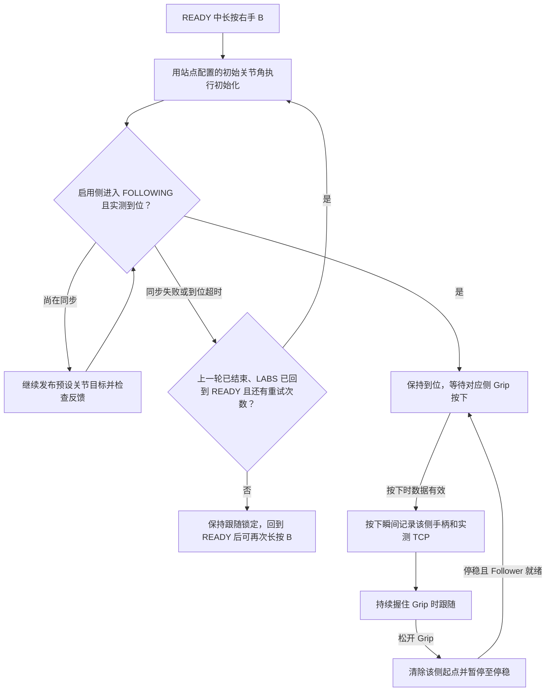
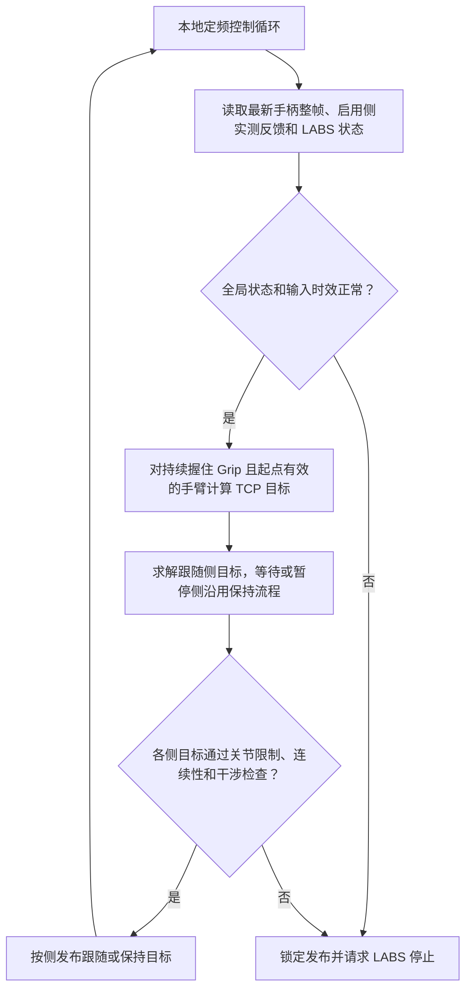
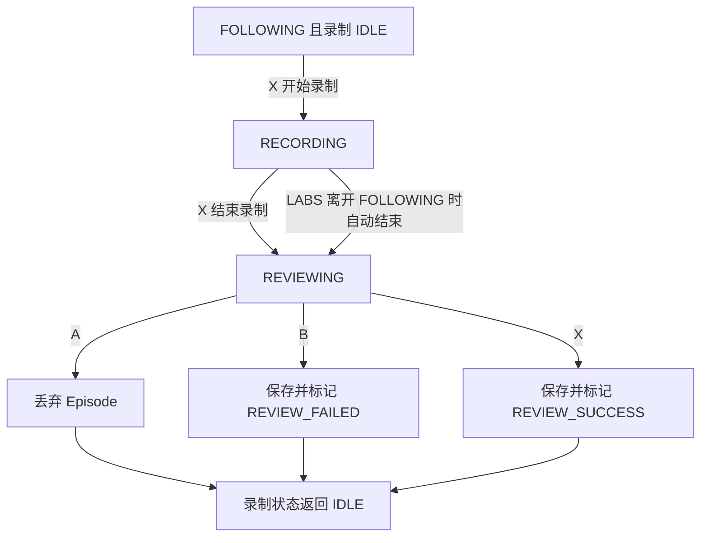
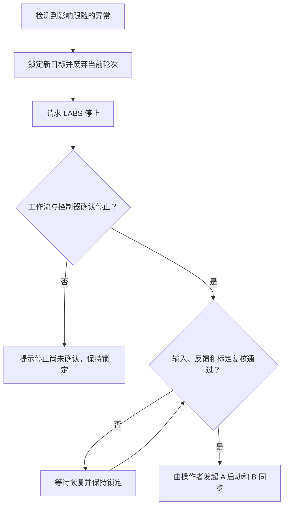

# 7. 遥操作同步、跟随及异常处理

## 7.1 GELLO 按键映射与状态判定

Quest 右手 A、右手 B、左手 X 分别对应 LABS 在 GELLO 模式下的左、中、右操作。A/B/X 的动作由 LABS 的 `workflow_state` 和 `recording_state` 一起决定，录制和审核的按键规则优先。长按 B 让启用侧移动到各自的预设关节位置。确认到位后，Grip 按第 5.2 节控制各侧取点、跟随和暂停。录制期间仍可用 Grip 控制跟随。[LABS 操作按钮配置](/home/xzz/Gitspace/labs/services/pipeline/data-collection-ui/app/components/TeleoperationActions/config.ts:15) · [录制与工作流优先级](/home/xzz/Gitspace/labs/services/pipeline/data-collection-ui/app/components/TeleoperationActions/config.ts:239)

| LABS 当前状态 | 右手 A | 右手 B | 左手 X |
| --- | --- | --- | --- |
| 遥操作 `IDLE`，录制 `IDLE` | `Start teleoperation`（启动遥操作） | 禁用 | 禁用 |
| 遥操作 `READY`，录制 `IDLE` | `Stop teleoperation`（停止遥操作） | 长按触发 `Sync robots`（同步到预设位，到位后等待 Grip） | 禁用 |
| `SYNCING` 或 `AUTORECOVERY`，录制 `IDLE` | `Stop teleoperation`（停止遥操作） | 禁用 | 禁用 |
| `FOLLOWING`，录制 `IDLE` | `Stop teleoperation`（停止遥操作） | 禁用 | `Start recording`（开始录制） |
| 录制 `RECORDING` | 禁用 | 禁用 | `Stop recording`（结束录制，进入审核） |
| 录制 `REVIEWING` | `Discard`（丢弃本轮录制） | `Save as failed`（保留本轮录制并标记失败） | `Save as successful`（保存本轮录制并标记成功） |

Bridge 将手柄各按钮映射到逻辑按键，索引由 Bridge 配置并用 Quest 实测核对。A、X 及审核时的 B 按下后触发一次请求。同步用的 B 必须在 `READY` 内持续按到配置的长按阈值，每次按住只发起一次同步。Grip 按下立即取点，持续握住维持跟随许可，松开立即撤销该侧许可。启动和重连后先观察到松开，再接受新按键。LABS 请求执行期间防止重复提交，Grip 松开和异常停止照常处理。请求结果不确定时先核对 LABS 状态及当前 Episode。

程序从站点配置读取启用侧。同步、取点和关节目标发布只处理启用的机械臂，单臂和双臂使用相同的 A/B/X 按键规则。

### 按键模块与状态机实现

本地在同一个 `quest_teleop` 服务中使用 Python 开发，ROS 2 订阅、定时器和发布由 `rclpy` 接入。按功能拆成 Python 模块，共用进程内的数据快照，不为每个模块单独建 ROS 2 节点。按键识别和状态转换可以脱离 ROS 2 测试。

- **`button_mapper`：** 输入为 Bridge 校验后的手柄整帧。保存各键上一次有效状态，用会话号和帧序号识别新帧。会话切换或重连时清除按键历史。输出带侧别、帧序号和时间的 A/B/X 事件，以及各侧 Grip 的按下、持续握持和松开状态。Grip 状态不可读时撤销该侧跟随许可，重新读到松开并再次按下后才可取点。
- **`teleop_state_machine`：** 维护同步轮次、待确认请求和各侧跟随轮次。LABS 上报的 `workflow_state`、`recording_state` 和 Episode 单独保存。LABS 可以保持 `FOLLOWING`，而各侧分别处于等待 Grip、跟随或暂停停稳。状态机串行处理按键、接口结果和状态更新。
- **发布许可：** 每侧同一时刻只允许发布同步目标、保持目标或相对跟随目标中的一种。每次有效按下 Grip 建立该侧新轮次，松开时立即撤销许可并废弃起点和未发布的候选。异步结果带请求编号，旧结果不能覆盖新轮次的状态或恢复发布许可。

## 7.2 A 键启动与停止遥操作

1. `IDLE` 时按 A，通过 LABS 启动接口建立遥操作。等待 LABS 进入 `READY`，并检查 Bridge、启用侧的实测反馈、映射参数和转发链路。完成后提示 `Ready. Hold B to sync the robots.`（已就绪，长按 B 同步）。
2. 在允许停止的状态按 A，立即禁止新的相对跟随目标，发出 LABS 停止请求，确认工作流回到 `IDLE`，随后清除同步目标、起点和待发布的求解结果。停止结果未知时保持锁定并提示 `Stop not confirmed.`（停止尚未确认）。
3. 录制 `REVIEWING` 时按 A 执行丢弃当前 Episode。成功后录制状态回到 `IDLE`，之后按 A 再根据当前遥操作状态执行启停。

### LABS 客户端与启停实现

`labs_client` 封装读取状态、启动、同步、停止和录制接口，统一返回响应状态、业务结果及超时信息。HTTP 请求在独立的 I/O 任务中执行，设置连接和响应时限；结果带请求编号回到状态机。HTTP 成功只表示请求得到响应，操作完成以 LABS 返回的业务结果和后续状态为准。

- **启动：** 收到 A 后先核对 LABS 最近的状态，必要时刷新；仅在允许启动时提交请求。请求等待期间不授权相对跟随。确认进入 `READY`，且反馈、映射和转发链路就绪后，才接受 B 同步。
- **停止：** A 在允许停止时发出停止事件。状态机先撤销同步和跟随两种发布许可，使当前轮次失效，再请求 LABS 停止；停止请求不排在普通录制或查询请求后面。旧的启动或同步请求如果仍可能在 LABS 生效，保持输出锁定，并复查 LABS 和控制器状态。确认远端已经停止后，才允许下一轮启动。
- **边界：** WSS 收包、ROS 2 反馈回调、跟随定时器和发布入口都不等待 HTTP。请求超时以后先查状态；在上一请求结果不明时，不自动重发会改变 LABS 状态的同类请求。

## 7.3 B 键同步与 Grip 跟随启动

1. **初始化关节。** 在 `READY` 中长按右手 B，读取各启用侧在站点配置中的初始关节角。关节反馈和初始化条件就绪后，先在各启用侧的 Leader 话题定频发布初始关节目标，再请求 LABS 同步。同步期间持续发布这组目标并更新消息时间戳，手柄运动只更新输入缓存。
2. **同步失败就重试。** 普通同步失败或到位超时只记录重试信息，不弹出错误。先确认上一轮已结束且 LABS 已回到 `READY`，再重新执行关节初始化。接口响应超时但执行结果未知时，先查询 LABS 状态，不重复发送请求。自动重试次数由配置限制，次数用完后，待 LABS 回到 `READY` 再由操作者长按 B 重试。断线、反馈过期或控制器故障时，锁定输出并请求 LABS 停止。
3. **到位后等待 Grip。** LABS 确认启用侧进入 `FOLLOWING`，且各侧实测关节角与预设关节角的差值均在到位容差内后，继续定频发送预设关节角作为保持目标。此时可等待操作者按下 Grip。到位时已按住的 Grip 需要松开再按。
4. **按侧取点和跟随。** 按下 Grip 的当帧，用该侧有效的手柄位姿和时间接近的实测关节反馈建立起点。按下当帧的数据无效时，等数据恢复后重新按下。首个跟随关节目标通过连续性检查后，持续握住 Grip 即可跟随。
5. **松开 Grip 暂停对应侧。** 停止更新该侧的手柄跟随目标，清除起点，执行经联调验证的保持停稳流程。暂停期间需要继续定频发送有效的保持目标，单纯停发可能让现有 Follower 超时退出。该臂停稳且 Follower 保持就绪后，再按 Grip 即可重新取点。保持路径未验证或执行失败时，走 LABS 停止流程，恢复后重新执行 A 启动和 B 同步。[FR3 Follower 目标超时处理](/home/xzz/Gitspace/labs/services/actuators/franka-robot/src/third_party/franka_follower_controllers/src/joint_follower_controller.cpp:87)

### 同步与自动重试实现

1. **建立初始化轮次。** 状态机接收 B 事件后，为启用侧加载站点配置中的初始关节角，检查 J1 至 J7 的数量、顺序、限位及反馈时效。固定本轮初始化目标，由统一发布入口按周期发送；确认已开始发送后，再让 `labs_client` 提交同步请求。同步目标与请求结果都带本轮标识。
2. **处理同步结果。** 普通失败或到位超时先结束本轮，不弹出错误。确认上一轮已结束、LABS 已回到 `READY` 且重试次数未用完时，再建立新轮次并重新初始化。接口响应超时且结果未知时先查 LABS 状态。联调时须核实 LABS 回到 `READY` 的恢复路径，恢复路径未确认时保持锁定。
3. **按侧交接给跟随循环。** 每次有效按下 Grip 时，保留该侧的按键帧和实测关节快照，供 TCP 起点和肘部参考计算。首个 TCP 目标用取点帧计算，再检查求得的关节目标与该侧最后一条已发保持目标是否连续。通过后切换该侧发布许可，由同一出口发布，后续再按新手柄帧更新。求解期间如果 Grip 松开，废弃该次候选，保持暂停。

## 7.4 持续跟随的实现与开发

| 模块 | 开发内容 | 输出 |
| --- | --- | --- |
| 按键与状态模块 | 读取按键、LABS 状态和操作结果，维护各侧跟随轮次，负责启动、同步和停止请求 | 当前允许的操作和各侧发布许可 |
| 跟随控制循环 | 定频读取手柄整帧和实测反馈，只对已取点且持续握住 Grip 的侧更新 TCP 目标 | 跟随侧的 TCP 目标 |
| 笛卡尔与肘部求解 | 用实测关节角及上一条已发布命令求解跟随侧的七关节目标，双臂时与另一侧的跟随或保持目标一并检查 | 各跟随侧的七关节候选目标和诊断 |
| Leader 发布 | 复查 LABS 状态、按侧许可和轮次，按 J1 至 J7 顺序填写 `JointState.position`，使用本次生成或刷新目标时的 ROS 时间戳 | 对应侧 Leader 消息 |

WebSocket 接收只更新最新输入缓存。控制循环按配置周期取最新数据，检查 Quest 帧、启用侧实测反馈和 LABS 状态是否都在各自时效内。求解耗时超出周期、状态在求解中变化或跟随轮次失效时，废弃该周期候选结果。发布记录中保留输入帧和实际发出的关节目标，便于定位时序和串臂问题。

开发时先用固定的离线手柄帧和关节反馈打通取点、TCP 映射和关节输出，再接仿真控制器验证实时闭环。双臂模式下左右映射和求解各自独立，发布前对两侧候选目标一起检查。

### 跟随循环与关节目标发布实现

| 代码模块 | 实现职责 |
| --- | --- |
| `input_bridge` / `ros_adapter` | WSS 接收端保留最新一帧校验后的手柄数据，ROS 2 反馈回调按侧更新最新有效关节快照。快照包含采样或消息时间及本机接收时间，供循环判断时效。运动求解和 LABS HTTP 调用分别由各自任务执行。 |
| `follow_loop` | 由 `rclpy` 定时驱动，同一时刻最多运行一个周期。按各侧快照决定保持或更新跟随目标。Grip 仍有效且握住时，偶发无效位姿只跳过该侧本次跟随更新。上一周期未完成时跳过新周期，不积压求解任务。 |
| `motion_solver` | 接收 TCP 目标、实测关节角、上一条实际发布目标及肘部参考，返回候选七关节目标和诊断。双臂运行时，先一并检查两侧跟随或保持目标的限位、连续性及干涉，再提交发布。求解模块不持有 ROS 发布者。 |
| `joint_target_publisher` | 唯一持有 Leader 话题发布者，按各侧许可发送同步、保持或跟随目标。按 J1 至 J7 填写 `JointState`，记录实际发布的目标、时间和输入帧序号。 |

控制循环读取一份只读快照后，在锁外完成映射和求解，避免占住输入更新。候选结果保留计算开始时的轮次标识和周期截止时间。提交发布前，发布模块重新核对**当前轮次、许可类型、候选与反馈时效、LABS 状态**。候选过期或许可变化就丢弃。最终校验与本地发布提交要和撤销许可串行处理，避免出现“刚检查通过，随后收到停止，最后才发布旧目标”；临界区不执行求解或 HTTP 请求。双臂目标一并校验，各侧仍通过独立话题发送，不把两次 ROS 2 发布视为原子交付。

ROS 2 输入回调与控制定时器使用不同回调组，控制定时器禁止自身重入。定频循环只负责上层目标更新。先用 Python 实现并记录求解耗时、发布间隔和超周期次数；双臂仿真如果证明瓶颈来自求解或干涉检查，再替换该模块的实现，状态机和 LABS 客户端仍保留在 Python。

## 7.5 X 键录制与 A/B/X 审核

开始录制使用当前选中的 `task_id`，并保存 LABS 返回的 Episode ID。录制中按 X 只结束本轮，确认进入 `REVIEWING` 后，下一次按键才决定审核结果。A 丢弃，B 保留数据并标成失败，X 保留数据并标成成功。审核动作只处理 LABS 当前待审核的 Episode。操作报错或响应超时后，先复查录制状态和 Episode ID。页面与终端提示使用表中英文文案，括号内为中文说明。[LABS 录制和审核接口](/home/xzz/Gitspace/labs/services/pipeline/data-collection/src/handlers/recording.py:24) · [LABS 录制状态机](/home/xzz/Gitspace/labs/services/pipeline/data-collection/src/state_machine/recording.py:32)

### 录制与审核实现

录制动作复用 `labs_client` 的异步请求机制，由状态机结合当前录制状态决定 X 是开始还是结束。发起操作时保存请求编号、`task_id` 和当时的 Episode ID；审核前核对 LABS 当前待审核的仍是这个 Episode。接口超时先查询录制状态和 Episode，查清后再决定下一步。旧请求返回时若 Episode 或请求编号已经变化，不更新当前轮的本地记录。录制请求在等待期间不占用控制定时器，也不能拦住异常停止。

## 7.6 异常停止与恢复

| 异常 | 处理方式 |
| --- | --- |
| 偶发无效手柄位姿，Grip 仍有效且握住，输入未超时 | 跳过该侧本次跟随更新，保留本轮起点。后续有效数据继续用于跟随 |
| 单侧 Grip 状态不可读 | 暂停该侧并清除起点。恢复读取且停稳后，重新松开并按下 Grip 取点 |
| WSS 断开、任一启用侧手柄输入超时或参考空间重置 | 锁定所有启用侧的目标发布，清空旧输入和起点，请求 LABS 停止。参考空间变化后复核手柄运动与工位轴向是否一致 |
| 任一侧实测关节过期、求解失败或目标超限 | 丢弃本周期所有启用侧的候选目标，锁定输出并走 LABS 停止流程。记录侧别和原因 |
| LABS 离开 `FOLLOWING` 或发生 `AUTORECOVERY` | 使当前轮次失效。录制中由 LABS 的自动结束逻辑把 Episode 转入待审核，等待操作者决策 |
| 停止响应超时 | 保持锁定并显示 `Stop not confirmed.`（停止尚未确认），通过站点停止手段处置并核对实际控制器状态 |

Bridge 按侧报告输入超时。触发 LABS 停止时，确认所有启用侧控制器已停止，并核对 LABS 工作流状态。Quest 进程退出时，由部署侧监督和机器人既有停止机制处理。恢复前先处理待审核的 Episode，再按 A 启动、长按 B 同步。确认到位后重新按对应侧 Grip 取点。[LABS 停止实现](/home/xzz/Gitspace/labs/services/pipeline/data-collection/src/services/teleop.py:105) · [录制自动结束](/home/xzz/Gitspace/labs/services/pipeline/data-collection/src/state_machine/recording_autostop.py:20)

### 故障检测与停止实现

Bridge、反馈回调和跟随循环只报告各自检测到的故障和侧别，状态机统一判定是否需要停止。同一故障重复上报时复用当前停止流程，不重复堆积请求。对输入与反馈超时使用本地单调时钟；ROS 时间用于消息时间戳，不用于计算本地等待时长。超时巡检独立于 WSS 新帧到达，即使收包停止也能发现断流。

一旦判定需要停止，先撤销发布许可、作废当前轮次并让未完成的候选失效，再由客户端异步请求停止。跟随循环没有新目标可发时仍保持停止确认流程。进程崩溃无法由本进程发出停止请求：由部署侧监督进程存活，并在集成测试中实测 Follower 收不到目标后的行为。应用层锁定只约束新的发布，已送出的目标及机械臂实际停稳情况仍需由下游验证。

## 7.7 联调与验收

- 验证按 A 进入 `READY`、长按 B 让各臂到达各自预设关节位置。模拟一次普通同步失败，确认上一轮结束且回到 `READY` 后能重新初始化。接口结果未知时不得重复发起同步。
- 验证同步前握住 Grip 不取点，到位后松开再按才取点。测试单侧按下、双侧同时跟随、单侧先松开、两侧松开、停稳后重新按下，以及两次进入跟随的首帧连续性。核对等候或暂停侧的目标仍按周期更新且实际停稳。
- 测试偶发无效位姿、Grip 不可读、单侧输入超时、求解失败、断线和参考空间重置。确认偶发位姿失效时仍按 Grip 状态判断该侧许可，触发 LABS 停止后须重新同步和按 Grip 取点。
- 录制状态下验证 A、B 禁用、X 结束录制。进入审核后分别验证 A 丢弃、B 保存失败、X 保存成功，核对 Episode ID、数据及标签。
- 验证按住、长按、连续按键和请求超时。确认同一次按下只发起一次操作，状态异常时保留正确的停止或审核入口。

### Gazebo 联调与真机接入

1. **Gazebo 映射联调。** 在 Gazebo 中加载 FR3 模型，用 Quest 手柄驱动相对位姿映射和关节求解。在终端输出 TCP 目标位姿、目标与仿真实测关节角，以及控制器输出的关节力矩。确认手柄与机械臂的对应关系、运动方向和关节顺序，核对跟随时目标是否连续。
2. **接入 FR3 真机。** 确认工位停止方式和控制器状态，進行跟随，观察 TCP 目标、关节目标与力矩反馈。
