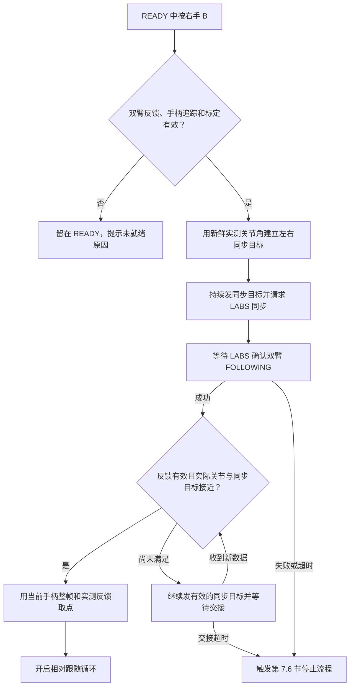
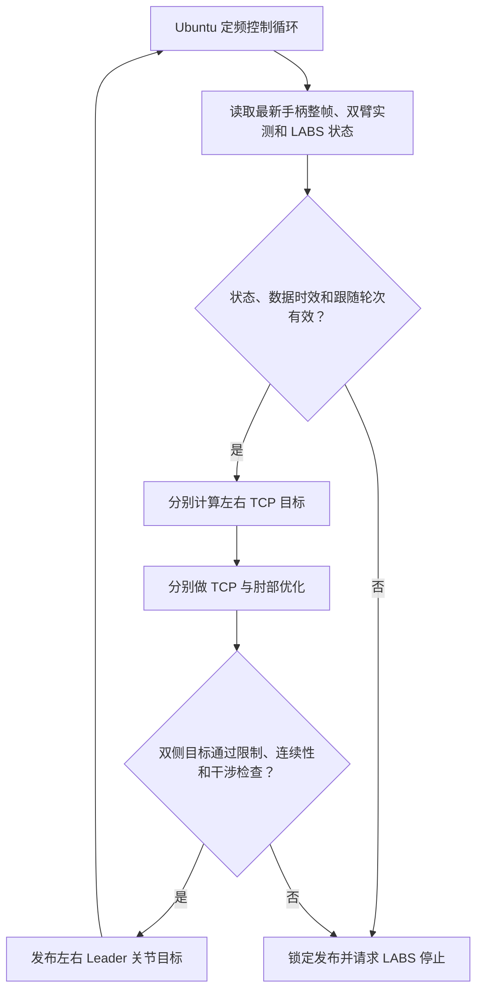
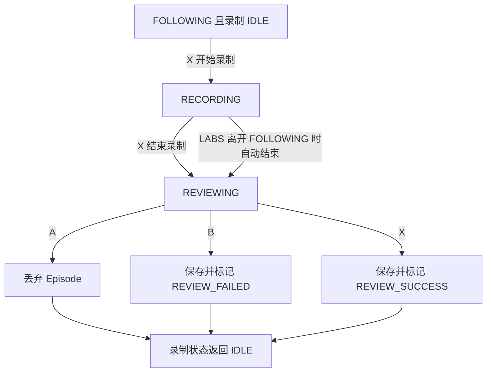
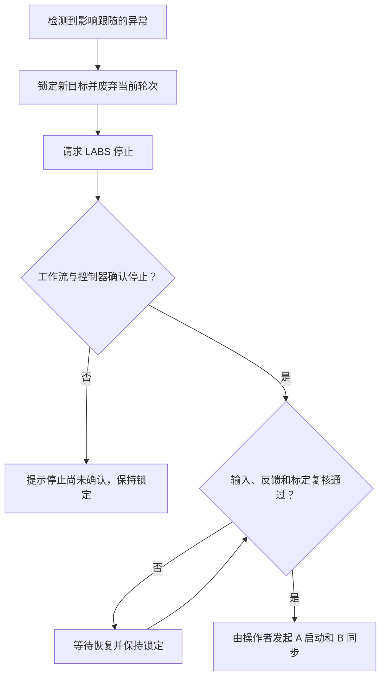

# 7. 遥操作同步、跟随及异常处理

## 7.1 GELLO 按键映射与状态判定

Quest 右手 A、右手 B、左手 X 分别对应 LABS 在 GELLO 模式下的左、中、右操作。按键动作由 LABS 的 `workflow_state` 和 `recording_state` 一起决定。录制中和待审核状态优先于遥操作状态。B 在 `READY` 发起同步，双臂同步完成后开始相对跟随。跟随起点由程序自动采集。[LABS 操作按钮配置](/home/xzz/Gitspace/labs/services/pipeline/data-collection-ui/app/components/TeleoperationActions/config.ts:15) · [录制与工作流优先级](/home/xzz/Gitspace/labs/services/pipeline/data-collection-ui/app/components/TeleoperationActions/config.ts:239)

| LABS 当前状态 | 右手 A | 右手 B | 左手 X |
| --- | --- | --- | --- |
| 遥操作 `IDLE`，录制 `IDLE` | `Start teleoperation`（启动遥操作） | 禁用 | 禁用 |
| 遥操作 `READY`，录制 `IDLE` | `Stop teleoperation`（停止遥操作） | `Sync robots`（发起同步，完成后进入跟随） | 禁用 |
| `SYNCING` 或 `AUTORECOVERY`，录制 `IDLE` | `Stop teleoperation`（停止遥操作） | 禁用 | 禁用 |
| `FOLLOWING`，录制 `IDLE` | `Stop teleoperation`（停止遥操作） | 禁用 | `Start recording`（开始录制） |
| 录制 `RECORDING` | 禁用 | 禁用 | `Stop recording`（结束录制，进入审核） |
| 录制 `REVIEWING` | `Discard`（丢弃本轮录制） | `Save as failed`（保留本轮录制并标记失败） | `Save as successful`（保存本轮录制并标记成功） |

Bridge 将手柄各按钮映射到逻辑按键。实际索引通过第 3 章的配置和 Quest 实测校验。按键模块只处理有效的松开→按下边沿，按住时只产生一次请求。启动和重连后先看到松开再接受新按键。每次请求先读取 LABS 当前状态，单个动作执行期间锁住后续按键操作。调用结果以 LABS 响应和状态变化为准。结果不确定时先核对状态及当前 Episode，再允许下一次操作。

本章按双臂部署描述。实现中从站点配置读取启用的机械臂集合。第 9 章单臂验收时，同步、取点和发布只检查启用侧，A/B/X 的功能保持一致。

## 7.2 A 键启动与停止遥操作

1. `IDLE` 时按 A，通过 LABS 启动接口建立遥操作。等待 LABS 进入 `READY`，并检查 Bridge、双臂反馈、映射参数和转发链路。完成后提示 `Ready. Press B to sync the robots.`（已就绪，按 B 同步）。
2. 在允许停止的状态按 A，立即禁止新的相对跟随目标，发出 LABS 停止请求，确认工作流回到 `IDLE`，随后清除同步目标、起点和待发布的求解结果。停止结果未知时保持锁定并提示 `Stop not confirmed.`（停止尚未确认）。
3. 录制 `REVIEWING` 时按 A 执行丢弃当前 Episode。成功后录制状态回到 `IDLE`，之后按 A 再根据当前遥操作状态执行启停。

## 7.3 B 键同步并启动跟随

1. **发同步目标。** 收到 B 后按左右侧保存最新实测 J1 至 J7，作为本轮同步目标。先启动两个 Leader 的定频发布，再调用 LABS 同步接口。同步阶段持续发送这组关节目标并更新消息时间戳。手柄运动只更新输入缓存。
2. **等实际确认。** 现有 LABS 工作流在各控制器 Coordinator 都进入 `FOLLOWING` 后才切换工作流。Quest 再检查反馈新鲜度以及实测关节距离同步目标是否在交接容差内。这个容差和等待时限由仿真确定并记入配置。[LABS Franka 工作流](/home/xzz/Gitspace/labs/services/pipeline/data-collection/src/state_machine/franka_workflow.py:41) · [双臂跟随确认](/home/xzz/Gitspace/labs/services/pipeline/data-collection/src/state_machine/franka_workflow.py:93)
3. **交接到跟随。** 用同一帧有效的左右手柄数据和时间接近的两侧反馈按第 5 章取点。首帧相对位移和旋转增量为零，目标 TCP 等于实测起点。检查首个七关节目标与上一同步目标的间隔和连续性，合格后才从同步目标切换到相对跟随目标。

## 7.4 持续跟随的实现与开发

| 模块 | 开发内容 | 输出 |
| --- | --- | --- |
| 按键与状态模块 | 读取有效按键、LABS 状态和操作结果，维护当前跟随轮次，负责启动、同步和停止请求 | 当前允许的操作、跟随发布许可 |
| 跟随控制循环 | 在 Ubuntu 定频执行，读取最新手柄整帧和实测反馈快照。通过许可和时效检查后，按第 5 章分别生成 TCP 目标 | 左右臂 TCP 目标 |
| 笛卡尔与肘部求解 | 按第 6 章读取当前关节角和上一条已发布命令，分别求解并校验，检查成对目标 | 左右七关节候选目标和诊断 |
| Leader 发布 | 复查 LABS 状态和跟随轮次，按第 3 章填充时间戳及 J1 至 J7 的 `JointState.position` | 对应侧 Leader 消息 |

WebSocket 接收只更新最新输入缓存。控制循环按配置周期取最新数据，检查 Quest 帧、双臂反馈和 LABS 状态是否都在各自时效内。求解耗时超出周期、状态在求解中变化或跟随轮次失效时，废弃该周期候选结果。发布记录中保留输入帧和实际发出的两侧目标，便于定位时序和串臂问题。

开发时先用固定的离线手柄帧和关节反馈打通取点、TCP 映射和关节输出，再接仿真控制器验证实时闭环。双臂模式下左右映射和求解各自独立，发布前对两侧候选目标一起检查。

## 7.5 X 键录制与 A/B/X 审核

开始录制使用当前选中的 `task_id`，并保存 LABS 返回的 Episode ID。录制中按 X 只结束本轮，确认进入 `REVIEWING` 后，下一次按键才决定审核结果。A 丢弃，B 保留数据并标成失败，X 保留数据并标成成功。审核动作只处理 LABS 当前待审核的 Episode。操作报错或响应超时后，先复查录制状态和 Episode ID。页面与终端提示使用表中英文文案，括号内为中文说明。[LABS 录制和审核接口](/home/xzz/Gitspace/labs/services/pipeline/data-collection/src/handlers/recording.py:24) · [LABS 录制状态机](/home/xzz/Gitspace/labs/services/pipeline/data-collection/src/state_machine/recording.py:32)

## 7.6 异常停止与恢复

| 异常 | 首版处理 |
| --- | --- |
| WSS 断线、手柄丢追踪或参考空间重置 | 锁定两侧跟随发布，清空旧输入和起点，走 LABS 停止流程。参考空间变化后复核第 4 章方向 |
| 任一侧实测关节过期、求解失败或目标超限 | 丢弃本周期两侧候选目标，锁定输出并走 LABS 停止流程。记录侧别和原因 |
| LABS 离开 `FOLLOWING` 或发生 `AUTORECOVERY` | 使当前轮次失效。录制中由 LABS 的自动结束逻辑把 Episode 转入待审核，等待操作者决策 |
| 停止响应超时 | 保持锁定并显示 `Stop not confirmed.`（停止尚未确认），通过站点停止手段处置并核对实际控制器状态 |

第 3 章的 Bridge 按侧报告输入失效。首版双臂执行层按上表统一停止，并确认工作流和控制器状态。若运行进程自身退出，由部署侧监督和机器人既有停止机制处理，具体反应在第 9 章验证。恢复后若有待审核 Episode，先按第 7.5 节处理，再按 A 启动、B 同步并采集新起点。[LABS 停止实现](/home/xzz/Gitspace/labs/services/pipeline/data-collection/src/services/teleop.py:105) · [录制自动结束](/home/xzz/Gitspace/labs/services/pipeline/data-collection/src/state_machine/recording_autostop.py:20)

## 7.7 联调与验收

- 验证 `IDLE` 按 A 进入 `READY`，按 B 完成同步并开始跟随，首帧目标与实际姿态连续。
- 测试左右手柄各自运动、双手同时运动、单侧求解失败、断线和参考空间重置。确认恢复连接后需重新走同步流程。
- 录制状态下验证 A、B 禁用、X 结束录制。进入审核后分别验证 A 丢弃、B 保存失败、X 保存成功，核对 Episode ID、数据及标签。
- 验证按住、长按、连续按键和请求超时。确认同一次按下只发起一次操作，状态异常时保留正确的停止或审核入口。
