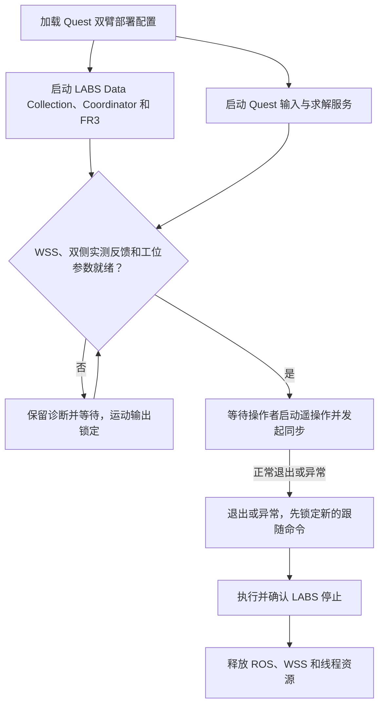

# 8. LABS 控制接入

## 8.1 仓库与服务组织

Quest 的采集输入、标定、映射和求解放在独立 `quest_teleop` 仓库。LABS 负责服务构建、工位配置、控制器生命周期和录制。目录按现有输入服务的组织方式新增，子模块固定到已推送的提交。[LABS 现有输入子模块](/home/xzz/Gitspace/labs/.gitmodules:4)

| 位置 | 开发内容 |
| --- | --- |
| `services/input/franka-quest/src/third_party/quest_teleop` | Quest 开发代码的子模块位置 |
| `services/input/franka-quest/` | 新增 Dockerfile、启动脚本和服务 Compose 配置 |
| `deployments/fr3_duo_quest/` | 计划新增的 Quest 双臂部署目录，放站点配置、运行参数、Tilt 与生产 Compose 入口 |

Quest Bridge 和跟随程序在同一 Ubuntu 服务进程内共享校验后的整帧。求解和周期发布使用独立于网络收包及 LABS API 请求的执行循环，避免某个接口等待时阻塞手柄数据或关节目标更新。

### 子模块与服务构建

1. **在 `quest_teleop` 开发程序。** Ubuntu 端用 Python 和 `rclpy`，把 Bridge、遥操作状态机、LABS 客户端、跟随循环和关节目标发布作为同一服务内的模块。手柄整帧在服务内传递，LABS 通过 ROS 2 接收关节目标，不直接读取手柄数据。
2. **在 LABS 封装服务。** 由 Dockerfile 安装目标 ROS 2 发行版对应的依赖并构建 Quest 软件包。启动脚本加载 ROS 2 环境，读取挂载的站点配置和 `calibration.yaml`，再用 `exec` 启动 Quest 进程，使容器停止信号能传给程序。WSS 证书和私钥运行时挂载，初始化关节角及工位参数由配置提供。
3. **在站点接入服务。** 将 Quest 服务加入开发用 Tilt、站点 Compose 和生产构建入口。开发和生产使用相同的服务入口及配置字段。每次更新 Quest 功能，先提交到 `quest_teleop`，再更新 LABS 记录的子模块提交，便于按版本重建镜像。

## 8.2 双臂站点与运行配置

1. **配置入口。** 以现有 FR3 双臂部署为基线新增 Quest 部署。配置文件中列明两侧命名空间、FR3 模型、关节顺序、目标入口、反馈来源和工具 TCP。在左右命名空间下，将 `leader/quest/joint_states` 设为目标入口，订阅 `franka_robot_state_broadcaster/measured_joint_states` 读取实测反馈。目标和反馈均用 `sensor_msgs/msg/JointState`。[FR3 双臂配置](/home/xzz/Gitspace/labs/deployments/fr3_duo_example/config_franka_robot.yml:1)
2. **选择唯一目标源。** Quest 部署启用 Quest Leader 路由。GELLO 部署使用原路由。每个运行站点每侧只将一个控制源转发到 Follower。用独立部署配置区分两种控制源，启动时检查匹配关系。
3. **对齐控制和录制出口。** Quest 站点的 LABS 转发、FR3 控制器订阅和 MCAP 目标录制统一使用对应侧的 `follower/quest/joint_states`。核对录制的关节顺序及实测反馈来源。另行录制手柄原始数据时，使用录制配置显式加入对应条目。[数据录制话题解析](/home/xzz/Gitspace/labs/services/pipeline/data-recorder/src/configs/record_topics.py:37)
4. **区分仿真和真机配置。** 仿真及模拟硬件使用独立配置，明确机器人地址、工具、控制参数和 ROS 2 通信配置。现有 FR3 双臂例程两侧的 `mock_hardware` 默认是 `false`，验证前检查当前实际加载的配置。[FR3 硬件模式](/home/xzz/Gitspace/labs/deployments/fr3_duo_example/config_franka_robot.yml:5)

### 站点配置与路由实现

从现有 FR3 双臂站点派生 Quest 部署，分别配置 `left_arm`、`right_arm` 的命名空间、Leader 入口与实测反馈来源。每侧的链路是：**Quest 发布到 `leader/quest/joint_states` → LABS 转发到 `follower/quest/joint_states` → 同侧 FR3 Follower 执行**。以下修改只用于 Quest 站点，GELLO 站点保留原配置。

| Quest 站点配置文件 | 修改项 | 设置 |
| --- | --- | --- |
| `config_station.yml` | `left_arm`、`right_arm` 的 `leader_topic` 和 `follower_topic` | 分别设为相对名称 `leader/quest/joint_states` 和 `follower/quest/joint_states`，由已有左右命名空间解析。 |
| `config_franka_robot.yml` | 两侧控制器的 `target_topic_name` | 均设为相对名称 `follower/quest/joint_states`，与同侧 LABS 转发出口解析为同一个完整话题。 |
| `config_contract_gr00t.yml` | 左右臂 `action` 的录制目标话题 | 左臂用 `/left/follower/quest/joint_states`，右臂用 `/right/follower/quest/joint_states`。实测关节反馈仍录原有的反馈话题。 |

- **Quest 参数：** 启动时读取启用侧、J1 至 J7 的关节名及初始关节角，同时加载两臂安装变换、工具 TCP、运动限制和标定结果。启动时核对初始关节角的数量、顺序及限位；配置缺失或左右对应关系错误时不放行运动目标。
- **环境配置：** Gazebo 和真机分别使用独立启动配置，明确控制器、反馈来源和设备连接方式。Gazebo 联调时不启用真机硬件接口。核对 Quest、LABS 和 Follower 的 ROS 2 发现设置及话题 QoS；检查时间戳的组件应使用同一 ROS 时间基准。
- **联调检查：** LABS 转发节点建立后，用 `ros2 topic info --verbose <话题名>` 核对每侧 Leader/Follower 的发布者、订阅者与 QoS，再核对反馈关节名和顺序。发现 Follower 有第二个目标发布源时，先排除冲突再做同步。

## 8.3 服务启动、状态与退出

开发部署在 Tilt 和站点 Compose 中加入 Quest 服务的构建、配置挂载和启动。生产部署加入站点构建清单和 Compose 服务，保证构建产物与运行配置一一对应。日志分别记录 WSS 状态、FR3 反馈、LABS 工作流和目标发布状态。

启动后运动输出默认锁定，操作者发起同步后才允许发布同步目标；LABS 确认进入 `FOLLOWING` 且取点及首帧检查通过后，才发布相对跟随目标。正常退出先请求并确认 LABS 停止，再释放 ROS 发布者、WSS 连接和工作线程。服务崩溃由外部进程监控检测，在部署联调中验证停止路径及重启后的初始锁定状态。

### 启动脚本与退出处理

- **启动：** 配置加载成功后，启动 WSS、ROS 2 反馈订阅和 LABS 状态读取。Compose 负责进程启动顺序；Quest 程序单独检查 LABS API、手柄输入、反馈和工位参数是否就绪。若转发节点在 A 启动遥操作后才创建，则在接受 B 同步前检查转发链路。容器运行或接口可达都不自动开启运动输出。
- **运行：** 日志分别显示 WSS 连接、各侧反馈时效、LABS 工作流和发布许可。状态查询、录制和同步的 HTTP 等待放在独立 I/O 任务，收包、反馈回调和定频发布继续运行。
- **退出：** 收到停止信号后，先撤销同步和跟随许可并作废当前轮次，再请求 LABS 停止。等待停止确认有时限；无法确认时记录状态并保持锁定，不能把容器退出当作机械臂已停稳。正常关闭时再释放 ROS 2 节点、WSS 和工作任务。进程崩溃由进程外的监督和机器人既有停止机制处理；服务重启后保持锁定，由操作者重新启动和同步。

## 8.4 LABS 接口接入

Quest 服务在 Ubuntu 端调用 Data Collection 后端。响应体和当前系统状态都用于判断是否成功，尤其是录制接口可能用成功的 HTTP 状态返回业务错误。

| 动作 | LABS 后端接口 | Quest 侧处理 |
| --- | --- | --- |
| 获取系统状态 | `GET /api/v1/system/info` | 读取 `workflow_state`、`recording_state` 和当前 Episode |
| 启动遥操作 | `POST /api/v1/teleop/start` | 等待 `READY`，确认两侧反馈和转发链路 |
| 发起同步 | `POST /api/v1/teleop/start_syncing` | 先发布同步目标，等待 LABS 确认 `FOLLOWING` |
| 停止遥操作 | `POST /api/v1/teleop/stop` | 锁定新的跟随命令，确认 `IDLE` 及控制器状态 |
| 开始录制 | `POST /api/v1/recording/start` | 通过查询参数传入当前任务的 `task_id`，记录 Episode ID |
| 结束录制 | `POST /api/v1/recording/stop` | 等待进入 `REVIEWING` |
| 保存审核结果 | `POST /api/v1/recording/save` | 用查询参数 `label` 指定 `REVIEW_SUCCESS` 或 `REVIEW_FAILED` |
| 丢弃录制 | `POST /api/v1/recording/discard` | 丢弃当前待审核的 Episode，确认录制状态 |

站点配置或任务选择结果向 Quest 服务提供有效的 `task_id`。使用 LABS Web 页面选任务时，接入层要把选择结果传给 Ubuntu 服务，网页会话里的任务上下文由 LABS UI 管理。[系统状态接口](/home/xzz/Gitspace/labs/services/pipeline/data-collection/src/handlers/system.py:13) · [遥操作接口](/home/xzz/Gitspace/labs/services/pipeline/data-collection/src/handlers/teleop.py:16) · [录制接口](/home/xzz/Gitspace/labs/services/pipeline/data-collection/src/handlers/recording.py:24) · [LABS Web 获取任务](/home/xzz/Gitspace/labs/services/pipeline/data-collection-ui/app/routes/api/record-start.ts:7)

### Data Collection 客户端实现

在 Python 的 `labs_client` 内封装表中的接口。服务地址从部署配置读取；连接、请求和状态确认分别设置时限。客户端解析 HTTP 状态及业务结果，并把结果连同请求编号返回状态机，由状态机决定是否结束操作、继续等待或锁定输出。

- **启停与同步：** 启动请求后等 LABS 确认 `READY`；同步请求在初始关节目标开始发送后提交，等 LABS 确认 `FOLLOWING` 再交接；停止时先锁定 Quest 输出，再核对 LABS 工作流及 Follower 状态。接口响应超时时先查询当前状态，避免重复执行；普通同步失败只在上一轮结束且 LABS 回到 `READY` 后重试。恢复到 `READY` 的实际路径在接入时核实。
- **录制与审核：** 开始录制时读取当前有效的 `task_id`，保存 LABS 返回的 Episode ID；结束和审核之前核对当前录制状态和 Episode。操作结果未知时先核对状态，确认后再决定下一步。客户端只执行请求，不直接修改发布许可。

## 8.5 Follower 接入与验收

接入时先在 Gazebo 核对关节目标、反馈与停止行为，随后切换到真机配置。

### Gazebo 到真机的接入步骤

1. **在 Gazebo 跑通 Quest → LABS → Follower。** 用 Quest 手柄完成同步、取点和跟随。在终端查看 TCP 目标位姿、Leader 与 Follower 的关节目标、仿真关节角和控制器输出的关节力矩。核对同侧目标是否一致、两侧是否串接、切入跟随时目标是否连续。简单走一次录制和审核，确认 Episode 内能找到关节目标和反馈。完成一次停发核对，确认下游实际如何处理目标中断。
2. **接入 FR3 真机。** 切换到独立的真机站点配置，先核对已启用侧、反馈来源、控制器状态和现场停止方式。用低速、小范围跟随确认方向、关节顺序及停止响应，再扩大范围。真机力矩以控制器提供的反馈为准；若无对应反馈，不能把仿真的关节力矩当作真机读数。
