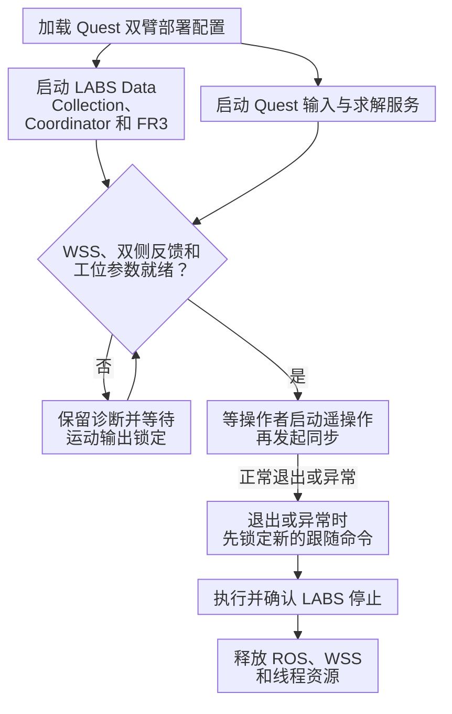

# 8. LABS 控制接入

## 8.1 仓库与服务组织

Quest 的采集输入、标定、映射和求解放在独立 `quest_teleop` 仓库。LABS 负责服务构建、工位配置、控制器生命周期和录制。目录按现有输入服务的组织方式新增。
| 位置 | 开发内容 |
| --- | --- |
| `services/input/franka-quest/src/third_party/quest_teleop` | Quest 开发代码的子模块位置 |
| `services/input/franka-quest/` | 新增 Dockerfile、启动脚本和服务 Compose 配置 |
| `deployments/fr3_duo_quest/` | 计划新增的 Quest 双臂部署目录，放配置、运行参数、Tilt 与生产 Compose 入口 |

Quest Bridge 和跟随程序在同一本地服务进程内共享校验后的整帧。求解和周期发布使用独立于网络收包及 LABS API 请求的执行循环，避免某个接口等待时阻塞手柄数据或关节目标更新。

### 子模块与服务构建

1. **在 `quest_teleop` 开发程序。** 本地用 Python 和 `rclpy`，把 Bridge、遥操作状态机、LABS 客户端、跟随循环和关节目标发布作为同一服务内的模块。手柄整帧在服务内传递，LABS 通过 ROS 2 接收关节目标，不直接读取手柄数据。
2. **在 LABS 封装服务。** 由 Dockerfile 安装目标 ROS 2 发行版对应的依赖并构建 Quest 软件包。启动脚本加载 ROS 2 环境，读取挂载的站点配置和 `calibration.yaml`，再用 `exec` 启动 Quest 进程，使容器停止信号能传给程序。WSS 证书和私钥运行时挂载，初始化关节角及工位参数由配置提供。
3. **在站点接入服务。** 将 Quest 服务加入开发用 Tilt、站点 Compose 和生产构建入口。开发和生产使用相同的服务入口及配置字段。每次更新 Quest 功能，先提交到 `quest_teleop`，再更新 LABS 记录的子模块提交，便于按版本重建镜像。

## 8.2 双臂与运行配置

1. **配置入口。** 为现有 FR3 双臂部署新增 Quest 部署。配置文件中列明两侧命名空间、FR3 模型、关节顺序、目标入口、反馈来源和工具 TCP。在左右命名空间下，将 `leader/quest/joint_states` 设为目标入口，订阅 `franka_robot_state_broadcaster/measured_joint_states` 读取实测反馈。目标和反馈均用 `sensor_msgs/msg/JointState`。
2. **选择唯一目标源。** Quest 部署启用 Quest Leader 路由。GELLO 部署使用原路由。每个运行站点每侧只将一个控制源转发到 Follower。用独立部署配置区分两种控制源，启动时检查匹配关系。
3. **对齐控制和录制出口。** Quest 站点的 LABS 转发、FR3 控制器订阅和 MCAP 目标录制统一使用对应侧的 `follower/quest/joint_states`。核对录制的关节顺序及反馈。

### 硬件配置与路由实现

从现有 FR3 双臂配置新增 Quest 部署，分别配置 `left_arm`、`right_arm` 的命名空间、Leader 入口与实测反馈来源。每侧的链路是：**Quest 发布到 `leader/quest/joint_states` → LABS 转发到 `follower/quest/joint_states` → 同侧 FR3 Follower 执行**。以下修改只用于 Quest 配置，GELLO 不变。

| Quest 配置文件 | 修改项 | 设置 |
| --- | --- | --- |
| `config_station.yml` | `left_arm`、`right_arm` 的 `leader_topic` 和 `follower_topic` | 分别设为相对名称 `leader/quest/joint_states` 和 `follower/quest/joint_states`，由已有左右命名空间解析。 |
| `config_franka_robot.yml` | 两侧控制器的 `target_topic_name` | 均设为相对名称 `follower/quest/joint_states`，与同侧 LABS 转发出口解析为同一个完整话题。 |
| `config_contract_gr00t.yml` | 左右臂 `action` 的录制目标话题 | 左臂用 `/left/follower/quest/joint_states`，右臂用 `/right/follower/quest/joint_states`。实测关节反馈仍录原有的反馈话题。 |

- **Quest 参数：** 启动时读取启用侧、J1 至 J7 的关节名及初始关节角，同时加载两臂安装变换、工具 TCP、运动限制和标定结果。启动时核对初始关节角的数量、顺序及限位；配置缺失或左右对应关系错误时不放行运动目标。
- **环境配置：** Gazebo 和真机分别使用独立启动配置，明确控制器、反馈来源和设备连接方式。Gazebo 联调时不启用真机硬件接口。核对 Quest、LABS 和 Follower 的 ROS 2 发现设置及话题 QoS；检查时间戳的组件应使用同一 ROS 时间基准。
- **联调检查：** LABS 转发节点建立后，用 `ros2 topic info --verbose <话题名>` 核对每侧 Leader/Follower 的发布者、订阅者与 QoS，再核对反馈关节名和顺序。发现 Follower 有第二个目标发布源时，先排除冲突再做同步。

## 8.3 服务启动、状态与退出

开发部署在 Tilt 和站点 Compose 中加入 Quest 服务的构建、配置挂载和启动。生产部署加入站点构建清单和 Compose 服务，保证构建产物与运行配置一一对应。日志分别记录 WSS 状态、FR3 反馈、LABS 工作流和目标发布状态。

启动后运动输出默认锁定，操作者发起同步后才允许发布同步目标。LABS 进入 `FOLLOWING` 且实测确认到位后，先发布保持目标。对应侧 Grip 按下取点、开始检查通过且仍持续握住时，才发布该侧的相对跟随目标。松开后机器人停止跟随。正常退出先请求并确认 LABS 停止，再释放 ROS 发布者、WSS 连接和工作线程。

### 启动脚本与退出处理

- **启动服务。** Quest 服务和 LABS 一起启动，开发环境用 `task start`，生产环境用 `task start-prod`。Quest 服务读取工位配置和标定文件，启动手柄接收、机器人反馈订阅和 LABS 状态读取。Quest 浏览器连接后，程序先接收手柄数据，等待操作者开始遥操作。
- **开始遥操作。** 按右手 A，LABS 进入 `READY` 并建立 Leader → Follower 转发。确认手柄、关节反馈和转发正常后，长按右手 B，让机械臂移动到各自的预设关节位置。确认到位后，按下哪侧 Grip 就为哪侧取点，持续握住时跟随，松开时暂停该侧。
- **停止遥操作。** 在允许停止的状态下按右手 A。Quest 取消本轮尚未发出的跟随目标，并调用 LABS 的停止接口，由 LABS 停用控制器并清理转发节点。核对控制器已停用、机械臂已停稳后，本轮遥操作结束。采集服务可以继续运行，等待下一次启动。
- **关闭服务。** 先结束遥操作并确认机械臂停稳，再用 `task stop` 或 `task stop-prod` 关闭服务。Quest 进程收到退出信号后，关闭 WSS 连接并释放 ROS 2 节点。服务重新启动后，再由操作者按 A 启动、长按 B 同步。

## 8.4 LABS 接口接入开发

Quest 服务在本地调用 Data Collection 后端。

| 动作 | LABS 后端接口 | Quest 侧处理 |
| --- | --- | --- |
| 获取系统状态 | `GET /api/v1/system/info` | 读取 `workflow_state`、`recording_state` 和当前 Episode |
| 启动遥操作 | `POST /api/v1/teleop/start` | 等待 `READY`，确认两侧反馈和转发链路 |
| 发起同步 | `POST /api/v1/teleop/start_syncing` | 先发布同步目标，等待 LABS 确认 `FOLLOWING` |
| 停止遥操作 | `POST /api/v1/teleop/stop` | 锁定新的跟随命令，确认 `IDLE` 及控制器状态 |
| 开始录制 | `POST /api/v1/recording/start` | `FOLLOWING` 且录制空闲时，带上选中的 `task_id`。开始成功后记录 Episode ID |
| 结束录制 | `POST /api/v1/recording/stop` | 结束当前 Episode 的录制，等待进入 `REVIEWING` |
| 保存审核结果 | `POST /api/v1/recording/save` | 待审核时保存当前 Episode，通过 `label` 标记成功 `REVIEW_SUCCESS` 或失败 `REVIEW_FAILED` |
| 丢弃录制 | `POST /api/v1/recording/discard` | 待审核时丢弃当前 Episode |

和 GELLO 一样，先在 LABS Web 的 `Change task` 里选任务。网页把选中的 `task_id` 保存在当前浏览器会话。点 `Start recording` 时，网页读取这个编号并发给 Data Collection。Quest 按键录制调用同一个后端接口，接入时需要在选任务成功后把编号传给本地 Quest 服务。按 X 时使用已确认的任务编号。

### Data Collection 客户端实现

在 Python 的 `labs_client` 内封装表中的接口。服务地址从部署配置读取；连接、请求和状态确认分别设置时限。客户端解析 HTTP 状态及业务结果，并把结果连同请求编号返回状态机，由状态机处理是否结束操作、继续等待等状态。

- **启停与同步：** 启动请求后等 LABS 确认 `READY`。同步请求在预设关节目标开始发送后提交，等 LABS 确认 `FOLLOWING` 且各启用侧实测到位后，等待 Grip 取点。整站停止时先锁定 Quest 输出，再核对 LABS 工作流及 Follower 状态。

### 录制与审核

1. **开始录制。** 机械臂同步完成，LABS 处于 `FOLLOWING` 且录制空闲时，按左手 X。Data Collection 用选中的任务编号创建 Episode，再让现有 Data Recorder 开始录制。Quest 收到成功结果后记录本轮的 Episode ID。 
2. **结束录制。** 录制中再按一次 X，结束当前 Episode 的录制，等待 LABS 进入 `REVIEWING`。
3. **审核本轮数据。** 进入 `REVIEWING` 后，按 A 丢弃，按 B 保存为失败，按 X 保存为成功，对应 GELLO 页面上的 `Discard`、`Save as failed` 和 `Save as successful`。

录制文件仍由 LABS Data Recorder 写入 MCAP。它根据工位配置录制两侧 Follower 的关节目标和已配置的 FR3 实测关节反馈。Quest 工位把关节目标换成对应侧的 Quest Follower 话题。

## 8.5 Follower 接入

接入时先在 Gazebo 核对关节目标、反馈与停止行为，随后切换到真机配置。

### Gazebo 仿真及切入机器人

1. **在 Gazebo 跑通 Quest → LABS → Follower。** 用 Quest 手柄完成同步、取点和跟随。在终端查看 TCP 目标位姿、Leader 与 Follower 的关节目标、仿真关节角和控制器输出的关节力矩。核对同侧目标是否一致、两侧是否串接、切入跟随时目标是否连续。在 LABS Web 选好任务，用 X 开始并结束一轮录制，完成审核。核对保存的 Episode 属于该任务，再检查对应的 MCAP 中是否有同侧 Follower 关节目标和 FR3 实测关节反馈。完成一次停发核对，确认下游实际如何处理目标中断。
2. **接入 FR3。** 切换到机器人配置，先核对已启用侧、反馈来源、控制器状态和现场停止方式，真机力矩以控制器提供的反馈为准。
