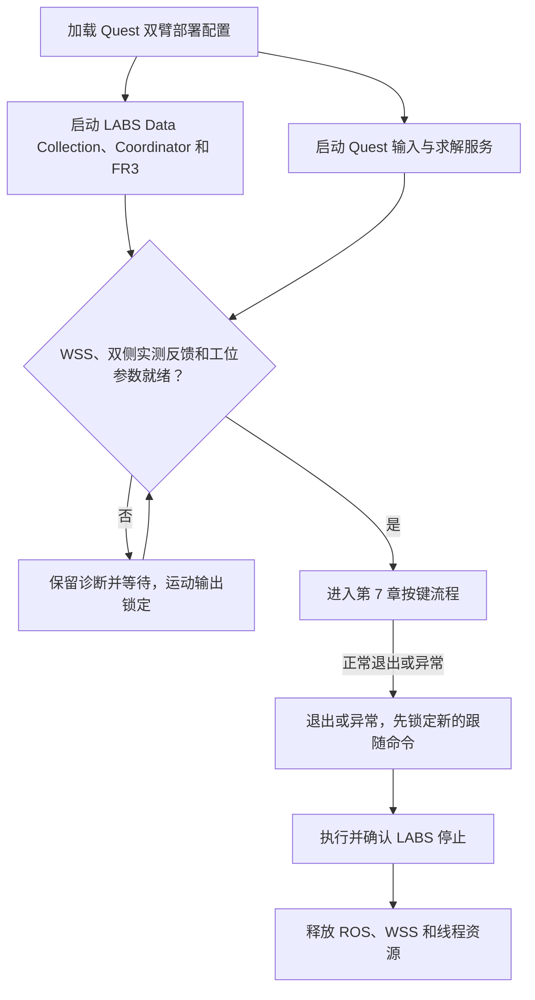

# 8. LABS 控制接入

## 8.1 仓库与服务组织

Quest 的采集输入、标定、映射和求解放在独立 `quest_teleop` 仓库。LABS 负责服务构建、工位配置、控制器生命周期和录制。目录按现有输入服务的组织方式新增，子模块固定到已推送的提交。[LABS 现有输入子模块](/home/xzz/Gitspace/labs/.gitmodules:4)

| 位置 | 开发内容 |
| --- | --- |
| `services/input/franka-quest/src/third_party/quest_teleop` | Quest 开发代码的子模块位置 |
| `services/input/franka-quest/` | 新增 Dockerfile、启动脚本和服务 Compose 配置 |
| `deployments/fr3_duo_quest/` | 计划新增的 Quest 双臂部署目录，放站点配置、运行参数、Tilt 与生产 Compose 入口 |

Quest Bridge 和跟随程序首版在同一 Ubuntu 服务进程内共享校验后的整帧。求解和周期发布使用独立于网络收包及 LABS API 请求的执行循环，避免某个接口等待时阻塞手柄数据或关节目标更新。

## 8.2 双臂站点与运行配置

1. **配置入口。** 以现有 FR3 双臂部署为基线新增 Quest 部署。配置文件中列明两侧命名空间、FR3 模型、关节顺序、目标入口、反馈来源和工具 TCP。具体话题名称与消息类型以第 3 章总表为准。[FR3 双臂配置](/home/xzz/Gitspace/labs/deployments/fr3_duo_example/config_franka_robot.yml:1)
2. **选择唯一目标源。** Quest 部署启用 Quest Leader 路由。GELLO 部署使用原路由。每个运行站点每侧只将一个控制源转发到 Follower。用独立部署配置区分两种控制源，启动时检查匹配关系。
3. **保留控制和录制出口。** Follower 的目标订阅和现有 MCAP 录制配置继续使用第 3 章列出的 Follower 话题。验证下游录制读取的关节顺序以及反馈来源。另行录制手柄原始数据时，使用录制配置显式加入对应条目。[数据录制话题解析](/home/xzz/Gitspace/labs/services/pipeline/data-recorder/src/configs/record_topics.py:37)
4. **区分仿真和真机配置。** 仿真及模拟硬件使用独立配置，明确机器人地址、工具、控制参数和 ROS 2 通信配置。现有 FR3 双臂例程两侧的 `mock_hardware` 默认是 `false`，验证前检查当前实际加载的配置。[FR3 硬件模式](/home/xzz/Gitspace/labs/deployments/fr3_duo_example/config_franka_robot.yml:5)

## 8.3 服务启动、状态与退出

开发部署在 Tilt 和站点 Compose 中加入 Quest 服务的构建、配置挂载和启动。生产部署加入站点构建清单和 Compose 服务，保证构建产物与运行配置一一对应。日志分别记录 WSS 状态、FR3 反馈、LABS 工作流和目标发布状态。

启动后运动输出默认锁定，由第 7 章的同步和跟随条件放行。正常退出先请求并确认 LABS 停止，再释放 ROS 发布者、WSS 连接和工作线程。服务崩溃由外部进程监控检测，在部署联调中验证停止路径及重启后的初始锁定状态。

## 8.4 LABS 接口接入

Quest 服务在 Ubuntu 端调用 Data Collection 后端。按键规则以第 7 章为准。响应体和当前系统状态都用于判断是否成功，尤其是录制接口可能用成功的 HTTP 状态返回业务错误。

| 动作 | LABS 后端接口 | Quest 侧处理 |
| --- | --- | --- |
| 获取系统状态 | `GET /api/v1/system/info` | 读取 `workflow_state`、`recording_state` 和当前 Episode |
| 启动遥操作 | `POST /api/v1/teleop/start` | 等待 `READY`，确认两侧反馈和转发链路 |
| 发起同步 | `POST /api/v1/teleop/start_syncing` | 先发布同步目标，等待 LABS 确认 `FOLLOWING` |
| 停止遥操作 | `POST /api/v1/teleop/stop` | 锁定新的跟随命令，确认 `IDLE` 及控制器状态 |
| 开始录制 | `POST /api/v1/recording/start` | 通过查询参数传入当前任务的 `task_id`，记录 Episode ID |
| 结束录制 | `POST /api/v1/recording/stop` | 等待进入 `REVIEWING` |
| 保存审核结果 | `POST /api/v1/recording/save` | 用查询参数 `label` 指定 `REVIEW_SUCCESS` 或 `REVIEW_FAILED` |
| 丢弃录制 | `POST /api/v1/recording/discard` | 丢弃当前待审核的 Episode，确认录制状态 |

首版将有效 `task_id` 由站点或已选任务显式传给 Quest 服务。使用 LABS Web 页面选任务时，接入层要把选择结果传给 Ubuntu 服务，网页会话里的任务上下文由 LABS UI 管理。[系统状态接口](/home/xzz/Gitspace/labs/services/pipeline/data-collection/src/handlers/system.py:13) · [遥操作接口](/home/xzz/Gitspace/labs/services/pipeline/data-collection/src/handlers/teleop.py:16) · [录制接口](/home/xzz/Gitspace/labs/services/pipeline/data-collection/src/handlers/recording.py:24) · [LABS Web 获取任务](/home/xzz/Gitspace/labs/services/pipeline/data-collection-ui/app/routes/api/record-start.ts:7)

## 8.5 Follower 接入与验收

1. 在仿真或模拟硬件中启动 Quest 站点，确认左右 Coordinator 和 Follower 对应正确。
2. 按第 7 章走完 A 启动和 B 同步，检查各侧 Leader 与 Follower 的目标一致，并用实测反馈验证交接和跟随结果。
3. 运行一次完整的 X 开始、X 结束和 A/B/X 审核流程。核对系统状态、Episode 标签及录制数据。
4. 分别中断 WSS、停止 Quest 服务进程并模拟 LABS 后端响应超时，记录控制器最终状态和重新接入所需的操作。
