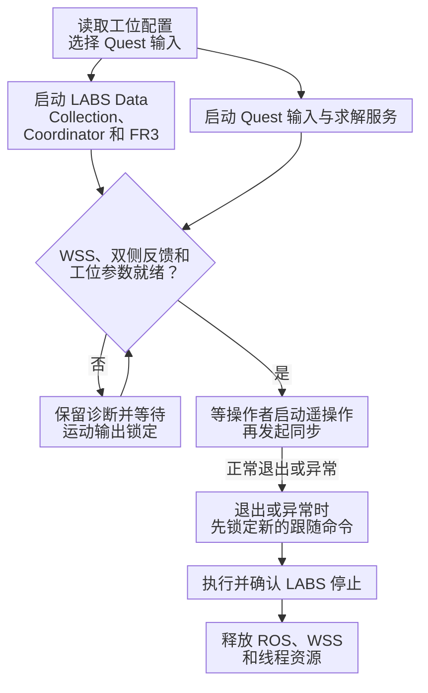

# 8. LABS 控制接入

## 8.1 仓库与服务组织

Quest 的采集输入、标定、映射和求解放在独立 `quest_teleop` 仓库。LABS 负责服务构建、工位配置、控制器生命周期和录制。目录按现有输入服务的组织方式新增。

| 位置 | 开发内容 |
| --- | --- |
| `services/input/franka-quest/src/third_party/quest_teleop` | Quest 开发代码的子模块位置 |
| `services/input/franka-quest/` | 新增 Dockerfile、启动脚本和服务 Compose 配置 |
| `deployments/fr3_duo_example/` | 在现有 FR3 双臂工位增加 `LEADER_TYPE` 和 `config_quest.yml`，将 Quest 服务接入 Taskfile、Tilt 和 Compose |

Quest Bridge 和跟随程序在同一本地服务进程内共享校验后的整帧。求解和周期发布使用独立于网络收包及 LABS API 请求的执行循环，避免某个接口等待时阻塞手柄数据或关节目标更新。

### 子模块与服务构建

1. **在 `quest_teleop` 开发程序。** 本地用 Python 和 `rclpy`，把 Bridge、遥操作状态机、LABS 客户端、跟随循环和目标发布放在同一服务中。手柄整帧在服务内传递，关节和夹爪目标通过 ROS 2 发给 LABS。
2. **在 LABS 封装服务。** 用 Dockerfile 安装 FR3 部署所需的 ROS 2 依赖并构建 Quest 软件包。启动脚本加载 ROS 2 环境，读取挂载的 `config_quest.yml` 和 `calibration.yaml`，再用 `exec` 启动 Quest 进程。WSS 证书和私钥在运行时挂载。
3. **接入工位启动流程。** 工位 Taskfile 从 `.env` 读取 `LEADER_TYPE`，按所选输入构建 `franka-gello` 或 `franka-quest`。开发环境由 Tilt 启动，生产环境由 Compose 启动，两种环境都只启动选中的输入服务。`quest_teleop` 的版本由 LABS 记录的子模块提交确定。

## 8.2 双臂与运行配置

1. **选择输入。** FR3 双臂使用同一份工位配置。在工位 `.env` 中设置 `LEADER_TYPE=gello` 或 `LEADER_TYPE=quest`。未设置时使用 GELLO，其他值在启动前报错。`ROBOT_TYPE` 用于选择机器人型号，`ROS2_VERSION` 用于选择 ROS 版本。
2. **选择 Leader 话题。** LABS 根据 `LEADER_TYPE` 订阅左右臂和夹爪的输入，每侧只转发当前选中的一套 Leader 目标。
3. **共用控制和录制出口。** 机械臂目标转发到同侧已有的 `follower/gello/joint_states`，夹爪目标转发到同侧的 `follower/gripper/gripper_client/target_gripper_width_percent`。两个地址在切换输入时固定使用，FR3、Robotiq、Data Recorder 和 GR00T 的 `action` 映射都沿用现有配置。

### 硬件配置与路由实现

在现有 `deployments/fr3_duo_example/` 增加输入选择。左右臂和夹爪按各自的 `left`、`right` 命名空间解析话题。

| 文件 | 开发内容 |
| --- | --- |
| `.env.example`、`Taskfile.yml` | 增加 `LEADER_TYPE=gello` 示例。Taskfile 读取并校验取值，选出需要构建和启动的输入服务。 |
| `Tiltfile`、`docker-compose.yml` | 按所选输入启用 `leader-gello` 或 `leader-quest` profile，沿用已有的 GPU profile。给 `data-collection` 和 `data-recorder` 的 `environment` 都加上 `LEADER_TYPE: "${LEADER_TYPE:-gello}"`。 |
| `config_station.yml`、共享配置加载器 `station.py` | 在工位 YAML 中定义 `leader_sources`。加载器读取 `LEADER_TYPE`，为左右臂和夹爪填入对应的 `leader_topic` 和 `leader_device`。只对声明了 `leader_sources` 的工位执行这一步。 |
| `config_quest.yml` | 配置 Quest 按键、两侧实测关节反馈、关节顺序、TCP、预设位、运动限制和夹爪开口比例。Quest 的输出话题和 `leader_sources.quest` 一致。 |

`config_station.yml` 中新增以下输入配置。容器从环境变量读取选择结果，再由 `StationConfig.from_yaml()` 将所选配置填入 `left_arm`、`right_arm`、`left_gripper` 和 `right_gripper`。

```yaml
leader_sources:
  gello:
    leader_device: franka_gello
    arm_topic: leader/gello/joint_states
    gripper_topic: leader/gripper/gripper_client/target_gripper_width_percent
  quest:
    leader_device: franka_quest
    arm_topic: leader/quest/joint_states
    gripper_topic: leader/quest/gripper/target_gripper_width_percent
```

- **Quest 参数。** 启动时加载两臂安装变换和标定结果，核对各启用侧的预设关节角数量、顺序及限位。配置齐全且左右对应正确后才允许发送运动目标。
- **环境配置。** Gazebo 用仿真控制器和仿真反馈，FR3 真机用对应的驱动和实测反馈。核对各服务的 ROS 2 发现设置、话题 QoS 和时间基准。
- **联调检查。** LABS 建立转发后，用 `ros2 topic info --verbose <话题名>` 核对机械臂和夹爪的发布者、订阅者及左右对应关系。确认 Follower 只有一个目标发布源后再同步。

## 8.3 服务启动、状态与退出

下面是 `LEADER_TYPE=quest` 时的启动和退出流程。



启动日志打印实际选中的 Leader 类型。Quest 服务记录 WSS 连接、FR3 反馈、LABS 工作流和目标发布状态，方便确认选中的服务和话题是否对应。

启动后运动输出默认锁定，操作者发起同步后才允许发布同步目标。LABS 进入 `FOLLOWING` 且实测确认到位后，先发布保持目标。对应侧 Grip 按下取点、开始检查通过且仍持续握住时，才发布该侧的相对跟随目标。松开后机器人停止跟随。正常退出先请求并确认 LABS 停止，再释放 ROS 发布者、WSS 连接和工作线程。

### 启动脚本与退出处理

- **启动服务。** 在工位 `.env` 中选好 `LEADER_TYPE`，开发环境用 `task start`，生产环境用 `task start-prod`。选中 Quest 时，服务读取 `config_quest.yml` 和标定文件，订阅机器人反馈，读取 LABS 状态，然后等待 Quest 浏览器连接。
- **开始遥操作。** 按右手 A，LABS 进入 `READY` 并建立 Leader → Follower 转发。确认手柄、关节反馈和转发正常后，长按右手 B，让机械臂移动到各自的预设关节位置。确认到位后，按下哪侧 Grip 就为哪侧取点，持续握住时跟随，松开时暂停该侧。
- **停止遥操作。** 在允许停止的状态下按右手 A。Quest 取消本轮尚未发出的跟随目标，并调用 LABS 的停止接口，由 LABS 停用控制器并清理转发节点。核对控制器已停用、机械臂已停稳后，本轮遥操作结束。采集服务可以继续运行，等待下一次启动。
- **关闭或切换输入。** 先结束遥操作并确认机械臂停稳，再用 `task stop` 或 `task stop-prod` 停止当前部署。确认原输入服务已退出后，修改 `LEADER_TYPE` 并重新启动。再次选择 Quest 时，由操作者按 A 启动、长按 B 同步。

## 8.4 LABS 接口接入开发

Quest 服务在本地调用 Data Collection 后端。

| 动作 | LABS 后端接口 | Quest 侧处理 |
| --- | --- | --- |
| 获取系统状态 | `GET /api/v1/system/info` | 读取 `workflow_state`、`recording_state` 和当前 Episode |
| 启动遥操作 | `POST /api/v1/teleop/start` | 等待 `READY`，确认两侧反馈和转发链路 |
| 发起同步 | `POST /api/v1/teleop/start_syncing` | 先发布同步目标，等待 LABS 确认 `FOLLOWING` |
| 停止遥操作 | `POST /api/v1/teleop/stop` | 锁定新的跟随命令，确认 `IDLE` 及控制器状态 |
| 开始录制 | `POST /api/v1/recording/start` | `FOLLOWING` 且录制空闲时，带上选中的 `task_id`。开始成功后记录 Episode ID |
| 结束录制 | `POST /api/v1/recording/stop` | 结束当前 Episode 的录制，等待进入 `REVIEWING` |
| 保存审核结果 | `POST /api/v1/recording/save` | 待审核时保存当前 Episode，通过 `label` 标记成功 `REVIEW_SUCCESS` 或失败 `REVIEW_FAILED` |
| 丢弃录制 | `POST /api/v1/recording/discard` | 待审核时丢弃当前 Episode |

和 GELLO 一样，先在 LABS Web 的 `Change task` 里选任务。网页把选中的 `task_id` 保存在当前浏览器会话。点 `Start recording` 时，网页读取这个编号并发给 Data Collection。Quest 按键录制调用同一个后端接口，接入时需要在选任务成功后把编号传给本地 Quest 服务。按 X 时使用已确认的任务编号。

### Data Collection 客户端实现

在 Python 的 `labs_client` 内封装表中的接口。服务地址从部署配置读取；连接、请求和状态确认分别设置时限。客户端解析 HTTP 状态及业务结果，并把结果连同请求编号返回状态机，由状态机处理是否结束操作、继续等待等状态。

- **启停与同步：** 启动请求后等 LABS 确认 `READY`。同步请求在预设关节目标开始发送后提交，等 LABS 确认 `FOLLOWING` 且各启用侧实测到位后，等待 Grip 取点。整站停止时先锁定 Quest 输出，再核对 LABS 工作流及 Follower 状态。

### 录制与审核

1. **开始录制。** 机械臂同步完成，LABS 处于 `FOLLOWING` 且录制空闲时，按左手 X。Data Collection 用选中的任务编号创建 Episode，再让现有 Data Recorder 开始录制。Quest 收到成功结果后记录本轮的 Episode ID。 
2. **结束录制。** 录制中再按一次 X，结束当前 Episode 的录制，等待 LABS 进入 `REVIEWING`。
3. **审核本轮数据。** 进入 `REVIEWING` 后，按 A 丢弃，按 B 保存为失败，按 X 保存为成功，对应 GELLO 页面上的 `Discard`、`Save as failed` 和 `Save as successful`。

Data Recorder 根据工位配置，将两侧 Follower 的关节目标、夹爪开口目标和已配置的实测反馈写入 MCAP。GELLO 和 Quest 使用同一组录制话题。切换输入后，核对所选任务、Episode 和两侧目标数据。

## 8.5 Follower 接入

接入时先在 Gazebo 核对关节目标、反馈与停止行为，随后切换到真机配置。

### Gazebo 仿真及切入机器人

1. **在 Gazebo 跑通 Quest → LABS → Follower。** 用 Quest 手柄完成同步、取点和跟随。在终端查看 TCP 目标位姿、Leader 与 Follower 的关节目标、仿真关节角和控制器输出的关节力矩。核对同侧目标是否一致、两侧是否串接、切入跟随时目标是否连续。在 LABS Web 选好任务，用 X 开始并结束一轮录制，完成审核。核对保存的 Episode 属于该任务，再检查对应的 MCAP 中是否有同侧 Follower 关节目标和 FR3 实测关节反馈。完成一次停发核对，确认下游实际如何处理目标中断。
2. **接入 FR3。** 切换到机器人配置，先核对已启用侧、反馈来源、控制器状态和现场停止方式，力矩以控制器提供的反馈为准。
