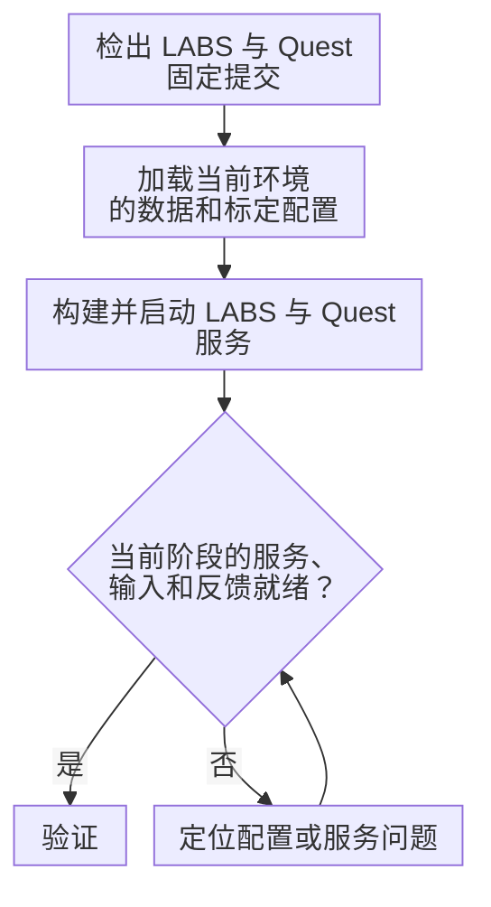

# 9. 部署集成

## 9.1 版本和部署

1. 固定 LABS 提交及其记录的 `quest_teleop` 子模块提交。初始化子模块 `git submodule update --init --recursive`。
2. 核对 FR3 部署对应的 ROS 版本、Quest 输入服务依赖、机器人描述和求解器版本。

## 9.2 部署配置与启动检查

| 配置 | 检查内容 |
| --- | --- |
| Quest 网络与 HTTPS | Quest 与本地能互访，浏览器接受 HTTPS 证书并建立 WSS |
| ROS 2 通信 | Quest、LABS、左右 FR3 使用匹配的 ROS 环境，Leader 目标、Follower 转发和关节反馈的话题匹配 |
| 机器人及工具 | 手臂命名空间、机器人模式、法兰及夹爪、安装关系和关节顺序 |
| 标定与约束 | 加载 `calibration.yaml`、启用侧的工作空间和关节运动限制 |
| LABS 及录制 | 能读取工作流及录制状态，当前任务有效，确定输出目录 |

启动时先确认输入数据、仿真、还是机器人。仿真和机器人使用相应的独立配置和设备连接方式。通过镜像和服务检查后，再核对输入、状态和反馈。

## 9.3 部署开发

1. **把 Quest 服务接进 LABS。** 将 `quest_teleop` 作为子模块接入，编写 Dockerfile 和启动脚本，把 Quest 服务加入 Tilt 和生产 Compose。用 `task start``task build-prod``task start-prod` 对环境进行构建和测试。
2. **准备 Quest 工位配置。** 在 `deployments/fr3_duo_quest/` 配置左右臂的 Leader、Follower 和关节反馈话题。启动时加载 `calibration.yaml`、左右臂预设关节角，并挂载录制目录。
3. **仿真和 FR3 测试。** 仿真接 Gazebo 的控制器和反馈，跑通 B 键同步、Grip 取点、跟随和暂停。仿真通过后切换到 FR3 配置，核对左右臂的控制及相关信息。

## 9.4 手柄输入测试

本地启动手柄采集服务，让 Quest 浏览器通过 WSS 发送含左右手状态的数据。从本地终端核对两侧位姿、按键和追踪状态。

确定终端收到左右手数据及按键状态。

## 9.5 标定测试

加载硬件配置中的双臂安装变换、TCP 和已有的 `calibration.yaml`。需新标定时，通过在网页采集 O、X、Y，验证每次右手 Trigger 只确认一个点，计算并保存方向标定结果。用左右手柄分别做工位单轴平移、原地旋转和方向反转等数据。

记录三点、标定矩阵和独立验证结果。

## 9.6 仿真测试

用左右手数据格式，验证 Bridge 校验、ROS 2 输入话题和断线恢复。配置控制器和 Leader 路由，跑通 A 启动、长按 B 同步到预设位、按下 Grip 取点、持续握持跟随、松开暂停和停稳后重新取点。再用统一的测试轨迹分别验证 TCP 与新肘部求解，记录 TCP 误差、肘部偏移、关节变化、求解耗时以及反馈。

在仿真中核对首帧目标是否连续，并验证松开 Grip 后能否停稳。

录制用多次 Episode 分别覆盖 A 丢弃、B 保存为失败和 X 保存为成功。每轮都用 X 开始和结束录制。然后对录制数据分别丢弃、保存等。

## 9.7 FR3 真机测试

单臂仿真通过后，切换到 FR3 真机配置，核对实际安装、机器人 IP、工具和工位范围。按 A 进入 `READY`，长按 B 同步到预设位。确认到位后，分别按左右 Grip 核对手柄与机械臂的对应关系和首帧目标，再验证双臂跟随、单轴平移、原地旋转、松开停稳和再次按下取点。
