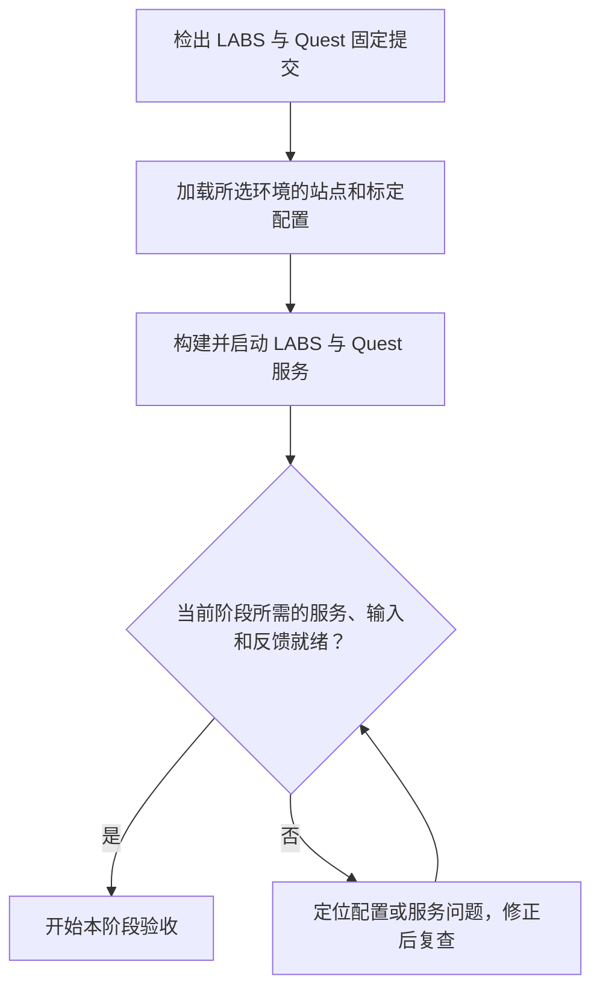
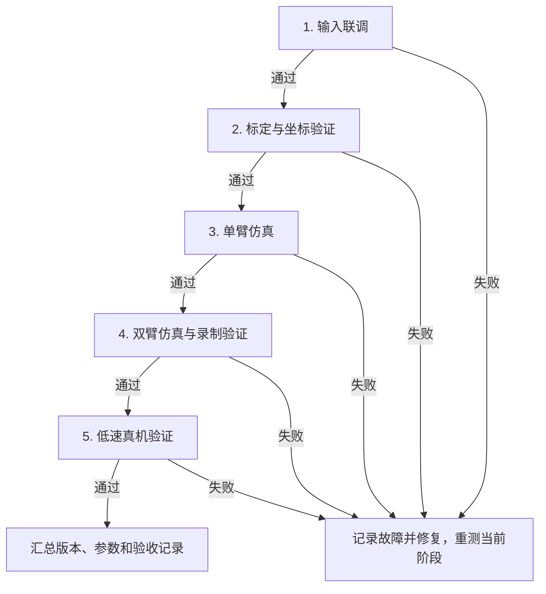

# 9. 部署集成与分阶段验收

## 9.1 版本和部署准备

1. 固定 LABS 提交及其记录的 `quest_teleop` 子模块提交。在干净检出中执行 `git submodule update --init --recursive`，确认运行机器能拉到同一版本。
2. 核对 FR3 部署对应的 ROS 版本、Quest 输入服务依赖、机器人描述和求解器版本。记录镜像标签和镜像标识，确保部署可追溯。
3. 在 `deployments/fr3_duo_quest/` 配置 Quest 服务，分别验证开发和生产启动。开发用 `task start`，生产先构建 `task build-prod` 然后用 `task start-prod` 启动。现有 FR3 双臂 Taskfile 提供这些入口，Quest 服务需纳入相应的 Tilt 和 Compose 配置。[FR3 站点 Taskfile](/home/xzz/Gitspace/labs/deployments/fr3_duo_example/Taskfile.yml:40)

## 9.2 部署配置与启动检查

| 配置 | 检查内容 |
| --- | --- |
| Quest 网络与 HTTPS | Quest 与本地能互访，浏览器接受 HTTPS 证书并能建立 WSS |
| ROS 2 通信 | Quest、LABS、左右 FR3 使用匹配的 ROS 环境，Leader 目标、Follower 转发和实测关节反馈的话题与各侧配置匹配 |
| 机器人及工具 | 双侧命名空间、机器人模式、工具 TCP、安装关系和关节顺序一致 |
| 标定与约束 | 加载 `calibration.yaml`、启用侧的工作空间和关节运动限制，记录当前参数版本 |
| LABS 及录制 | 能读取工作流及录制状态，当前任务有效，确定录制输出目录和剩余空间 |

启动时先确认运行的是输入联调、仿真、模拟硬件还是真机环境。仿真和模拟硬件使用相应的独立配置和明确的设备连接方式。通过镜像和服务检查后，再核对实时输入、状态和反馈。

## 9.3 第一阶段：手柄输入联调

按第 3.4.1 节方案一，在本地启动手柄采集服务，让 Quest 浏览器通过 WSS 发送只含左右手的简化帧。从本地终端核对两侧位姿、按键和追踪状态，测试单侧失去追踪、断网重连和会话结束。

通过条件是终端收到正确的左右手数据，能区分位姿无效及按键不可读。此阶段机械臂控制链保持锁定。

## 9.4 第二阶段：标定与坐标验证

加载站点配置中的双臂安装变换、工具 TCP 和已有的 `calibration.yaml`。需要新标定时，按第 2 章选网页采点或本地采点，验证每次右手 Trigger 只确认一个点，并保存三点方向标定结果。用左右手柄分别做工位单轴平移、原地旋转和方向反转，在仿真或离线输出中检查两侧 TCP 目标。验证新会话及参考空间重置后轴向一致时可复用标定。

通过条件是方向、比例和旋转轴符合工位定义，输出的角度误差在工位设定阈值内。记录三点、标定矩阵和独立验证结果。

## 9.5 第三阶段：单臂仿真

切换到第 3.4.2 节方案二，验证完整帧校验、ROS 2 输入话题和断线恢复。只配置一侧控制器和 Leader 路由，跑通 A 启动、长按 B 同步到预设位、按下 Grip 取点、持续握持跟随、松开暂停和停稳后重新取点。再用统一的测试轨迹分别验证 TCP 基线与新增肘部任务，记录 TCP 误差、肘部偏移、关节变化、求解耗时以及命令和反馈时延。

通过条件是首帧连续、可用范围内跟随正确、约束生效，求解失败和数据中断能进入停止流程。用该阶段的实测结果确定同步交接容差、各路超时和控制周期参数。

## 9.6 第四阶段：双臂仿真

先分别按下左、右 Grip 验证各自取点和跟随，再测试双手同时跟随和单侧先松开。确认暂停侧停稳，另一侧仍可跟随，并验证两侧目标的时效、连续性和干涉检查。测试单侧失效、反馈中断、Quest 服务退出和 LABS 接口超时，检查两侧停止结果和重入跟随的过程。

录制验收用三轮 Episode 分别覆盖 A 丢弃、B 保存为失败和 X 保存为成功。每轮都用 X 开始和结束录制，再执行审核动作。核对实际文件、标签、关节目标及实测反馈。

## 9.7 第五阶段：FR3 真机验证

仿真验收通过后，核对实际安装、机器人 IP、工具和工位范围，执行现场既有的停止检查。真机以低速、小范围先测单臂，再测双臂。按 A 进入 `READY`，长按 B 同步到预设位。确认到位后按对应侧 Grip，核对首帧目标，再验证单轴平移、原地旋转、松开停稳和再次按下取点。

逐项记录反馈、目标和 LABS 状态。停止或恢复行为与仿真预期不符时，暂停下一项，保留记录并回到对应仿真测试复查。

## 9.8 验收顺序与交付记录

每阶段记录 LABS 和 Quest 提交、镜像标识、部署方式、标定和约束文件、测试输入、实际结果及遗留问题。交付包含部署入口、运行配置、验收记录和可复用的测试轨迹，区分输入联调、仿真与真机结果。
