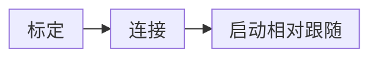
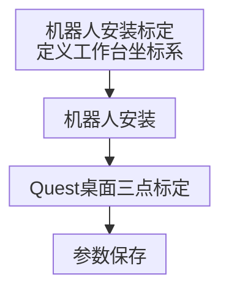
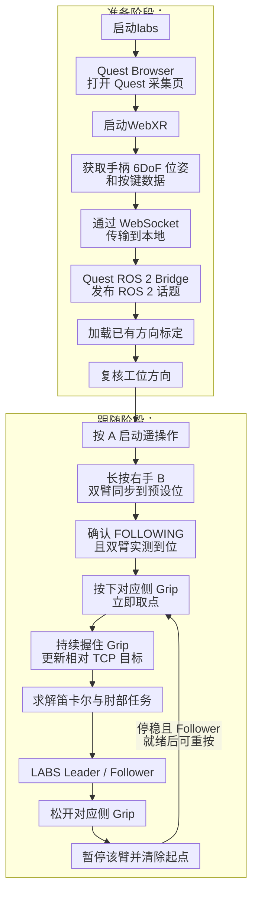
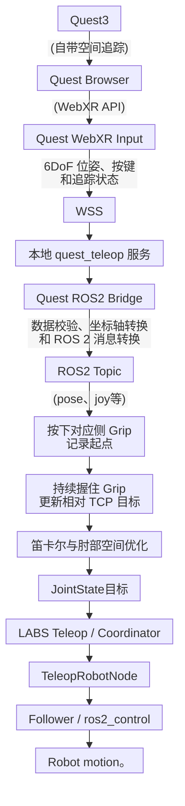
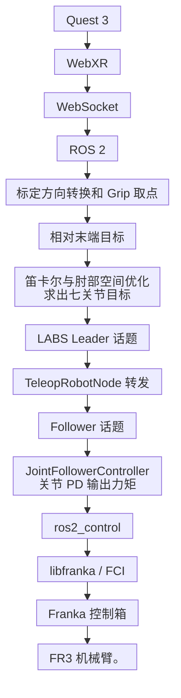
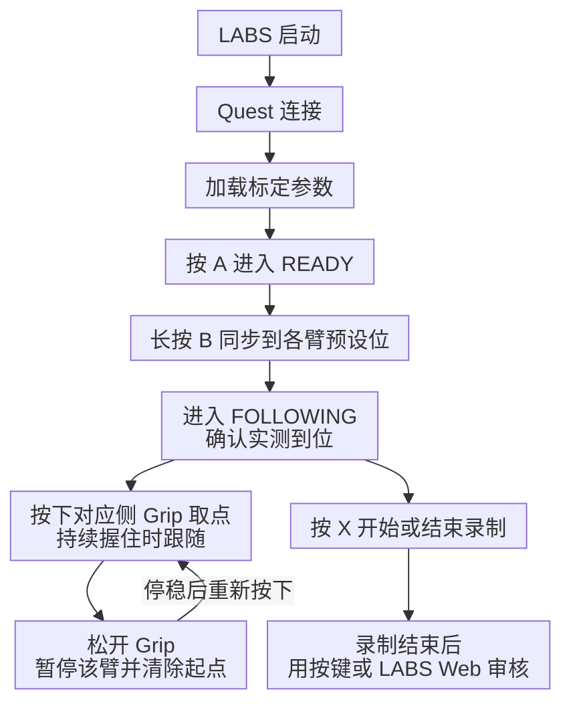

# Quest开发方案

基于Meta Quest 3设备，结合ROS 2针对Franka设计开发一套具有运动映射、机器人遥操作及示教数据采集能力的 VR 遥操作系统。通过Quest 3可提供空间运动输入和交互能力。

开发目标：建立一套可以使用Quest 3控制Franka机器人的遥操作系统

## 技术调研

### 1、论文：Quest2ROS2: A ROS 2 Framework for Bi-manual VR Teleoperation，HRI 2026。

开源代码：

<https://github.com/Taokt/Quest2ROS2/tree/main/q2r2_bringup>

Ingelhag提出以Meta Quest 2/3为输入，采用Unity开发VR应用，利用ROS-TCP-Connector将控制器运动信息传输至机器人。

系统使用Quest控制器获取三维位置、四元数姿态及按键状态，传给ROS2。其中，BaseArmController（功能：接收 VR 控制器数据、获取机器人当前末端位姿、计算相对运动并发布目标）负责核心运动映射；LeftArmController 和 RightArmController 分别配置左右机械臂的输入话题、坐标系及控制器接口。\_apply\_moving\_average\_filter() 对控制器位姿进行滑动平均滤波，\_pose\_callback() 根据手柄运动增量计算机器人末端目标，\_inputs\_callback() 实现暂停、恢复和重新对齐，\_toggle\_gripper() 通过 ROS 2 GripperCommand Action 控制夹爪。

六自由度位姿传输给ROS2，机器人支持六自由度跟随、相对运动映射、夹爪控制、暂停和对齐功能

位置采用相对运动映射：

$$
p_{target}=p_{robot,0}+(p_{VR,t}-p_{VR,0})
$$

姿态采用四元数相对旋转

$$
q_{\Delta }=q_{VR,t}\otimes q_{VR,0}^{-1}
$$

$$
q_{target}=q_{\Delta }\otimes q_{robot,0}
$$

系统输入：Meta Quest 2/3 左右控制器的六自由度位姿（三维位置和四元数姿态）、Trigger、Grip及功能按键状态，以及机器人当前末端位置和姿态（通过 ROS 2 TF2 获取）

系统输出： 左右机械臂的六自由度末端目标位姿（PoseStamped），通过 ROS 2 Topic 发送至对应笛卡尔控制器；夹爪开合指令通过 GripperCommand Action 发送，同时输出用于 RViz 显示的目标位姿可视化数据

优缺点：采用ROS2通信机制，方便机器人软件集成

采用相对位姿，不需要VR与机器人末端位置一致

基础控制使用同一个手臂基类方便拓展

已有位置与姿态滤波、暂停恢复、对齐、夹爪控制

可使用可视化

依赖机器人的笛卡尔控制器

未提供自由度的关节目标转换接口

滑动平均可能增加控制延迟，四元数直接平均存在旋转连续性问题

对于侧装手臂需要额外标定和安装变换

注意自碰撞

### 2、开源项目：基于Meta Quest 3的机器人手部追踪与遥操作技术

开源代码：

<https://github.com/aadhithya14/Open-Teach/tree/main>

当前项目使用Meta Quest3遥操作Franka机器人进行单臂控制。当前开源项目基于Meta Quest 3、Unity、Python、ZeroMQ(高性能消息通讯库，用于不同进程及网络设备间的数据交换)与机器人运动控制接口，实现手部关键点跟踪、空间坐标转换、手臂跟随运动、双臂遥操作及数据采集。

当前项目通过 Quest 3 内置摄像头和Hand TRacking算法获取腕和手指关节点，Unity应用通过网络将数据发送给python，建立人手局部坐标系，再计算相对于初始位姿的运动。

Franka Arm Operator 先记录人手与机器人末端初始姿态，使用齐次变换矩阵计算相对运动，将人手转换为机器人末端目标，然后生成机器人目标：

$$
T_{R,0}T_{adapt}T_{H,0}^{-1}T_{H,t}T_{adapt}^{-1}
$$

其中，$(T_{adapt})$表示人手与机器人末端之间的固定坐标适配变换。

机器人手臂：利用手腕关键点以及食指和小指的指节点，建立一个三维坐标系：其中二维平面沿人体手掌方向布置，第三轴则垂直于手掌。随后，将手腕位置映射到机器人末端执行器的位置，并将该三维坐标系随时间变化的变换映射到末端执行器姿态的变化上。机器人手：我们利用从VR系统获取的教师手部姿态来计算教师手各关节的角度。给定这些关节角度，一种简单的重映射方法是直接将机器人关节设定为相应的角度。

系统输入： Quest 3裸手追踪获取的手腕位置、手部关键点及手掌姿态信息，遥操作暂停、恢复和运动缩放指令，以及Franka机械臂当前末端位姿和关节状态。

系统输出： 经过坐标变换、相对运动映射及滤波处理的Franka末端目标位姿，通过机器人控制接口执行；对于适配的灵巧手，还可输出手指关节控制目标，并记录机器人实际状态、运动数据和时间戳，生成HDF5采集文件。

优缺点：支持Meta Quest 3裸手追踪，无需额外的机械式设备，佩戴Quest 3 头显后，直接用自己的双手进行操作。Quest 3通过内置摄像头和视觉算法识别手腕、手掌及手指关节的位置与姿态，不需要握持控制器

使用 ZeroMQ 分离 VR 输入、运动映射与机器人控制。

已实现 Franka 机械臂相关控制。

包含机器人状态与示教数据记录模块。

手部追踪容易受到遮挡、光照变化和快速运动影响。

缺少实体按钮，运动、暂停和紧急操作需要额外设计。

Franka Arm Operator使用特定的坐标适配矩阵，不能直接适用于倾斜安装的双 FR3。

原有机器人接口与LABS Joint Follower不一致。

HDF5数据记录方式与LABS MCAP链路需要适配。

### 3、开源项目：基于Meta Quest 3的双臂遥操作与数据采集系统

开源代码：<https://github.com/ARCLab-MIT/beavr-bot>

采用Meta Quest 3、Python、ZeroMQ和LeRobot，实现手部运动追踪、双臂遥操作、机器人反馈、示教数据采集与模仿学习模型训练。

系统通过Quset 3获取操作者的手部位置与姿态，使用ZeroMQ将数据传输至机器人控制模块。其中，XArmOperator(功能：处理 VR 手部位姿、机器人坐标转换、运动映射和目标生成)类负责接收手部运动数据，通过齐次变换矩阵完成 VR 坐标系与机器人基座坐标系之间的转换，并结合机器人末端实际状态计算目标位姿。

CompStateFilter(功能:对机器人运动目标进行平滑滤波)采用位置线性插值、四元数球面线性插值和自适应滤波，降低跟踪抖动。最终通过机器人硬件接口执行运动指令。

双臂控制：系统分别配置左右机械臂的运动映射和坐标变换参数，实现两侧运动独立计算。

数据采集：集成LeRobot，通过 control\_robot.py 实现机器人状态、动作和图像的采集，将整个采集过程组织为Episode，生成 LeRobot 格式数据集，并用于模仿学习和模型训练。

系统输入： Quest 3 追踪获取的左右手部位置、姿态及交互指令，左右机械臂当前末端位姿、关节状态，以及机器人相机采集的图像数据。

系统输出： 经过左右独立坐标转换、运动映射及滤波处理的机械臂末端运动目标，通过机器人接口转换并发送控制指令；同时输出机器人状态反馈及遥操作会话状态，并生成包含图像、机器人观测和动作信息的 LeRobot 示教数据集。

优缺点：支持手部追踪和双臂遥操作

运动映射和硬件分离开发

使用ZeroMQ模块化通信，支持多进程部署

使用确认式通信管理操作状态变换

使用LeRobot数据采集与训练功能

双臂侧装需自定义配置内容

### 4、开源项目：Open-TeleVision——基于VR沉浸式视觉反馈的双臂遥操作技术

开源代码：

<https://github.com/OpenTeleVision/TeleVision>

采用Meta Quest 3、Python、Vuer（基于 WebXR 的交互框架）、WebRTC（实时音视频通信技术）及机器人运动控制接口，实现裸手追踪、双臂遥操作、机器人第一人称立体视觉反馈及模仿学习数据采集。

 Meta Quest 3利用自身的追踪摄像头和Hand Tracking算法识别操作者双手，获取头部、左右手腕及手指关节点的为位置和姿态；机器人双目相机负责采集工作环境图像；Python处理模块负责手部数据解析、空间坐标转换和动作重定向；机器人控制模块负责执行运动目标。

 Quest 3先通过内置视觉传感器完成手部追踪，再由WebXR提供手腕位姿和手部关节点数据。OpenTeleVision（功能：管理VR交互、接收左右手部运动数据及传输立体视觉画面）使用Vuer的Hands组件获取手部追踪信息，通过 on\_hand\_move() 接收左右手腕及手指关键点数据。VuerPreprocessor（功能：完成手部坐标转换、手腕姿态处理及手指关节点坐标变换）通过旋转矩阵和齐次变换计算手腕目标位姿，计算手腕相对于头部位置的空间关系。VuerTeleop（功能：调用动作重定向算法，将手指关键点转换为机器人灵巧手关节目标）利用dex-retargeting将人体手指关键点转换为机器人手关节角。

系统输入： Quest 3获取头部和左右手腕六自由度位姿、手指关节点，以及机器人双目相机采集的左右眼图像。

系统输出： 左右机械臂末端目标位姿、灵巧手关节目标，以及返回Quest 3 的双目视觉画面。

系统通过左右手腕空间位姿生成机械臂末端运动目标。双目相机分别采集左右视角图像，利用WebRTC或图像传输方式发送至VR，再通过Vuer实现左右眼独立显示，操作者能够通过Quest 3观察机器人第一人称视角。视觉与quest追踪相互独立。

优缺点：

支持手部追踪，不需要手柄或其他手戴设备

可加装灵巧手

可通过浏览器链接设备，使用WebXR实现手部数据采集及VR头显交互

有空间坐标转换，方便适配不同机器人坐标系

手部追踪会受遮挡、光照及运动速度的影响

视觉反馈依赖机器人相机、视频传输信息及网络环境，环境部署比较复杂

主要使用apple Vision pro设备

### 5、开源项目：Isaac ROS Teleop 基于Meta Quest 3 的 ROS 2 遥操作与坐标系对齐技术

开源代码：<https://github.com/NVIDIA-ISAAC-ROS/isaac_ros_teleop>

代码框架：<https://github.com/NVIDIA/IsaacTeleop>

采用 Meta Quest 3、CloudXR、OpenXR、ROS 2、Python 和 C++，使用VR控制器获取左右手6自由度位姿及按键状态，可支持手部追踪。实现机器人遥操作、坐标系转换、末端目标发布及机器人示教数据采集。

Meta Quest 3 利用原生空间追踪系统获取头显、手柄的位置和姿态，以及扳机、摇杆等按键状态。Quest Browser 通过 CloudXR 的 WebXR 客户端与本地通信；Isaac Teleop 负责 XR 设备数据接入、追踪信息处理及动作重定向；Isaac ROS Teleop 将处理后的数据发布到 ROS 2，供机器人控制器使用。

系统输入： Quest 3 获取头显、左右手柄六自由度位姿、按键及摇杆状态，以及可用的手部追踪数据。

系统输出： ROS 2 中的左右末端目标位姿、头部位姿、控制器状态和可选的手指关节目标，供机器人运动控制及数据采集模块使用

系统通过 CloudXR 和 Isaac Teleop 将 Quest 追踪数据转换为 ROS 2 控制输入，通过固定坐标转换或参考坐标系重新对齐，使 XR 操作空间与机器人控制空间建立对应关系。后续由机器人适配模块根据末端位姿生成关节控制目标，实现遥操作跟随。

优缺点：支持控制器输入及手部追踪。

提供ROS2接口、topic配置及TF坐标转换。

固定坐标变换，实现VR操作空间与机器人控制空间对齐。

有数据采集框架。

CloudXR、OpenXR 及相关运行环境的部署依赖较多，可直接使用 WebXR + WebSocket。

## 整体流程：

系统采用 Meta Quest 3 作为遥操作输入设备，通过 WebXR 获取左右手柄的六自由度位姿及按键状态，结合 ROS 2 与 LABS 现有框架，实现遥操作跟随。

计划采用独立quest\_teleop仓库开发Quest输入、数据通信、坐标标定、相对位姿映射及机器人适配，并使用git submodule方式集成到labs中。Quest输入通过独立的WebSocket接口进行信息传输，经由Quest ROS2 Bridge转换为ROS2 Topic。

整体流程可分三个阶段：标定-\>连接-\>启动相对跟随。



坐标标定与参数配置：需要标定时，在 Quest 网页采集 O、X、Y，通过 HTTPS 提交点位，由本地计算并保存 Quest 到工作台的方向旋转。运行时加载并复核已有标定，结合各臂安装变换和 TCP 配置，换算手柄运动方向。

连接：通过Labs及Quset Web会话，加载标定参数，检查左右手跟踪，通信及机器人状态。

跟随：长按右手 B，双臂移到各自的预设关节位置。LABS 进入 FOLLOWING 且实测确认双臂到位后，按下对应侧 Grip，记录该侧手柄位姿和该臂实测 TCP 位姿。持续握住时跟随，松开后暂停。该臂停稳且 Follower 仍就绪时，再次按下 Grip 重新取点。

### 1、坐标标定与参数配置：

(机器人安装标定) 工作台坐标系定义 -\>  机器人安装  -\>  Quest桌面三点标定 -\> 参数保存



(1) 工作台及机器人安装坐标系：以支架定义的 fr3\_duo\_mount\_origin 为公共基准，按安装模型确认原点和 $(+X)$、$(+Y)$、$(+Z)$ 的物理方向。将左右机器人的基座坐标系分别记为$(B_{L})$ 和 $(B_{R})$。根据双臂安装模型及站点配置，获取两台机械臂基座在公共坐标系下的位置和姿态，并表示为齐次变换矩阵。

$$
[{}^{W}T_{B_{i}}=\left[\begin{matrix}{}^{W}R_{B_{i}} & {}^{W}p_{B_{i}} \\ 0 & 1\end{matrix}\right],\quad \quad i\in \{L,R\}]
$$

其中，$({}^{W}R_{B_{i}})$表示该臂基座相对于工作台的安装旋转，$({}^{W}p_{B_{i}})$表示基座原点在工作台坐标系中的位置。左右臂分别按各自的实际安装姿态配置。

相对跟随时，手柄位移先转换到工作台坐标系，再转换到对应机械臂的基座坐标系。设$(\Delta p_{W})$为工作台系下的手柄位移，则该位移在对应基座系中的表达为：

$$
[\Delta p_{B_{i}}=({}^{W}R_{B_{i}})^{T}\Delta p_{W}]
$$

由于位移由两个位置相减得到，基座安装平移在计算中抵消。完整的安装变换 $({}^{W}T_{B_{i}})$用于将左右臂的末端位姿统一到工作台坐标系。

同时配置两台机器人的关节名称、顺序、关节限位及法兰到 TCP（工具中心点）的固定变换。运行时，根据该臂的实测七关节角$(q_{i})$，通过正运动学得到法兰位姿，再计算 TCP 位姿：

$$
[{}^{B_{i}}T_{TCP}(q_{i})={}^{B_{i}}T_{flange}(q_{i}){}^{flange}T_{TCP}]
$$

按grip记录当时的手柄位姿和实测 TCP 位姿，作为本次相对跟随的起点。

Quest到工作台的方向标定：在台面布置两段分别平行于装配机器人的底座坐标系 $(W)$ 的$(+X)\text{、}(+Y)$ 正方向的路径。头显放在桌面，WebXR持续运行且有手柄追踪。

在同一个 WebXR local-floor 参考空间中，保持手柄姿态基本一致，分别沿 O → X 和 O → Y 移动手柄并记录位置。每段用终点位置减去起点位置，得到 Quest 坐标系下的位移向量。将采集到的向量与工作台的$(+X)$、$(+Y)$ 方向配对，使用 Kabsch 算法求出 Quest 到工作台的旋转矩阵 $({}^{W}R_{Q})$。可以重复采样，减少单次手动摆放误差。

标定期间机械臂保持静止。头显放在桌面，WebXR会话保持运行，手柄有有效的六自由度追踪。标定和运行使用相同的坐标轴、位置单位和四元数顺序。

(2) 左右臂方向转换：左右臂共用同一个$({}^{W}R_{Q})$，再结合各自的安装旋转，得到 Quest 到各臂基座的方向转换：

$$
[{}^{B_{i}}R_{Q}=({}^{W}R_{B_{i}})^{T}{}^{W}R_{Q},\quad \quad i\in \{L,R\}]
$$

运行时，用对应的旋转矩阵转换手柄的相对位移和相对旋转。手柄位移由同一参考系下的两次位置相减得到，这一步只需标定Quest到工作台的方向旋转。

(4)方向验证：手臂保持静止时，沿工作台 $(+X)$、$(+Y)$和向上方向移动手柄，检查左右臂的目标方向与工作台实际方向是否一致。验证通过后，将 Quest 到工作台的旋转、左右臂安装外参、TCP 配置和运动缩放系数保存到 YAML，运行时加载。

### 2、运行阶段：

通过 LABS 控制机器人。双臂同步到位后，每侧独立处理 Grip。按下取点，持续握住时跟随，松开则暂停该臂。

准备阶段：

```text
启动labs									   ->
Quest Browser 打开 Quest 采集页 ->
启动WebXR   									->
获取手柄6Dof位姿及按键信息   				->
WebSocket传输数据到本地   			->
Quest ROS 2 Bridge 发布 ROS 2 Topic  		->
加载已有方向标定 ->
复核工位方向
```

跟随阶段：

```text
按 A 启动遥操作 ->
长按右手 B，双臂回到各自的预设关节位置 ->
确认 FOLLOWING 且双臂实测到位 ->
按下对应侧 Grip，立即取点 ->
持续握住时更新相对 TCP 目标 ->
笛卡尔与肘部空间优化求解七关节目标 ->
LABS Leader / Follower 执行 ->
松开 Grip，暂停该臂并清除起点 ->
该臂停稳且 Follower 就绪后，可再次按下 Grip 取点
```



(1)系统启动：在本地执行 task start 或 task start-prod，启动 LABS Web、Data Collection、ROS 2 及机器人相关服务。

在 Quest 3 的浏览器中打开本地 quest\_teleop 提供的采集页。LABS 在本地运行，并通过现有接口接收遥操作和录制请求。

(2)Quest 设备连接：在 Quest 采集页启动 WebXR 会话，通过原生空间追踪读取左右手柄的三维位置、四元数姿态和按键状态。

通过 WebSocket 将数据传输至本地，并由 Quest ROS 2 Bridge 发布对应的 ROS 2 Topic。

(3)加载标定参数：加载 Quest 参考坐标系$(Q)$到双臂共用底座坐标系 $(W)$的标定旋转 $({}^{W}R_{Q})$，以及左右机器人基座相对于$(W)$的安装变换$({}^{W}T_{B_{L}})$和$({}^{W}T_{B_{R}})$。同时加载各机器人的TCP定义、关节限位等。

从各臂的安装变换中提取安装旋转$({}^{W}R_{B_{i}})$，计算 Quest 到对应机械臂基座的方向转换：

$$
[{}^{B_{i}}R_{Q}=({}^{W}R_{B_{i}})^{T}{}^{W}R_{Q},\quad \quad i\in \{L,R\}]
$$

参数加载及检查通过后，等待 B 键同步。确认各臂到位后，才接受 Grip 按下事件并建立对应侧起点。

(4)机器人初始化与位置同步：复用 LABS 现有遥操作状态管理机制。

在 READY 时长按右手 B，将站点配置中各臂预设的七关节角作为同步目标并发出同步请求。LABS 进入 FOLLOWING 且实测关节角确认各臂到位后，等待对应侧 Grip 按下。

机器人利用现有Follower的轨迹同步能力，从当前位置沿受限轨迹运动至该目标。同步中不直接执行手柄连续跟随，先完成机器人初始位置及姿态运动。

(5)机器人跟随起点记录及相对位姿跟随：同步到位后，按下哪侧 Grip，就在按下瞬间记录该侧手柄位姿和对应机械臂的实测 TCP 位姿。左右侧各自取点。

持续握住 Grip 时，系统计算手柄相对于本次起点的位移和旋转，将其转换到对应机器人基座坐标系，再叠加到起始 TCP 位姿。笛卡尔与肘部空间优化据此计算七关节目标，检查关节限位、工作空间和目标连续性后，经 LABS Leader → Follower → ros2\_control 执行。

松开 Grip 时，系统停止根据手柄运动更新该侧目标，机器人停止跟随，并清除本次跟随起点。

(6)数据录制：复用 LABS 现有 Data Collection 功能：

左手柄 X 键：开始、结束录制 Episode。

录制状态及后续数据保存用 LABS 现有功能

(7)停止与异常：松开 Grip 时暂停该臂并清除起点，按已验证的保持流程停稳。待该臂停稳且 Follower 就绪后，再次按下 Grip 取点并持续握住即可跟随。若发生异常或 Follower 已停用，按 LABS 的停止和恢复流程处理。恢复后按 A 进入 READY、长按 B 同步，到位后重新按 Grip 取点。

### 3、与gello对应的关系及不同：

Quest 和 GELLO 共用 LABS 的遥操作状态管理、七关节目标接口和执行链路。输入都通过 JointState 将关节目标送到 LABS Follower，由 ros2\_control 执行。

|  | GELLO | Quest |
| --- | --- | --- |
| 输入数据 | GELLO 读取关节角，经过零位、方向和装配偏移转换后，提供七关节目标 | WebXR 提供左右手柄的六自由度位姿、按键和追踪状态 |
| 同步目标 | 使用 GELLO 映射得到的七关节目标完成轨迹同步。 | 保留右手 B 键同步。长按 B 时，机器人运动到初始位姿 |
| 建立起点 | gello初始位姿绝对映射 | 按下对应侧 Grip 时记录该侧手柄和实测 TCP 起点 |
| 跟随目标 | 持续跟随 GELLO 更新的七关节目标。 | 持续握住 Grip，将手柄相对起点的运动映射为 TCP 目标，再通过笛卡尔与肘部空间优化求解七关节目标 |
| 暂停恢复 | 按 GELLO 现有的遥操作流程处理 | 松开Grip后，机器人停止跟随。停稳且Follower保持就绪时，再次按Grip更新跟随起点 |

LABS 的 READY → SYNCING → FOLLOWING 用于管理控制器的准备、同步和跟随状态。对于 Quest，确认 FOLLOWING 且实测到位后，按下对应侧 Grip 建立起点，持续握住时驱动对应臂跟随。


开发重点为 WebXR 数据输入、ROS 2 Bridge、相对位姿映射、笛卡尔与肘部空间优化，以及 Quest 按键与 LABS 现有控制接口的集成。

### 4、整体控制为与相对映射：

系统进入READY后，长按B键系统读取初始定义关节角，作为Follower激活的同步目标，同步完成后，按下哪侧 Grip，就在按下瞬间为该侧取点，持续握住即跟随。

针对相对跟随：设$(Q)$为 Quest 参考坐标系，$(W)$ 为双臂共用底座坐标系，$(B_{i})$为对应 FR3 的基座坐标系，其中$(i\in \{L,R\})$。利用标定结果，计算手柄运动从 Quest 参考系到该臂基座系的方向变换:

$$
[C_{i}=({}^{W}R_{B_{i}})^{T}{}^{W}R_{Q}]
$$

$\text{设 }(t_{0})\text{为本次按下}$grip键并启用跟随的时刻。$(p_{H}(t))\text{、}(R_{H}(t))$分别表示手柄在 (Q) 中的位置和旋转，$(p_{E,0})\text{、}(R_{E,0})$表示$(t_{0})$时实测 TCP 在$(B_{i})$中的位置和旋转，$(B_{i})(s_{i})$为该臂的位置缩放系数。则 TCP 目标为

$$
[\begin{matrix}p_{E,target}(t) & =p_{E,0}+s_{i}C_{i}[p_{H}(t)-p_{H}(t_{0})]\end{matrix}
$$

$$
\Delta R_{H}(t)=R_{H}(t)R_{H}(t_{0})^{T}
$$

$$
R_{E,target}(t)=(C_{i}\Delta R_{H}(t)C_{i}^{T})R_{E,0}
$$

按下 Grip 取点时，手柄位移为零、相对旋转为单位旋转，首个 TCP 目标与实测起点一致。持续握住 Grip 时，系统更新该侧目标。松开时暂停该臂，停稳后重新按下时记录新的起点。

## 系统架构：

### 1、Quest3-\>ros2信息交互：

通过quest设备自带空间追踪功能获取对应的左右手柄6Dof的位姿及按键状态，将数据传给本地的ros2。

通过移动Quest左右手柄，Ros2可以接收到对应的三维位置、四元数姿态及按键数据。

### 2、技术实现：

(1) Quest自身数据采集：Quest3自带空间定位和手柄追踪，可直接获取手柄相对于VR参考坐标系的实时六自由度位姿，通过Meta Quest Browser支持的WebXR API可直接访问追踪数据，不需额外开发。

主要使用以下现有接口：

| WebXR API | 对应功能 |
| --- | --- |
| navigator.xr.requestSession() | 创建 VR 会话 |
| session.inputSources | 获取左右控制器 |
| XRInputSource.gripSpace | 获取手柄握持参考坐标系 |
| XRFrame.getPose() | 获取手柄三维位置和四元数姿态 |
| XRInputSource.gamepad | 获取按键、扳机和摇杆状态 |
| XRSession.requestAnimationFrame() | 实时更新设备追踪数据 |

采集的数据包括：

左右手柄位置：($x,y,z$)，单位 m。

左右手柄姿态：($q_{x},q_{y},q_{z},q_{w}$)。

控制器按键：Trigger、Grip、摇杆及功能按键。

设备状态：每侧追踪是否有效。连接状态和收包时间由本地记录。

(2)WebSocket网络通信：复用 LABS 现有 Web 服务，在 Web 前端增加 Quest 数据采集模块。

通过 task start 或 task start-prod 启动站点服务。Quest Browser 打开 Quest 采集页，经独立的 WSS 接口把手柄数据发给本地 quest\_teleop 服务。相机继续使用现有 LABS 通信接口。

(3)Quest数据转化与Ros2发布：在quest\_teleop中实现Quest ROS2 Bridge，负责接收WebSocket数据并转换为ROS2标准消息。主要处理：

数据结构及数值有效检查

两手柄标识和追踪状态

输入信息及通信状态

WebXR与ROS2坐标轴对应

ROS2位姿与按键消息处理

可以先预定义以下Topic：

| Topic | ROS 2 消息类型 | 功能 |
| --- | --- | --- |
| /quest/left/pose | geometry\_msgs/msg/PoseStamped | 左手柄六自由度位姿 |
| /quest/right/pose | geometry\_msgs/msg/PoseStamped | 右手柄六自由度位姿 |
| /quest/left/joy | sensor\_msgs/msg/Joy | 左手柄按键和摇杆 |
| /quest/right/joy | sensor\_msgs/msg/Joy | 右手柄按键和摇杆 |
| /quest/left/tracking\_valid | std\_msgs/msg/Bool | 左手柄追踪有效性 |
| /quest/right/tracking\_valid | std\_msgs/msg/Bool | 右手柄追踪有效性 |

### 3、数据流向：

Quest Browser（WebXR）→ WSS → 本地 Quest 服务与 ROS 2 Bridge → 手柄输入话题 → 按下对应侧 Grip 取点 → 持续握持时计算相对 TCP 目标 → 笛卡尔与肘部空间优化 → JointState 关节目标 → LABS Leader → TeleopRobotNode → Follower → ros2\_control → FR3。



当前输出为Quest在ROS2中的位姿、按键及追踪状态信息。

## 已有功能及复用情况：

当前LABS的Web端、WebSocket通信、ROS2节点管理、遥操作状态、话题转发及机器人控制。以下内容可复用：

| 已有功能 | 对应LABS中功能 | 复用方式 |
| --- | --- | --- |
| Web 前端 | data-collection-ui | 复用 React 页面和现有操作界面 |
| Web 服务 | server.js | 复用Express服务及task启动方式 |
| WebSocket通信 | useWebsocketCanvas.ts、handlers/camera.py | 根据现有通信机制，新增VR输入接口 |
| 遥操作按钮 | TeleoperationActions | 复用启动、同步、停止和录制操作 |
| 遥操作服务 | services/teleop.py | 复用 ROS 2 Executor、状态管理和节点生命周期 |
| ROS 2 目标转发 | services/teleop\_robot\_node.py | 复用 Leader → Follower 话题转发 |
| Coordinator通信 | services/franka\_robot.py | 复用机器人状态转换及 Service Client |
| Follower Controller | LABS 现有控制器 | 复用关节同步及连续跟随控制逻辑 |
| 数据采集 | LABS Data Collection | 后续复用遥操作数据录制功能 |

### 1、Web及通信功能复用：

现有LABS采用 React、Express和FastAPI构建Web与后端服务，并已具备相机WebSocket流传输功能。

Quest接入复用当前Web页面、服务部署方式及FastAPI基础设施，新增WebXR设备采集和独立WebSocket输入接口。

### 2、ROS2通信功能复用：

LABS通过 rclpy 实现 ROS 2 节点、Publisher、Subscriber 和 Executor 管理。

现有 TeleopRobotNode 支持 JointState、TwistStamped 和 Float32 消息，能够根据配置将 Leader Topic 转发至 Follower Topic。

Quest 的六自由度位姿由独立 Bridge 发布为 ROS 2 位姿消息。对应侧 Grip 启用跟随时，经相对映射和笛卡尔与肘部空间优化生成七关节目标，再接入 LABS 的转发链路。

### 3、遥操作同步与跟随功能复用：

LABS 已具有 READY、SYNCING、FOLLOWING 等遥操作状态及对应的控制流程，可参考现有 GELLO 操作方式实现 Quest 遥操作。

GELLO 提供七关节目标。Quest 通过 WebXR 获取手柄的六自由度位姿，同步到位后按对应侧 Grip 取点，持续握住时将手柄的相对运动映射为 TCP 目标，再通过笛卡尔与肘部空间优化生成七关节目标。

| 项目 | GELLO | Quest 3 |
| --- | --- | --- |
| 输入数据 | 七关节角度 | 末端六自由度手柄位姿 |
| 标定内容 | 关节方向、零位、装配偏移 | Quest 到双臂共用底座坐标系的方向标定 |
| 同步目标 | 映射后的关节目标 | 各臂预设的七关节角 |
| 建立跟随起点 | 使用现有 GELLO 映射 | 该侧 Grip 按下时记录手柄和实测 TCP 起点 |
| 跟随目标 | 连续关节角 | 持续握住 Grip 时，由相对 TCP 和肘部任务求解七关节目标 |

### 4、Quest中已经有的功能：

Quest中已经有头显空间定位，左右手柄控制器追踪，手部追踪，浏览器及网络通信能力，并支持直接使用WebXR应用。

(1)头显空间定位

Quest 3 通过 内置摄像头、惯性传感器及空间追踪系统，实现头显的六自由度（6DoF）定位，可以实时获取头显相对于 VR 参考坐标系的三维位置及四元数姿态。

通过 WebXR 的 XRFrame.getViewerPose() 获取头显位姿。

(2)左右手柄六自由度追踪

Quest 3 原生支持左右 Touch Plus 控制器空间追踪，可以实时获取左右手柄的位置和姿态。

通过 WebXR 的 XRInputSource.gripSpace 和 XRFrame.getPose() 获取手柄六自由度位姿，包括：

三维位置：(x, y, z)，单位 m。

四元数姿态：(qx, qy, qz, qw)。

控制器标识：左手或右手。

输入源及位姿追踪有效性信息。

手柄位姿作为遥操作输入。确认同步到位并按 Grip 取点后，通过相对位姿映射生成机器人末端目标。

(3)控制器按键及摇杆输入

Quest 3 控制器已具备 A、B、X、Y、Trigger、Grip 和摇杆等输入功能。

通过 XRInputSource.gamepad 获取控制器按键及摇杆状态，并结合控制器 Profile 确定相应的按键映射。

这些按键用于 LABS 遥操作控制：

A键启动遥操作和停止遥操作

右手 B 长按：启动机器人位置同步（SYNCING）。

对应侧 Grip 按下：在按下瞬间记录该侧跟随起点。

持续握住 Grip：对应臂连续跟随。松开时暂停该臂并清除起点。

左手 X：开始、结束数据录制。

Quest 已提供按键原始输入，系统只需增加按键事件解析、长按检测及 LABS 控制接口适配。

(4)手部追踪（Hand Tracking）

Quest 3 已集成手部追踪功能，能够通过内置视觉传感器识别左右手的位置、姿态以及手指关节点。

通过 WebXR Hand Input API 的 XRHand 和 XRFrame.getJointPose() 获取手部关节数据，可用于计算手腕位姿、手指动作及抓取状态。

(5)VR 参考坐标系

Quest 3 通过 WebXR 提供 local、local-floor 等参考坐标空间，能够统一表示头显和左右手柄的位置及姿态。

通过 XRSession.requestReferenceSpace() 获取参考坐标系，并将手柄位姿转换到统一的 VR 空间中。

可直接使用 Quest 提供的空间追踪结果，不用自己建立头显与左右手柄之间的定位关系。

在本地加载 Quest 到机器人基座的方向旋转，将手柄相对起点的平移与旋转换算至对应的基座坐标系。

停止后再次按下对应侧 Grip 时重新取点。

(6)浏览器与网络通信

Quest 3 内置 Meta Quest Browser，支持 WebXR、WebSocket 等 Web 技术。

可以通过 Quest Browser 访问本地的 LABS Web 页面，直接启动 WebXR 会话并读取设备追踪数据。

Quest 端负责获取手柄位姿及按键状态，通过 WebSocket 将数据发送至本地。

本地通过 Quest ROS 2 Bridge 接收并转换数据，发布对应的 ROS 2 Topic。

(7)功能具备表：

| Quest 自带功能 | 接口 | 备注 |
| --- | --- | --- |
| 头显 6DoF 定位 | getViewerPose() | 获取头部位置与姿态 |
| 左右手柄追踪 | gripSpace、getPose() | 获取机器人遥操作输入 |
| 控制器按键 | gamepad | A/B/X/Y、Grip 控制映射 |
| 裸手追踪 | XRHand、getJointPose() | 后续裸手及灵巧手遥操作 |
| VR 参考坐标系 | requestReferenceSpace() | 统一头显与手柄空间坐标 |
| 浏览器 WebXR | navigator.xr | 直接运行 Quest 数据采集页面 |

## 需开发功能：

### 1、新建quest\_teleop仓库：

实现Quest设备输入、通信协议、坐标标定、运动映射及机器人适配，并通过Git Submodule与Labs关联。

预计开发模块：

| 开发模块 | 主要功能 | 输入 | 输出 |
| --- | --- | --- | --- |
| WebXR Input | 获取左右手柄 6DoF、按键和追踪状态 | Quest追踪数据 | 带信息的手柄数据 |
| Quest Communication | WebSocket 通信、数据序列化及连接状态管理 | 手柄数据 | WebSocket 消息、连接状态 |
| Quest ROS Bridge | 数据校验、坐标转换及 ROS 2 发布 | WebSocket 消息 | 左右手柄位姿、按键等topic |
| 标定参数 | 计算Quest到左右机器人基座的方向变换 | 标定参数 | 机器人左右手的方向变换矩阵、TCP配置、跟随比例 |
| 遥操作状态管理 | A 启停，长按 B 同步到预设位，Grip 按下取点、持续握持跟随、松开暂停 | 按键、手柄位姿、机器人反馈、控制器状态 | 预设关节角作为同步目标、各侧跟随许可和停止请求 |
| 相对位姿映射 | 将手柄相对起点的运动转换为 TCP 目标 | 当前手柄位姿、跟随起点、方向变换矩阵和跟随比例 | 机器人对应基座系下的TCP目标 |
| 笛卡尔与肘部求解 | 经正运动学计算实测 TCP，根据 TCP 目标和肘部参考求解七关节目标 | 实测关节角、机器人模型、TCP 配置、目标位姿和肘部参考 | 实测 TCP、七关节 JointState 目标、求解状态 |
| Input Safety | 检测追踪丢失、通信超时和无效目标 | 跟踪状态、连接状态、机器人状态、求解结果 | 正常、异常及原因 |

### 2、相对位姿映射：

Quest手柄通过 WebXR 输出在local-floor参考坐标系$(Q)$中的位置和姿态。系统从YAML加载 Quest 到双臂共用底座坐标系$(W)$的标定旋转、左右机器人的基座安装变换、TCP配置及跟随比例系数。对左臂或右臂$(i)$，Quest 到该臂基座坐标系$(B_{i})$的方向转换为：

$$
C_{i}=({}^{W}R_{B_{i}})^{T}{}^{W}R_{Q},\quad \quad i\in \{L,R\}
$$

其中，$({}^{W}R_{Q})$为 Quest 到共用底座的标定旋转，$({}^{W}R_{B_{i}})$为该臂基座相对于共用底座的安装旋转。

A 键启动遥操作，长按 B 同步并确认到位后，将每侧 Grip 从松开变为按下的时刻记为$(t_{0})$。系统记录该侧的手柄起始位姿 $(p_{H}(t_{0}),R_{H}(t_{0}))$，以及该臂在基座系下的实测 TCP 位姿$(p_{E,0},R_{E,0})$。

同一次按下 Grip 后持续握住时，使用该侧手柄相对起点的运动连续生成 TCP 目标。

TCP计算目标位置及姿态：

$$
[\begin{matrix}p_{E,target}(t) & =p_{E,0}+s_{i}C_{i}[p_{H}(t)-p_{H}(t_{0})]\end{matrix}
$$

$$
\Delta R_{H}(t)=R_{H}(t)R_{H}(t_{0})^{T}
$$

$$
R_{E,target}(t)=(C_{i}\Delta R_{H}(t)C_{i}^{T})R_{E,0}
$$

其中，$(s_{i})$为该臂的跟随比例系数。TCP 目标在该臂基座坐标系中表示，并和按下 Grip 时建立的肘部参考一起用于七关节求解。

刚启动跟随时，目标TCP位姿与实际起点相同，松开grip时，对应手臂退出跟随。再次启动时，重新按下grip键记录手柄及机器人TCP作为新的跟随起点，然后长按跟随。

### 3、Quest 手柄按键控制：

通过 WebXR 读取 A、B、X、Y 和 Grip 等按键，新增 Button Mapper，将按键转换为 LABS 现有遥操作和录制接口请求。

| 按键 | 功能 | 对应操作 |
| --- | --- | --- |
| 右手 A 单击 | 启动或停止遥操作 | LABS 处于 IDLE 时启动遥操作，进入 READY。停止遥操作按钮可用时，按 A 停止遥操。 |
| 右手 B 长按 | 启动机器人同步 | LABS 处于 READY 时，让各臂运动到各自预设的七关节位置，到位后等待 Grip。 |
| 左右 Grip 按下 | 建立对应手臂跟随起点 | LABS 处于 FOLLOWING、实测确认到位且该侧数据有效时，在 Grip 按下瞬间记录该侧手柄位姿和该臂实测 TCP 位姿。 |
| Grip 持续握持 | 对应手臂持续相对跟随 | 根据手柄相对于本轮起点的位移和旋转，更新该臂的 TCP 目标。 |
| Grip 松开 | 暂停对应臂跟随 | 撤销该侧跟随许可并清除起点，执行保持停稳。停稳且 Follower 就绪后，再次按下 Grip 时重新记录起点。 |
| 左手 X 单击 | 开始、结束数据录制 | 调用 LABS Episode 开始、结束接口 |
| 左右 Trigger | 夹爪控制 | 对应左右手夹爪控制 |

grip按下瞬间取点，持续握住时更新目标，松开时暂停该侧、清除起点，并执行经验证的保持或受控停止。

待审核的录制可在 LABS Web 操作，也可按 A 丢弃、按 B 保存为失败、按 X 保存为成功。

### 4、LABS集成开发：

只增加Quest适配，复用web端接口及控制。

(1) Web 集成：Quest 采集页在独立 quest\_teleop 服务中开发。LABS 的 data-collection-ui 沿用现有操作和录制页面。采集页主要实现：

Quest WebXR 会话启动和退出。

左右手柄位姿及按键采集。

Quest 网络连接与追踪状态显示。

Quest 输入数据发送。

同步、跟随和录制状态反馈。

(2) WebSocket 后端集成：在本地 quest\_teleop 服务中提供 Quest 的 WSS 接口。

负责 Quest 连接管理、数据接收、异常断开检测及与 Quest ROS 2 Bridge 的交互。

复用 LABS 现有后端部署基础设施，不直接复用相机图像数据协议。

ROS 2 Bridge 集成：新增 Quest ROS 2 Bridge，发布 Quest 原始位姿、按键和追踪状态信息。

Coordinator 负责同步和状态切换。Quest 服务生成七关节同步、保持或跟随目标，按侧发布到 LABS Leader 话题。

ROS 2 Bridge 的创建、停止和资源释放需明确生命周期。

### 5、遥操作状态控制集成：

Quest Button Mapper 通过 LABS 现有遥操作接口发出启动、同步和停止请求。Grip 的按侧取点、跟随和暂停许可由 Quest 本地状态机管理。

检查READY → SYNCING 的实现。SYNCING 完成条件及后续状态转换。FOLLOWING 目标发布许可条件。停止请求及异常停止行为。Follower 接收关节目标的名称、单位、时间戳等信息。

在 Quest适配层实现新的按键操作，复用controller\_coordinator状态机。

### 6、数据采集集成：

左手 X 键在 LABS 工作流进入 FOLLOWING 后，使用当前任务的 task\_id 调用录制接口。再次按下X结束当前录制。

用 LABS 原有数据录制、审核、保存及后处理流程。

需验证 Quest 手柄状态、机器人关节状态及实际录制数据能够正确关联，并确认当前 Data Collection 是否需要补充 Quest 原始位姿和按键 Topic 的录制配置。

### 7、部署集成：

在现有 LABS 部署配置中接入 Quest 所需服务及配置：

Quest WebXR 前端资源。

WebSocket 路由。

Quest ROS 2 Bridge。

相对映射。

ROS 2 Topic 和输入源映射。

HTTPS/WSS 配置。

保持现有 task start 和生产环境启动流程。

### 8、Franka FR3控制器接入

Quest 从 LABS 的 Leader 话题接入。quest\_teleop 读取对应 FR3 的实测关节状态，对 TCP 目标和肘部参考进行优化并计算七关节目标。按 FR3 的 J1 至 J7 顺序，将关节角以弧度写入 sensor\_msgs/msg/JointState.position，并写入有效时间戳，左右臂分别发布到 /left/leader/quest/joint\_states 和 /right/leader/quest/joint\_states。

在LABS的config\_station.yml中修改左右手臂的leader\_topic配置为：leader/quest/joint\_states，leader\_device配置为franka\_quest,folower\_topic可改为：follower/quest/joint\_states，同步配置 config\_station.yml 的 follower\_topic、\`config\_franka\_robot.yml\` 的 target\_topic\_name，以及 config\_contract\_gr00t.yml 的左右臂 action 话题。夹爪配置也可将gello替换成quest。LABS 根据左右命名空间建立转发，将关节目标送到 config\_franka\_robot.yml 中 target\_topic\_name 指定的话题。FR3 侧用现有 JointFollowerController执行关节同步和跟随。

## 系统数据流：

Quest 3 → WebXR → WebSocket → ROS 2 → 标定方向转换和 Grip 取点 → 相对末端目标 → 笛卡尔与肘部空间优化求解七关节目标 → LABS Leader 话题 → TeleopRobotNode 转发 → Follower 话题 → JointFollowerController（关节 PD，输出关节力矩）→ ros2\_control → libfranka / FCI → Franka 控制箱 → FR3 机械臂。



## 操作流程：

LABS 启动 → Quest 连接并加载标定参数 → 按 A 进入 READY → 长按 B 同步到各臂预设位 → 实测确认到位 → 按下对应侧 Grip 取点 → 持续握住时跟随 → 松开暂停该侧。LABS 处于 FOLLOWING 时用 X 开始或结束录制，结束后通过按键或 LABS Web 审核。



笛卡尔与肘部空间优化的详细方案见第 6 章。

对应话题映射：labs中有多少

跟随控制如何实现：

具体需要开发哪些内容

如何实现
